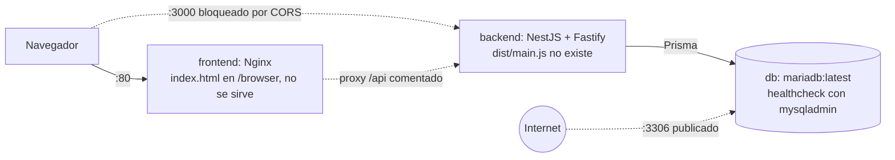
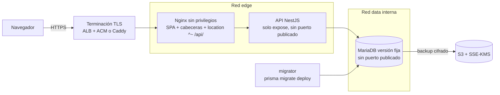
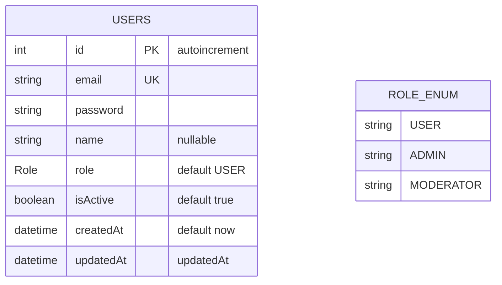
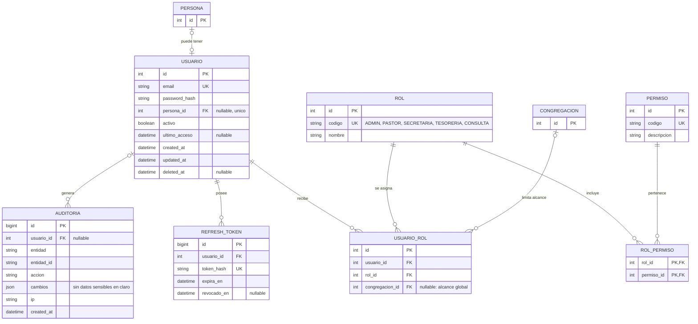
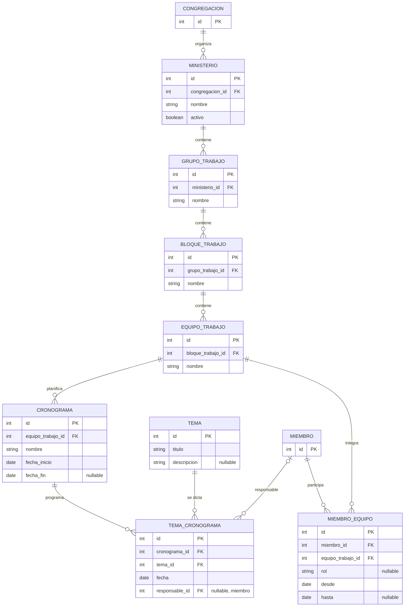
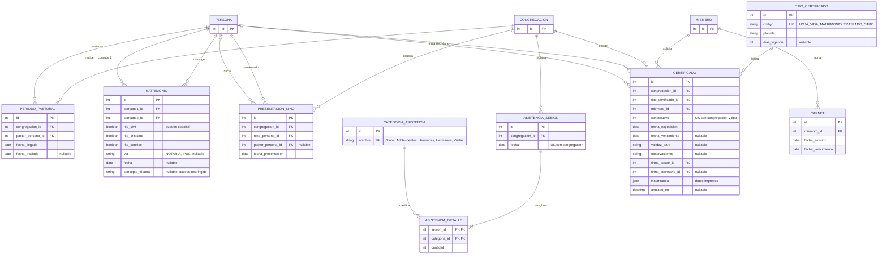
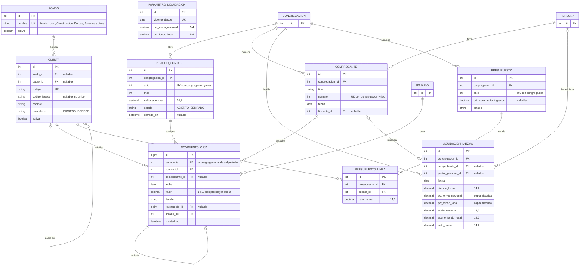

# Auditoría técnica del proyecto: estado actual, arquitectura, DER y plan de mejora

| | |
|---|---|
| **Fecha** | 2026-11-02 |
| **Versión auditada** | Commit `5611855` en `main`, más dos cambios sin confirmar en `.gitignore` y `frontend/.gitignore` |
| **Alcance** | Backend, frontend, infraestructura, seguridad, modelo de datos, documentación |
| **Tipo de revisión** | Análisis estático. No se compiló, no se ejecutaron pruebas, no se levantó Docker y no se modificó código |
| **Privacidad** | Este documento solo describe la estructura de los archivos de `resources/`. No reproduce ningún dato personal |

## 1. Resumen ejecutivo

**El proyecto es un andamiaje (scaffolding) bien orientado, pero todavía no es un producto ni se puede desplegar.** No tiene lógica de negocio, el stack de Docker no arranca y la documentación afirma lo contrario en varios puntos. La parte urgente no es técnica: **el único commit contiene datos personales reales de miembros de la iglesia.**

### Qué hay que saber primero

1. **No hagas `git push` todavía.** El commit incluye Excel y un PDF con identidad, contacto, datos socioeconómicos y datos de menores de edad, además de una foto real de una persona. El cambio local en `.gitignore` no los retira. No hay indicios locales de que se hayan publicado, pero eso solo lo puede confirmar el dueño con su sesión de GitHub (§3.1).
2. **`docker compose up` no levantaría la aplicación.** Hay cinco fallos independientes, y corregir uno solo no basta (§3.2).
3. **No hay autenticación.** Los paquetes están instalados, pero no existe código que los use, y `README.md:222` la marca como hecha.
4. **El modelo de datos tiene una sola entidad (`User`) frente a las 57 que propone este informe.** El «diccionario de datos» solo lista 16 nombres de tabla, sin campos, así que hay decisiones que solo puede tomar el cliente (§10).
5. **Lo existente es corregible a bajo costo.** Casi todo se arregla con cambios pequeños, porque aún hay poco código que migrar. Es el mejor momento para hacerlo.

### Estado por área

| Área | Estado | Lectura |
|---|---|---|
| Privacidad de datos | 🔴 Crítico | Datos personales reales en el historial de git |
| Infraestructura y Docker | 🔴 No arranca | Buena estructura multi-stage, con 5 fallos de arranque |
| Seguridad de la aplicación | 🟠 Sin construir | Bootstrap razonable (Helmet, `ValidationPipe`); sin auth, roles ni rate limit |
| Documentación | 🟠 Poco fiable | Marca como hechas cosas que no existen |
| Modelo de datos | 🟠 Sin dominio | Solo `User` y `Role`; sin migraciones, y las reglas de git las excluyen |
| Backend | 🟡 Base correcta | NestJS 11 + Fastify 5 + Prisma 6.19 coherentes; 2 endpoints de ejemplo |
| Frontend | 🟡 Plantilla intacta | Angular 20 estricto y standalone, sin modificar desde `ng new` |
| Pruebas | 🟡 Mínimas | Solo los tests generados; sin CI |

### Hallazgos

Se registraron **125 hallazgos**, que se consolidan en **98 únicos** porque varias áreas detectaron el mismo problema:

| Severidad | Únicos | Significado |
|---|---|---|
| CRÍTICO | 6 | Riesgo real sobre datos, o impide arrancar |
| ALTO | 6 | Bloquea avanzar con seguridad |
| MEDIO | 33 | Conviene resolver antes de construir sobre ello |
| BAJO | 46 | Mejora o deuda menor |
| INFO | 7 | A tener en cuenta |

**Nivel de confianza:** 106 hallazgos pasaron una verificación independiente que intentó refutarlos: 54 quedaron confirmados, 52 ajustados (cita, severidad o clasificación) y ninguno se refutó por completo. Los 19 con prefijo `X-` salen de una revisión final de completitud y no tuvieron ese segundo verificador. Los bloqueantes de §3 también se contrastaron de nuevo contra los archivos al redactar este informe.

### Lo que está bien hecho

- Backend coherente en versiones, con Swagger bien integrado sobre Fastify, Helmet, compresión y un `ValidationPipe` estricto (`whitelist`, `forbidNonWhitelisted`).
- Controlador delgado que delega en el servicio; `PrismaService` falla rápido si no conecta.
- Frontend con `strict` y `strictTemplates`, componentes standalone y presupuestos de build.
- Dockerfiles multi-stage, backend con usuario no root y `dumb-init`, `depends_on` con `service_healthy`.
- Proxy de desarrollo coherente con el puerto y el prefijo del backend.
- `.env` y `backend/.env` ignorados por git y sin rastro en el historial.

## 2. Alcance y método

- **Qué se revisó:** los 59 archivos versionados, los `package.json` instalados en `node_modules` para confirmar versiones y comportamientos de librerías, y la estructura de los 5 archivos de `resources/`.
- **Cómo:** una revisión independiente por área (backend, frontend, infraestructura y seguridad, datos), seguida de un verificador escéptico por área y una revisión final de coherencia entre capas.
- **Clasificación:** *defecto* es algo que existe y está mal, o una afirmación falsa de la documentación. *Pendiente* es lo aún no construido. *Mejora* es opcional. Lo pendiente no se trata como fallo salvo que bloquee.

### Limitaciones

- **Nada se ejecutó.** Los fallos de arranque se deducen de la configuración, del `backend/dist/` existente y del código de las librerías. Deben confirmarse al construir las imágenes.
- **`mysqladmin` en `mariadb:latest`:** la ausencia está documentada por la MariaDB Foundation desde la versión 11.0, pero no se comprobó dentro de la imagen actual.
- **`.env` reales:** no se abrieron. Se desconoce si usan los valores por defecto.
- **Publicación del repositorio:** `git ls-remote` y el acceso anónimo no distinguen entre privado y eliminado.
- **Sin `npm audit`:** no se evaluaron vulnerabilidades de dependencias.
- **Ley 1581 de 2012:** las referencias son orientativas, citadas de conocimiento general. Requieren validación de un abogado.
- **Diagramas:** la sintaxis de los bloques Mermaid se validó con el analizador oficial de Mermaid. El DER propuesto es una propuesta, no un modelo aprobado.

## 3. Hallazgos críticos y altos

### 3.1 Datos personales en git (CRÍTICO)

**IDs:** INF-01, DAT-01. Relacionados: X-02, X-03, FE-28.

**Evidencia.** `git ls-files resources` lista 3 Excel, el PDF y el `.docx`, y todos están en el commit `5611855`. La regla nueva `.gitignore:155` no afecta a archivos ya rastreados. Contienen identidad, contacto, afiliación a seguridad social, SISBEN, condición de desplazamiento, datos de menores (`Presentación de Niños`) y una foto real (página 5 del PDF).

**Impacto.** La pertenencia a una iglesia revela convicciones religiosas, un dato sensible según la Ley 1581 de 2012. `COMMIT-MESSAGE.md:98` indica justamente el `git push origin main` que los publicaría.

**Estado del remoto.** `git branch -vv` muestra `origin/main: gone`, y no hay `refs/remotes`, `packed-refs` ni `FETCH_HEAD`. El reflog solo tiene `commit (initial)`. Esto apunta a que **no se hizo push desde esta copia**, aunque no descarta otra copia. El repositorio responde 404 de forma anónima, lo que no distingue entre privado e inexistente.

**Qué hacer, en este orden:**

1. No hacer push.
2. Comprobar en GitHub, con sesión iniciada, si el repositorio existe, su visibilidad y su historial.
3. Rescatar la especificación antes de tocar nada (X-02): mover `resources/prompts/initial.mdx` a `docs/specs/` y dejar `.github/instructions/` como única copia de las instrucciones.
4. Guardar los archivos de datos fuera del repositorio, cifrados y con acceso restringido.
5. Limpiar según el caso:

```bash
# Si NUNCA se publicó (un solo commit, limpieza sencilla)
git rm -r --cached resources/
git rm COMMIT-MESSAGE.md
git commit --amend
git reflog expire --expire=now --all
git gc --prune=now
git log --all -- resources/   # debe salir vacío

# Si SÍ se publicó: reescribir con git filter-repo, forzar el push,
# revisar forks, pedir la purga a GitHub Support y tratarlo como un
# posible incidente de datos personales con asesoría legal.
```

6. Desarrollar solo con datos sintéticos o anonimizados, y añadir un escaneo preventivo de `*.xls*`, `*.pdf` y `*.docx` en pre-commit o CI.

### 3.2 Fallos de arranque en Docker (CRÍTICO)

Son cinco fallos independientes. Cada uno impide por sí solo que el stack funcione.

| # | IDs | Fallo | Evidencia | Corrección |
|---|---|---|---|---|
| 1 | BE-03, FE-02, INF-05 | `package-lock.json` ignorado: `npm ci` falla en un clon limpio | `.gitignore:115`; `backend/Dockerfile:26`; `frontend/Dockerfile:22` | Quitar la regla y versionar ambos lockfiles. Ya coinciden con `package.json` e incluyen binarios Linux musl |
| 2 | BE-01, INF-02 | El contenedor ejecuta `dist/main.js`, pero el build produce `dist/src/main.js` | `backend/Dockerfile:93`; `backend/package.json:14`; `backend/tsconfig.build.json:3` no excluye `prisma.config.ts` | Añadir `"include": ["src/**/*"]` a `tsconfig.build.json` y comprobar que aparece `dist/main.js` |
| 3 | BE-02, INF-03 | `@nestjs/platform-fastify` es `devDependency` y `npm prune` lo elimina | `backend/package.json:45`; `backend/Dockerfile:41,66` | Moverlo a `dependencies` y regenerar el lockfile |
| 4 | FE-01, INF-04 | Nginx sirve `dist/frontend`, pero `index.html` queda en `dist/frontend/browser` | `frontend/Dockerfile:30,48`; `frontend/nginx.conf:11-12` | `COPY --from=builder /app/dist/frontend/browser /usr/share/nginx/html` |
| 5 | INF-07, DAT-04 | El healthcheck usa `mysqladmin`, ausente desde MariaDB 11.0; el backend espera `service_healthy` | `docker-compose.yml:8,23,46-48` | `["CMD", "healthcheck.sh", "--connect", "--innodb_initialized"]` y fijar la versión de la imagen |

**Por qué pasó inadvertido:** `npm run start` funciona porque la CLI de Nest prueba primero `dist/src/main` (`@nestjs/cli/actions/start.action.js:85-87`), y las `devDependencies` sí están en desarrollo.

**Severidad del punto 5.** Los verificadores discreparon entre ALTO y CRÍTICO. Se deja en CRÍTICO porque está documentado por MariaDB y bloquearía todo el arranque, con la salvedad de que falta confirmarlo en la imagen actual.

**Criterio de aceptación:** desde un clon limpio, `docker compose up --build` deja los tres servicios en `healthy`, y `GET /api/health` y `GET /` responden 200 por sus puertos publicados.

### 3.3 Hallazgos de severidad alta

| IDs | Hallazgo | Evidencia | Acción |
|---|---|---|---|
| BE-04 (pendiente) | **Sin autenticación, autorización ni hash de contraseñas.** Bloquea cualquier módulo con datos de miembros | 0 resultados de `UseGuards`, `AuthGuard` y `APP_GUARD` en `backend/src`; sin `bcrypt` ni `argon2` | Crear `AuthModule` y `UsersModule` antes del dominio: `JwtAuthGuard` global con `@Public()`, `RolesGuard`, hash con argon2 y rate limit en login |
| BE-06, INF-08 | **Las migraciones están ignoradas por git.** La excepción `.gitkeep` tampoco funciona, porque git no reincluye archivos bajo un directorio excluido | `.gitignore:41-42`; `init.sh:173-174` | Quitar las reglas antes de la primera migración. Añadir después un servicio de una sola ejecución con `prisma migrate deploy` |
| INF-06 | **Base de datos publicada en todas las interfaces con contraseña root conocida por defecto.** Se materializa al desplegar; bloqueante antes de cualquier despliegue | `docker-compose.yml:12,18-19` | Quitar `ports` de `db`; para desarrollo, un override con `127.0.0.1:3306:3306`; usar `${VAR:?mensaje}` |
| INF-09, BE-30, FE-03, X-12 | **No hay `.dockerignore`, y `.gitignore:100` impide versionarlos.** `COPY . .` lleva `backend/.env` a la etapa builder y pisa el cliente Prisma generado en Linux con el de Windows (efecto en runtime no verificado) | `backend/Dockerfile:35`; `frontend/Dockerfile:25` | Quitar la regla y crear ambos archivos con `node_modules`, `dist`, `.angular`, `.env`, `.env.*`, `!.env.example`, `coverage`, `.git`. Limpiar caché con `docker builder prune` si ya se construyó |
| INF-11, BE-05, FE-06 | **La documentación declara completo y seguro lo que no lo es.** Da falsa seguridad a quien vaya a cargar datos reales | `README.md:221-226`; `docs/INITIALIZATION-SUMMARY.md:3,279-286,302-309,317`; detalle en §12 | Separar «Implementado» de «Planificado» y marcar `INITIALIZATION-SUMMARY.md` como histórico |
| DAT-03 (pendiente) | **Sin soporte de consentimiento ni protección de datos sensibles.** El PDF no tiene cláusula de autorización en ninguna de sus 7 páginas. Bloquea la migración, no el desarrollo | `schema.prisma:19-39`; columnas `Datos!AD:AJ` | Antes de migrar: consentimiento, auditoría, ficha socioeconómica separada, permisos por rol y política de tratamiento validada legalmente |

## 4. Arquitectura

### 4.1 Vista actual

Es un monolito modular en un monorepo sin raíz de tooling. Las líneas discontinuas indican lo que hoy no funciona.



### 4.2 Arquitectura objetivo recomendada

Se recomienda un **monolito modular**. Microservicios no se justifican: un solo equipo, una sola base de datos y dominios muy relacionados. Los límites de módulo permiten extraer servicios más adelante si hiciera falta.



**Capas del backend por módulo:**

```text
src/
  config/      env.validation.ts, configuración tipada
  common/      filtros, smart-logger, interceptores
  health/      liveness y readiness
  auth/        guards, estrategias
  users/       controller -> service -> repository -> Prisma; dto y mappers
  membresia/   mismo patrón
  secretaria/  mismo patrón
  contabilidad/ mismo patrón
  prisma/      infraestructura
```

Reglas: los controladores no contienen lógica, solo los repositorios usan Prisma, y las respuestas pasan por DTO y mapper para que nunca salga `password`.

### 4.3 Coherencia entre capas

Valores por defecto o de ejemplo leídos en cada archivo. Los `.env` reales no se abrieron. Veredicto: **OK** = coherente; **FALLO** = incoherencia con efecto; **DERIVA** = coincide hoy, pero se mantiene a mano en varios sitios.

| Valor compartido | Código | `.env.example` (raíz) | `backend/.env.example` | `docker-compose.yml` | Dockerfile / Nginx / proxy | Documentación / especificación | Veredicto |
|---|---|---|---|---|---|---|---|
| Puerto backend | `3000`, `backend/src/main.ts:69` | no existe | `3000` :18 | `PORT: 3000` :40; `3000:3000` :45 | `EXPOSE 3000` backend/Dockerfile:79; `ENV PORT` :83; `proxy.conf.json:3` | README.md:207, :234; initial.mdx:61 | OK. Si cambia `PORT`, se rompen los healthchecks fijos (compose:54; Dockerfile:87) |
| Puerto frontend dev | `4200` como CORS por defecto, main.ts:36 | no existe | `4200` :23 | no aplica | no aplica | GETTING-STARTED.md:56 | OK |
| Puerto frontend prod | origen no contemplado en CORS (main.ts:36) | no existe | no existe | `80:80` :70; healthcheck :76 | `listen 80` nginx.conf:7; `EXPOSE 80` frontend/Dockerfile:54 | README.md:205 | FALLO: ver INF-12. Además, Apache ocupa el 80 en este equipo (X-05) |
| Puerto BD | no aplica | no existe | `3306` :6 | `3306:3306` :19; URL :41 | no aplica | README.md:209 | DERIVA: el puerto publicado no es parametrizable |
| Host BD | no aplica | no existe | `localhost` :6 | `db` :41, servicio :7 | no aplica | initial.mdx:62 | OK: difiere por contexto |
| Prefijo API | `api`, main.ts:41 | no aplica | no aplica | `/api/health` :54 | `/api` proxy.conf.json:2; `/api` **comentado** nginx.conf:49; backend/Dockerfile:87 | GETTING-STARTED.md:43-45 correcto; INITIALIZATION-SUMMARY.md:47 dice `GET /`, falso (X-13) | FALLO en Nginx y en la documentación |
| Ruta `/` en test | `@Get()` app.controller.ts:10 | no aplica | no aplica | no aplica | no aplica | `test/app.e2e-spec.ts:21` usa `/` sin prefijo porque el test no llama a `setGlobalPrefix` | DERIVA: en despliegue la ruta real es `/api` |
| Swagger | `api/docs`, main.ts:66 | no aplica | no aplica | no aplica | activos con extensión afectados por el regex de nginx.conf:33 (X-01) | README.md:234; SUMMARY:49 | OK sin Nginx; FALLO si se activa el proxy tal cual |
| Nombre BD | no aplica | `fullstack_db` :7 | `fullstack_db` :6 | `fullstack_db` :13, :41 | no aplica | ninguna | DERIVA: dos fuentes, y nombre genérico (X-15) |
| Usuario BD | no aplica | `app_user` :8 | `app_user` :6 | `app_user` :14, :41 | no aplica | ninguna | DERIVA |
| Contraseña BD | no aplica | `app_password` :9 | `app_password` :6 | `app_password` :15, :41 | no aplica | ninguna | DERIVA: se inserta en la URL sin codificar (X-06) |
| Contraseña root | no aplica | `rootpassword` :6 | no existe | `rootpassword` :12, :23 | no aplica | ninguna | Igual en ambos; ver INF-06 e INF-10 |
| Secreto JWT | **ningún lector** en `backend/src` | valor de ejemplo :14 | mismo valor :11 | mismo valor por defecto :42 | no aplica | initial.mdx:62 | FALLO: se configura en tres sitios y nada lo consume |
| Expiración JWT | **ningún lector** | `1d` :15 | `1d` :12 | `1d` :43 | no aplica | ninguna | FALLO: igual que el secreto |
| `CORS_ORIGIN` | main.ts:36 | no existe | `http://localhost:4200` :23 | **no existe** | no aplica | ninguna | FALLO: ver INF-12 |
| `NODE_ENV` | app.service.ts:14; prisma.service.ts:24 | no existe | `development` :17 | `production` :39 | backend/Dockerfile:82 | ninguna | OK |
| `LOG_LEVEL` | **ningún lector** | no existe | `debug` :28 | no existe | no aplica | ninguna | FALLO: variable inerte |
| `DATABASE_URL` | schema.prisma:13; prisma.config.ts:11 | **no existe** | :6 | :41, compuesta | no aplica | GETTING-STARTED.md:64 pide editarla en `.env` (X-04) | FALLO en la documentación |
| Node | no aplica | no aplica | no aplica | no aplica | `node:20-alpine` backend/Dockerfile:9, :46; frontend/Dockerfile:9 | initial.mdx:74 pide `node:latest`; `@types/node ^22.10.7` backend/package.json:50; sin `engines` ni `.nvmrc`; local v22.23.4 | FALLO leve (X-11) |
| TypeScript | no aplica | no aplica | no aplica | no aplica | no aplica | backend `^5.7.3` (package.json:69); frontend `~5.9.2` (package.json:46); instalado 5.9.3 en ambos | DERIVA |
| Imagen BD y motor Prisma | `provider = "mysql"` schema.prisma:12 | no aplica | prefijo `mysql://` :6 | `mariadb:latest` :8 | no aplica | initial.mdx:55 **exige** `latest` | OK funcional; la especificación contradice INF-14 (X-17) |
| Artefacto backend | salida real `dist/src/main.js` (comprobado en `backend/dist/`) | no aplica | no aplica | no aplica | `dist/main.js` backend/Dockerfile:93 | `dist/main` backend/package.json:14 | FALLO: ver BE-01 |
| Artefacto frontend | no aplica | no aplica | no aplica | no aplica | `dist/frontend` frontend/Dockerfile:30, :48; root nginx.conf:11 | SUMMARY:223 | FALLO: ver FE-01 |
| Usuario de contenedor | no aplica | no aplica | no aplica | no aplica | backend `USER nestjs` :76; frontend sin `USER` | README.md:226 dice no-root | FALLO: ver FE-08 |

## 5. Backend

**Resumen.** 6 archivos de código en `backend/src` más un spec, y un test e2e en `backend/test`. Sin lógica de dominio.

### 5.1 Módulos y endpoints

**Módulos** (`backend/src/app.module.ts:7-18`):

| Módulo | Contenido | Notas |
|---|---|---|
| `AppModule` | `AppController`, `AppService` | Importa `ConfigModule` y `PrismaModule` |
| `ConfigModule` | `forRoot` global | `app.module.ts:9-12`, sin validación |
| `PrismaModule` | `PrismaService` | `@Global()` (`prisma/prisma.module.ts:4`) |

No existen los módulos `auth`, `users` ni de dominio. No hay DTOs, guards, filtros ni interceptores: Grep de `UseGuards|AuthGuard|@Catch|APP_FILTER|APP_GUARD|Interceptor` sobre `backend/src` devuelve 0 resultados.

**Endpoints efectivos** (prefijo `api`, `main.ts:41`):

| Método y ruta | Origen | Respuesta | Auth |
|---|---|---|---|
| `GET /api` | `app.controller.ts:10-15` | `'Hello World!'` (`app.service.ts:5-7`) | Pública |
| `GET /api/health` | `app.controller.ts:17-22` | `status`, `timestamp`, `uptime`, `environment` (`app.service.ts:9-16`) | Pública |
| `GET /api/docs` | `main.ts:66` | Swagger UI | Pública |
| `GET /api/docs-json`, `GET /api/docs-yaml` | Sufijos por defecto (`@nestjs/swagger/dist/swagger-module.js:171,174`) | Especificación OpenAPI | Pública |

**Modelo Prisma:** solo `User` y el enum `Role` (`prisma/schema.prisma:19-39`). El cliente generado coincide con el schema: `diff` sin diferencias frente a `node_modules/.prisma/client/schema.prisma`.

### 5.2 Bootstrap en `main.ts`

| Aspecto | Estado | Evidencia |
|---|---|---|
| Fastify | Correcto, `FastifyAdapter({ logger: true })` con logger fijo | `main.ts:14-17` |
| Helmet | Presente, CSP permisiva y global | `main.ts:20-29`; ver BE-12 |
| Compresión | Correcta, gzip y deflate | `main.ts:32` |
| CORS | Lee `process.env` y la variable falta en Compose | `main.ts:35-38`; ver BE-09 |
| Prefijo | `api` fijo en código | `main.ts:41` |
| ValidationPipe | `whitelist`, `forbidNonWhitelisted`, `transform`; conversión implícita activa | `main.ts:44-53`; ver BE-26 |
| Swagger | Sin condición de entorno; tags `auth` y `users` sin controladores | `main.ts:56-66`; ver BE-11 y BE-24 |
| Listen | `0.0.0.0`, puerto desde `process.env` | `main.ts:69-70` |
| Shutdown | Ausente; 0 resultados de `enableShutdownHooks` en `backend/src` | Ver BE-10 |
| Logs de arranque | `console.log` | `main.ts:72-73`; ver BE-15 |
| Errores de arranque | `bootstrap()` sin `.catch` | `main.ts:75`; ver BE-25 |

No se configura `trustProxy` (0 resultados). Hoy no afecta, porque el proxy de Nginx está comentado (`frontend/nginx.conf:49-59`), pero será necesario para que la IP de cliente y el rate limit funcionen tras el proxy.

### 5.3 Dependencias

Versiones leídas de `node_modules/<pkg>/package.json`:

| Paquete | Instalada | Observación |
|---|---|---|
| `@nestjs/core`, `common`, `platform-fastify`, `platform-express`, `testing` | 11.1.9 | Alineadas |
| `@nestjs/swagger` | 11.2.3 | Peer opcional `@fastify/static ^8.0.0`: cumplido con 8.3.0 |
| `fastify` | 5.6.2 | Transitiva; `dev=true` en `package-lock.json` |
| `@fastify/helmet` / `@fastify/compress` | 13.0.2 / 8.3.0 | Dependencias de producción |
| `@fastify/cors` | 11.1.0 | Transitiva, `dev=true`; `enableCors` la necesita en runtime |
| `class-validator` / `class-transformer` | 0.14.2 / 0.5.1 | Presentes, sin ningún DTO que las use |
| `prisma` / `@prisma/client` / `@prisma/config` | 6.19.0 | Alineadas |
| `jest` / `ts-jest` | 30.2.0 / 29.4.5 | Compatibles: peer de ts-jest `^29.0.0 \|\| ^30.0.0` |
| `typescript` | 5.9.3 | Dentro del peer de ts-jest `>=4.3 <6` |

**Swagger con Fastify: correcto.** `swagger-ui-express` no está instalado ni hace falta. Esto se desvía de `init.sh:59`, pero `resources/prompts/initial.mdx:26` permitía la alternativa de Fastify.

**Prisma: sintaxis válida.**
- `engine: "classic"` con `datasource.url` en `prisma.config.ts:9-12` es válido en 6.19 (`@prisma/config/dist/index.d.ts:487-496`). Según ese tipo, el `datasource` del config sobrescribe el `url` del schema, de modo que la URL se declara dos veces.
- `env()` lanza un error si falta la variable (`@prisma/config/dist/index.js:793-799`); ver BE-23.
- `provider = "mysql"` (`schema.prisma:12`) con la URL `mysql://` de MariaDB es coherente con `.env.example:6`.

**Faltantes:**
- No están instalados: `bcrypt`, `bcryptjs`, `argon2`, `@fastify/rate-limit`, `joi`, `zod`.
- `helmet` y `class-validator`, citados como posibles faltantes, sí están.

**Sin importar en `src/` ni `test/`:** `@nestjs/platform-express`, `@fastify/static`, `@nestjs/jwt`, `@nestjs/passport`, `passport`, `passport-jwt`, `passport-local`, `class-validator`, `class-transformer`, `source-map-support`, `ts-loader`, `@types/express`. No todos sobran; el detalle está en BE-22. `dotenv` solo se usa en `prisma.config.ts:1`.

### 5.4 Configuración y entorno

- `ConfigModule.forRoot({ isGlobal: true, envFilePath: '.env' })` (`app.module.ts:9-12`) no tiene `validate` ni `validationSchema`. La ruta es relativa al directorio de trabajo.
- `ConfigService` no se inyecta en ningún sitio. Se lee `process.env` directamente en `main.ts:36`, `main.ts:69`, `app.service.ts:14` y `prisma.service.ts:24`.
- `JWT_SECRET`, `JWT_EXPIRATION` y `LOG_LEVEL` están en `.env.example:11,12,28` pero el código no los consume (0 resultados en `src`).
- `CORS_ORIGIN` lo consume `main.ts:36`, pero Compose no lo pasa al servicio (`docker-compose.yml:38-43`). `LOG_LEVEL` tampoco se pasa.
- `docker-compose.yml:42` define un valor por defecto público para `JWT_SECRET`. Un arranque sin esa variable pasaría inadvertido cuando exista JWT.
- Archivos reales: `backend/.env` y `.env` en la raíz existen y git los ignora (`backend/.gitignore:3`, `.gitignore:17`). No se abrieron.

### 5.5 PrismaService

**Ciclo de vida** (`prisma/prisma.service.ts:8-21`):
- `$connect` en `onModuleInit`, con log y relanzamiento del error, lo que da un fallo rápido correcto.
- `$disconnect` en `onModuleDestroy`. Sin `enableShutdownHooks`, este hook no se ejecuta con SIGTERM (BE-10).

**Logs y exposición de datos:**
- La clase no declara constructor (`prisma.service.ts:5-6`) y hereda el de `PrismaClient` sin opciones, así que no se configura el registro de queries ni de parámetros. Es seguro, aunque deja sin observabilidad de consultas lentas.
- `logger.error('...', error)` (`:13`) pasa el objeto de error como segundo argumento; ver BE-27.

**`cleanDatabase`** (`:23-39`) es el punto delicado:
- La protección solo bloquea `NODE_ENV === 'production'`: con la variable sin definir o con `staging`, el borrado se ejecuta.
- El comentario `:28` dice que el orden importa por las claves foráneas, pero `Promise.all` (`:31`) lanza los borrados en paralelo y sin orden.
- Usa `any` (`:35`).
- Es un método público en un provider global. Hoy no tiene llamadas: Grep en `src` y `test` solo halla su definición.

**Diseño:** la herencia de `PrismaClient` más `@Global()` da a cualquier módulo acceso a todos los modelos y a la API completa del cliente; ver BE-21.

### 5.6 Autenticación: instalado frente a implementado

| Elemento | Instalado | Implementado |
|---|---|---|
| `@nestjs/jwt` 11.0.1 | Sí, en dev | No |
| `@nestjs/passport` 11.0.5, `passport` 0.7.0 | Sí, en dev | No |
| `passport-jwt` 4.0.1, `passport-local` 1.0.0 | Sí, en dev | No |
| Hash de contraseñas | **No** (`bcrypt`, `bcryptjs` y `argon2` ausentes) | No |
| Guards y RBAC | No aplica | No: el enum `Role` existe (`schema.prisma:35-39`) pero nada lo evalúa |
| Rate limit | **No** (`@fastify/rate-limit` ausente) | No |
| Modelo | `User` con `password`, `role`, `isActive` (`schema.prisma:21-25`) | Sin uso en `src` |

Swagger anuncia `addBearerAuth` y tags `auth` y `users` (`main.ts:60-62`), y `README.md:222` y `COMMIT-MESSAGE.md:62` hablan de JWT o auth como si existieran. Ver BE-04, BE-05, BE-07 y BE-11.

### 5.7 Manejo de errores

- No hay filtro global de excepciones (0 resultados de `@Catch|APP_FILTER`), en contra de `instructions.mdx:36`. Es pendiente (BE-16).
- No hay ningún `HttpException` en `src`, ni traducción de errores de Prisma.
- `PrismaService.onModuleInit` registra y relanza correctamente (`prisma.service.ts:12-15`).
- `cleanDatabase` lanza `Error` genérico (`prisma.service.ts:25`).
- `bootstrap()` no tiene `.catch` (`main.ts:75`). ESLint solo avisa de ello (`eslint.config.mjs:30`).

### 5.8 Pruebas (previsión estática)

Solo análisis estático; no se ejecutó ninguno.

**Unitario, `src/app.controller.spec.ts`:**
- Previsión: **pasaría**. Espera `'Hello World!'` (`:19`) y `AppService.getHello` lo devuelve (`app.service.ts:6`). No carga `PrismaModule`, solo controller y service (`:9-12`).
- Limitación: no cubre `getHealth` ni `PrismaService`.

**E2E, `test/app.e2e-spec.ts`:**
- **Fallaría sin MariaDB accesible.** Importa `AppModule` real (`:12`), que carga `PrismaModule` (`app.module.ts:13`), y `onModuleInit` relanza el error de conexión (`prisma.service.ts:12-15`). No se usa `overrideProvider` (0 resultados en `test/`).
- **Con base de datos pasaría, pero no valida lo que se despliega:**
  - `createNestApplication()` sin adaptador usa Express (`@nestjs/testing/testing-module.js:36`), no Fastify.
  - No aplica `main.ts`, por lo que prueba `GET /` (`:21`) cuando producción sirve `GET /api`, y omite pipes, Helmet y CORS.
- No cierra la app (0 resultados de `afterEach|afterAll|close()` en `test/`), de modo que deja la conexión abierta.

**Acoplamiento a tener en cuenta:** este e2e es lo que hoy justifica `@nestjs/platform-express`. Si se retira esa dependencia, hay que pasar antes el test a Fastify.

**CI:** no existe; `.github/` solo contiene `instructions`.

### 5.9 Scripts de `package.json`

| Script | Estado | Nota |
|---|---|---|
| `build` | Funciona, salida anidada | Genera `dist/src/main.js` (BE-01) |
| `start`, `start:dev`, `start:debug` | Funcionan según el código de la CLI | `start.action.js:85-87` resuelve `dist/src/main` |
| `start:prod` | **Roto** | `package.json:14` apunta a `dist/main`, que no existe |
| `lint` | Modifica archivos | `--fix` fijo (`package.json:15`); no sirve para CI (BE-20) |
| `test`, `test:cov`, `test:watch` | Correctos | Configuración jest en `package.json:72-88` |
| `test:e2e` | Requiere BD | Ver sección de tests |
| `test:debug` | **Roto en Windows** | `package.json:19` lanza `node node_modules/.bin/jest`, que es un script `#!/bin/sh` |
| `format` | Correcto | Reescribe `src` y `test` |

**Ausentes:** `prisma:generate`, `prisma:migrate`, `prisma:deploy`, `lint:check`, `typecheck`, y el campo `engines`.

### 5.10 Especificación frente a implementación

| Requisito | Fuente | Estado |
|---|---|---|
| NestJS con Fastify | `initial.mdx:21` | Hecho, pero el adaptador está mal ubicado en `devDependencies` (BE-02) |
| Passport y JWT instalados | `initial.mdx:22-24` | Instalados en `devDependencies` (`package.json:43-44,59-61`), en contra de lo que hace `init.sh:45` (BE-07) |
| Prisma | `initial.mdx:25` | Hecho |
| Swagger | `initial.mdx:26` | Hecho |
| `@nestjs/config` | `initial.mdx:27` | Instalado; sin validación ni uso de `ConfigService` |
| Dockerfile multi-stage | `initial.mdx:68-70` | Existe; el contenedor resultante no arrancaría (BE-01, BE-02) |
| DTOs validados en todos los endpoints | `instructions.mdx:45` | No aplica aún: los endpoints no reciben entrada |
| No exponer entidades Prisma | `instructions.mdx:32` | Pendiente: no hay controladores de entidades (BE-17) |
| `any` prohibido | `instructions.mdx:34` | Incumplido (`prisma.service.ts:35`, `eslint.config.mjs:29`) |
| `HttpException` y filtros globales | `instructions.mdx:36` | Pendiente (BE-16) |
| `Logger` de `@nestjs/common` | `instructions.mdx:47` | Incumplido en `main.ts:72-73`; `PrismaService` sí lo cumple |

`initial.mdx` solo pide scaffolding. Ni ese archivo ni `instructions.mdx` definen módulos de dominio de la iglesia, por lo que su ausencia es trabajo pendiente y no un defecto.

## 6. Frontend

### 6.1 Estado general

El frontend es **el resultado sin modificar de `ng new` (Angular CLI 20.3.10) más tres añadidos de infraestructura**: `proxy.conf.json`, `Dockerfile` y `nginx.conf`.

- `frontend/src/` tiene 9 archivos: `index.html`, `main.ts`, `styles.scss` y 6 en `app/`.
- No hay ninguna línea de dominio: ni pantallas, ni servicios, ni llamadas HTTP.
- Grep de `HttpClient|provideHttp|canActivate|loadComponent|loadChildren|OnPush|environment|DebugService` sobre `frontend/src` (`*.ts`, `*.html`): 0 coincidencias. Del patrón ampliado con `console\.` solo aparece `frontend/src/main.ts:6`.

**Lo importante:** casi todo lo que falta es *pendiente* normal de la etapa. Los defectos reales están en la **cadena de despliegue**: `Dockerfile`, `.gitignore` y `nginx.conf`. Hoy, por análisis estático, el contenedor no serviría la aplicación (FE-01), y un clon limpio no pasaría `npm ci` (FE-02).

**Lo que está bien de partida:**
- Componente standalone con `signal` y bloque `@for`.
- `strict` y `strictTemplates` activos.
- Presupuestos de producción configurados.
- Proxy coherente con el backend.
- `provideBrowserGlobalErrorListeners()` y Dockerfile multi-stage.

### 6.2 Versión de Angular

| Paquete | `package.json` | Instalado (`node_modules/<pkg>/package.json`) |
|---|---|---|
| `@angular/core` | `^20.3.0` (`frontend/package.json:27`) | 20.3.12 |
| `@angular/cli` | `^20.3.10` (`:37`) | 20.3.10 |
| `@angular/build` | `^20.3.10` (`:36`) | 20.3.10 |
| `typescript` | `~5.9.2` (`:46`) | 5.9.3 |
| `zone.js` | `~0.15.0` (`:33`) | 0.15.1 |
| `rxjs` | `~7.8.0` (`:31`) | 7.8.2 |

- `resources/prompts/instructions.mdx:11` pide "Angular (v20+, Standalone Components, Signals), SCSS": **cumple**.
- `resources/prompts/initial.mdx:9` pide "versión más reciente estable": **hoy no se cumple**: la última estable en npm es 22.2.4 y el proyecto va dos versiones mayores por detrás (ver FE-24).
- `@angular/cli` exige Node `^20.19.0 || ^22.12.0 || >=24.0.0` (campo `engines` del paquete instalado). El `package.json` del proyecto no declara `engines`.

### 6.3 Estructura y patrones

| Aspecto | Estado | Evidencia |
|---|---|---|
| Standalone | Sí | `frontend/src/main.ts:5` usa `bootstrapApplication`; `frontend/src/app/app.ts:6` usa `imports` en el componente |
| Signals | Solo una, innecesaria | `frontend/src/app/app.ts:11` |
| Zoneless | No | `frontend/angular.json:21-23` carga `zone.js`; `frontend/src/app/app.config.ts:9` usa `provideZoneChangeDetection({ eventCoalescing: true })`. `docs/INITIALIZATION-SUMMARY.md:70` lo declara correctamente |
| OnPush | **No, y exigido** | `frontend/src/app/app.ts:4-9` no tiene `changeDetection`; lo exige `resources/prompts/instructions.mdx:52` |
| Lazy loading | No aplicable todavía | `frontend/src/app/app.routes.ts:3` es `routes: Routes = []` |
| Rutas | Proveedor presente, sin rutas ni comodín 404 | `frontend/src/app/app.config.ts:10`, `frontend/src/app/app.routes.ts:3` |
| Control flow moderno | Sí | `frontend/src/app/app.html:239` |

**`app.html` sigue siendo la plantilla por defecto de Angular CLI.** El aviso está en `frontend/src/app/app.html:1-8` y `:333-339`. Son 342 líneas con `<style>` embebido (`:10-183`), logo SVG (`:188-232`), "Hello, {{ title() }}" (`:233`), "Congratulations! Your app is running." (`:234`) y enlaces a angular.dev y redes de Angular (`:239-246`, `:268-328`). El `<router-outlet />` real está en `:342`.

**`app.config.ts`** (`frontend/src/app/app.config.ts:7-11`) solo registra `provideBrowserGlobalErrorListeners`, `provideZoneChangeDetection` y `provideRouter(routes)`. No hay `provideHttpClient`, interceptores, `ErrorHandler` propio, `LOCALE_ID`, `withComponentInputBinding` ni estrategia de precarga.

**Carpetas ausentes** (Glob sobre `frontend/src/{assets,environments,styles,app/core,app/shared,app/features,locale}/**`: 0 resultados): `core`, `shared`, `features`, `environments`, `assets/scss`. Por tanto tampoco existen guards, interceptores, servicios ni `debug.service`. `frontend/src/app/app.scss` pesa 0 bytes y `frontend/src/styles.scss` solo contiene un comentario (`:1`).

### 6.4 Integración con el backend

**Desarrollo: coherente.**
- `frontend/proxy.conf.json:2-3` envía `/api` a `http://localhost:3000`.
- El backend usa prefijo `api` (`backend/src/main.ts:41`) y puerto `process.env.PORT || 3000` (`backend/src/main.ts:69`).
- La opción está cableada en `frontend/angular.json:63`, así que el `--proxy-config` de `README.md:86` y `:161` es redundante.
- Como el navegador ve el mismo origen (`:4200`), el CORS de `backend/src/main.ts:36` no interviene.

Diferencias menores con la especificación: `initial.mdx:33-38` pedía solo `target` y `secure`; `init.sh:96-105` añade `changeOrigin` y `logLevel`; el archivo real añade además `pathRewrite` (`frontend/proxy.conf.json:7-9`). Ver FE-21.

**Producción con Docker: no hay camino funcional.**
- El proxy `/api` de Nginx está comentado (`frontend/nginx.conf:49-59`).
- `location /` responde `index.html` a cualquier ruta sin archivo (`frontend/nginx.conf:42-45`).
- La vía alternativa, llamar directo a `:3000`, choca con CORS: `docker-compose.yml:38-43` no define `CORS_ORIGIN` y el valor por defecto es `http://localhost:4200` (`backend/src/main.ts:36`). Ver FE-04.

**Advertencia (X-01):** descomentar el bloque de Nginx no basta. Un regex tiene prioridad sobre un prefijo, así que `location ~* \.(js|css|...)$` (`frontend/nginx.conf:33`) capturaría rutas de la API con esas extensiones, entre ellas los activos de Swagger. Hay que usar `location ^~ /api/`.

### 6.5 Build y despliegue

**`outputPath` frente a lo que copia el Dockerfile: incompatibles.**
- `frontend/angular.json:19-35` no define `outputPath`.
- `frontend/Dockerfile:30` compila con `--output-path=dist/frontend`.
- El builder normaliza una ruta de tipo string añadiendo `browser: 'browser'` (`frontend/node_modules/@angular/build/src/builders/application/options.js:171-177`; default en `schema.json:320-324`), por lo que el resultado queda en `dist/frontend/browser/`.
- `frontend/Dockerfile:48` copia `dist/frontend` entero, así que el `index.html` queda en `/usr/share/nginx/html/browser/index.html`, no en la raíz que sirve Nginx (`frontend/nginx.conf:11`). Ver FE-01.

**Presupuestos.** `frontend/angular.json:38-49`: inicial 500 kB / 1 MB y estilo por componente 4 kB / 8 kB, los valores por defecto de la CLI. Son razonables; solo habrá que revisarlos al elegir librería de UI. `outputHashing: all` (`:50`). `optimization` tiene default `true` y `sourceMap` default `false` (`schema.json:210-212`, `:353-355`), correcto en producción, y `defaultConfiguration` es `production` (`:58`).

**Sin `fileReplacements`** ni variantes de entorno en `frontend/angular.json:36-57`.

**Desviación positiva de la especificación.** `initial.mdx:74` pedía `node:latest`; `frontend/Dockerfile:9` usa `node:20-alpine`, más reproducible aunque hoy conviene subir de versión (FE-22).

### 6.6 TypeScript

`frontend/tsconfig.json:5-17` activa `strict`, `noImplicitOverride`, `noPropertyAccessFromIndexSignature`, `noImplicitReturns`, `noFallthroughCasesInSwitch` e `isolatedModules`. `frontend/tsconfig.json:18-24` activa `strictInjectionParameters`, `strictInputAccessModifiers`, `typeCheckHostBindings` y `strictTemplates`.

**Es una base sólida.** Limitaciones:
- `strict` no prohíbe un `any` explícito, y `instructions.mdx:34` lo prohíbe. Sin ESLint (FE-19) la regla no se puede hacer cumplir.
- Faltan `noUncheckedIndexedAccess` y `noUnusedLocals`/`noUnusedParameters`.
- No hay alias `paths` para las capas (FE-20).

### 6.7 Pruebas

- **Runner:** `@angular/build:karma` (`frontend/angular.json:79`) con Jasmine (`frontend/package.json:39-45`). No hay `karma.conf.*` del proyecto (las coincidencias del Glob están todas bajo `node_modules`).
- **`frontend/src/app/app.spec.ts` sí coincide con el componente actual:** espera un `h1` con `Hello, frontend` (`:21`), que resulta de `frontend/src/app/app.html:233` y `frontend/src/app/app.ts:11`. No se ejecutó.
- **Fragilidad:** ese test valida la plantilla de ejemplo; **fallará en cuanto se elimine el placeholder**.
- **Cobertura:** 2 tests. No hay umbral de cobertura, script de CI ni E2E. `.github/` solo contiene un archivo de instrucciones (no hay workflows). `frontend/angular.json` no tiene target `e2e`.

### 6.8 Accesibilidad e internacionalización

**Idioma y metadatos**
- `frontend/src/index.html:2` declara `lang="en"` para una aplicación de usuarios hispanohablantes.
- `frontend/src/index.html:5` titula la página "Frontend".
- No hay `meta description`, `noscript` ni `robots`.

**Locale**
- No hay `LOCALE_ID` ni `registerLocaleData` (ausentes en `frontend/src/app/app.config.ts:7-11`), de modo que los pipes usarían `en-US`. En contabilidad esto afecta a moneda, separadores y fechas.
- `frontend/angular.json:75-77` tiene `extract-i18n`, pero no hay bloque `i18n` ni carpeta `locale`.

**Accesibilidad en lo existente (todo placeholder, desaparece al borrarlo)**
- `alt` en `<svg>`, atributo no válido (`frontend/src/app/app.html:281`, `:300`, `:319`).
- Logo SVG sin nombre accesible (`:188-193`).
- `aria-label` correcto en enlaces sociales (`:271`, `:290`, `:309`).

**Estructura común pendiente:** skip link, landmarks, gestión de foco al navegar, títulos de ruta y errores de formulario asociados con `aria-describedby`. No existe `shared/` donde colocarlos.

### 6.9 Arquitectura propuesta por features

Propuesta, no implementación. Los subdominios provienen de los nombres de archivo en `resources/` y del encargo. **Se deben validar con el cliente**, porque el diccionario de datos no define campos (§10.3).

```text
frontend/src/
├── app/
│   ├── app.ts / app.html / app.config.ts / app.routes.ts   # shell mínimo
│   ├── core/                     # singletons; se carga una vez
│   │   ├── auth/                 # auth.service, auth.store, auth.guard, role.guard
│   │   ├── http/                 # auth.interceptor, error.interceptor, api-base-url.token
│   │   ├── logging/              # debug.service, global-error.handler
│   │   └── layout/               # main-layout, sidebar, topbar
│   ├── shared/                   # sin estado de negocio ni HTTP
│   │   ├── ui/                   # data-table, form-field, confirm-dialog, empty-state
│   │   ├── pipes/                # cop-currency, masked-document
│   │   └── validators/
│   └── features/                 # todas con lazy loading
│       ├── auth/                 # login, recuperación de acceso
│       ├── dashboard/
│       ├── membresia/            # miembros, familias, ministerios/grupos
│       │   ├── membresia.routes.ts
│       │   ├── data-access/      # miembros.api.ts, miembros.store.ts, dto, mapper
│       │   ├── pages/            # lista, detalle, formulario (contenedores)
│       │   └── components/       # presentación pura
│       ├── secretaria/           # actas, certificados, correspondencia, asistencia
│       ├── contabilidad/         # ingresos, egresos, cuentas, cierres, reportes
│       └── administracion/       # usuarios, roles, auditoría
├── assets/scss/                  # _variables, _mixins, _typography, _breakpoints
└── styles.scss                   # solo @use
```

**Reglas de dependencia (a imponer con ESLint)**
- `features/*` puede importar `core` y `shared`.
- `shared` no importa `core` ni `features`.
- Una feature no importa a otra. Lo común sube a `shared`; si implica lógica, se expone por un contrato en `core`.

**Rutas**
```ts
export const routes: Routes = [
  { path: 'login', loadComponent: () => import('./features/auth/login.page').then(m => m.LoginPage) },
  {
    path: '', component: MainLayout, canActivate: [authGuard],
    children: [
      { path: 'membresia', canMatch: [roleGuard(['SECRETARIA', 'PASTOR'])], loadChildren: () => import('./features/membresia/membresia.routes').then(m => m.MEMBRESIA_ROUTES) },
      { path: 'contabilidad', canMatch: [roleGuard(['TESORERIA'])], loadChildren: () => import('./features/contabilidad/contabilidad.routes').then(m => m.CONTABILIDAD_ROUTES) },
    ],
  },
  { path: '**', loadComponent: () => import('./core/layout/not-found.page').then(m => m.NotFoundPage) },
];
```
Los nombres de roles son ilustrativos y están por definir con el negocio. Los guards de frontend mejoran la experiencia, pero **la autorización real debe aplicarla el backend**.

**Estado.** Signals en stores ligeros por feature (`instructions.mdx:51`). RxJS solo para flujos asíncronos complejos, como búsqueda con `debounce` y `switchMap`. Sin NgRx mientras no se justifique.

**Particularidades del dominio**
- **Contabilidad:** importes como enteros o decimal-string desde la API (nunca aritmética en `number` de cliente), formato `es-CO`/COP (supuesto por validar con el negocio), sin recálculo autoritativo en el cliente, confirmación explícita en operaciones irreversibles.
- **Membresía:** datos personales. Enmascarar documentos en listados, paginación del lado del servidor, exportaciones restringidas por rol (FE-27).
- **Secretaría:** generación de documentos del lado del servidor; el frontend solo descarga.

**Orden sugerido**
1. Corregir despliegue (FE-01 a FE-04).
2. Limpiar placeholder y test (FE-05, FE-18).
3. ESLint, OnPush en schematics y tokens SCSS (FE-19, FE-07, FE-15).
4. `core` (HTTP, errores, debug, locale) (FE-10, FE-14, FE-16).
5. Auth, cuando exista en backend (FE-11).
6. Membresía como primera feature vertical; luego secretaría y contabilidad.

### 6.10 Especificación frente a implementación

| Requisito | Fuente | Estado |
|---|---|---|
| `proxy.conf.json` hacia `:3000` | `initial.mdx:31-38` | Cumple, con claves extra |
| Dockerfile multi-stage: copiar `dist` a la raíz de Nginx | `initial.mdx:73-75` | **Falla:** queda en la subcarpeta `browser/` (FE-01) |
| `try_files $uri $uri/ /index.html` | `initial.mdx:78-79` | Cumple (`frontend/nginx.conf:43`) |
| Servicio `frontend` en `80:80`, contexto `./frontend` | `initial.mdx:63-65` | Cumple (`docker-compose.yml:63-70`) |
| Angular v20+, standalone, SCSS | `instructions.mdx:11` | Cumple |
| Signals para estado local | `instructions.mdx:22`, `:51` | Sin estado todavía |
| OnPush por defecto | `instructions.mdx:52` | **No cumple** (FE-07) |
| Lazy loading en rutas principales | `instructions.mdx:52` | Pendiente: no hay rutas |
| Variables SCSS globales, `_variables.scss` | `instructions.mdx:53`, `:92-94` | Pendiente |
| Interceptor con auto-logout en 401 | `instructions.mdx:37` | Pendiente |
| Gestión segura de JWT, prevención de XSS | `instructions.mdx:33` | Pendiente |
| Tests básicos por feature | `instructions.mdx:66` | Solo el test por defecto |
| `debug.service` en vez de `console.log` | Reglas globales del usuario | Pendiente (FE-14) |

`.github/instructions/intructions-chats.instructions.md` duplica el contenido de `instructions.mdx` (mismas reglas de Frontend en sus líneas 46-50). El nombre del archivo tiene una errata: "intructions". `resources/prompts/Checklist de Pre-Lanzamiento.mdx` existe pero está vacío.

## 7. Infraestructura

### 7.1 Rutas y Dockerfiles

**Backend (`backend/Dockerfile`)**

- Build context: `./backend` (`docker-compose.yml:33`). `COPY . .` (`:35`) sí incluye `prisma.config.ts` y `prisma/`.
- `prisma generate` (`:32`) corre antes de copiar `prisma.config.ts`, así que usa la ruta por defecto del schema. No falla por esto.
- `prisma.config.ts` entra en la compilación porque `tsconfig.json` no define `include` ni `rootDir` y `tsconfig.build.json:3` no lo excluye. TypeScript toma `backend/` como raíz, de ahí `dist/src/main.js` y `dist/prisma.config.js` (confirmado en `backend/dist/`).
- `CMD ["node","dist/main.js"]` (`:93`) y `start:prod` (`backend/package.json:14`) apuntan a una ruta inexistente. El error también afecta a `npm run start:prod` fuera de Docker, y `backend/README.md:44` lo recomienda.
- `npm prune --production` (`:41`) elimina lo marcado como dev. `backend/package-lock.json` marca `@nestjs/platform-fastify` con `"dev": true`, y el compilado lo requiere en `backend/dist/src/main.js:7`.
- La etapa final no copia `prisma.config.ts`; `prisma migrate deploy` usaría la ruta por defecto. La línea `:73` es redundante con `:66`.
- Correcto: multi-stage, usuario `nestjs` (`:56-57,76`), `dumb-init` (`:53,90`). La ruta de health coincide: prefijo `api` (`backend/src/main.ts:41`) + `health` (`backend/src/app.controller.ts:17`).

**Frontend (`frontend/Dockerfile`)**

- `--output-path=dist/frontend` (`:30`) es un string. En `options.js:171-177` eso fija `base`, y `browser` sigue siendo `'browser'`. La salida es `dist/frontend/browser/index.html`.
- `COPY --from=builder /app/dist/frontend /usr/share/nginx/html` (`:48`) deja `html/browser/index.html`. Nginx (`frontend/nginx.conf:11-12,43`) no encuentra `index.html` en la raíz: se espera 403 o un ciclo de redirección interna con 500, y el healthcheck falla (`docker-compose.yml:76`).
- `frontend/dist` no existe hoy en disco, así que `docs/INITIALIZATION-SUMMARY.md:223` no es contrastable contra un artefacto.

**Contexto de build sin `.dockerignore`**

- Glob `**/.dockerignore`: sin resultados. Además `.gitignore:100` lo ignora, de modo que al crearlo no se versionaría.
- `COPY . .` (`backend/Dockerfile:35`, `frontend/Dockerfile:25`) copia encima del `npm ci` el `node_modules` de Windows del host, `dist`, `.angular` y `backend/.env`. El `.env` queda en una capa de la etapa builder (no en la imagen final). También pisa el cliente Prisma generado en Linux con el de Windows (efecto en runtime no verificado): el resultado depende del estado del host.

**Arranque de BD y migraciones**

- `backend/prisma/` solo contiene `schema.prisma`; `.gitignore:41` ignora `migrations/`. Ningún paso ejecuta `prisma migrate deploy` (`backend/Dockerfile:93`). La tabla `users` no existiría en un despliegue limpio; esto no impide arrancar, porque el fallo aparecería con la primera consulta.
- `docker-compose.yml:52` monta `./backend/prisma` en producción sin uso en runtime.

### 7.2 Matriz de endurecimiento

| Control | Estado | Evidencia |
|---|---|---|
| `.dockerignore` | No existe y está ignorado | `.gitignore:100` |
| Usuario no root backend | Sí | `backend/Dockerfile:76` |
| Usuario no root frontend | No (no hay `USER`) | `frontend/Dockerfile:35-61` |
| Healthchecks | Declarados en los 3 servicios; el de BD usa `mysqladmin`, ausente desde MariaDB 11.0; el de backend es solo liveness | `docker-compose.yml:22,53,75`, `backend/src/app.service.ts:9-16` |
| `depends_on` con condición | Backend sí; frontend no | `docker-compose.yml:46-48,71-72` |
| Proxy `/api` en Nginx | Comentado | `frontend/nginx.conf:49-59` |
| BD publicada | Sí, en todas las interfaces | `docker-compose.yml:18-19` |
| Backend publicado | Sí (pedido en la especificación) | `docker-compose.yml:44-45`, `resources/prompts/initial.mdx:61` |
| Segmentación de red | Una sola red plana | `docker-compose.yml:91-93` |
| Secretos por defecto | Sí | `docker-compose.yml:12,15,41,42`, `.env.example:6,9,14` |
| Imágenes fijadas | No: `mariadb:latest` y `nginx:alpine` flotan; `node:20-alpine` fija la mayor, pero Node 20 está fuera de soporte desde abril de 2026 | `docker-compose.yml:8`, `frontend/Dockerfile:9,35`, `backend/Dockerfile:9,46` |
| Gzip | Sí | `frontend/nginx.conf:18-30` |
| `server_tokens off` | Sí | `frontend/nginx.conf:15` |
| Cabeceras de seguridad y CSP en Nginx | Ninguna | Grep sin coincidencias en `frontend/nginx.conf` |
| TLS | No (solo :80) | `frontend/nginx.conf:7-8`, `docker-compose.yml:70` |
| Límites de recursos, rotación de logs, `read_only`, `cap_drop` | Ninguno | Grep sin coincidencias en `docker-compose.yml` |
| Backups | Ninguno | Grep sin coincidencias (`mysqldump`, `mariadb-dump`, `backup`) |
| CI/CD | No existe | `.github/` solo contiene `instructions/`; el único `.yml` fuera de `node_modules` es `docker-compose.yml` |
| `.env` reales | `.env` y `backend/.env` existen, ambos ignorados (`.gitignore:17`, `backend/.gitignore:3`), sin historial en git; no se abrieron | `git status --ignored`, `git log --all -p -- '*.env'` vacío |

### 7.3 Especificación frente a implementación

- Cumplido: 3 servicios, variables, volumen, `3000:3000`, `80:80`, Dockerfiles multi-stage, `try_files` (`resources/prompts/initial.mdx:53-79`).
- Desviaciones que mejoran: `node:20-alpine` frente a `node:latest` (`initial.mdx:74`, `frontend/Dockerfile:9`); healthchecks y `condition` no pedidos.
- Desviaciones que empeoran: `3306:3306` no se pidió (`initial.mdx:55-57`, `docker-compose.yml:18-19`).
- Parcial: dependencias instaladas pero en la sección equivocada (`initial.mdx:21-23`, `backend/package.json:43-45`).
- Malas decisiones heredadas de la especificación: `mariadb:latest` (`initial.mdx:55`) y publicar el backend directamente (`initial.mdx:61`). Conviene corregir también el texto de la especificación.
- Riesgo al limpiar: las especificaciones viven en `resources/prompts/`, que ahora se ignora. Sacar `resources/` del índice sin moverlas las dejaría fuera del repositorio. Solo `instructions.mdx` tiene copia en `.github/instructions/`; `initial.mdx` no tiene ninguna, así que perderlo sería una pérdida real (X-02).

**Nota (X-17):** la especificación exige valores que este informe recomienda cambiar (`mariadb:latest`, `node:latest`, publicar el puerto 3000). Conviene registrar esas desviaciones como decisiones para que no parezcan incumplimientos.

## 8. Evaluación SOLID

Con tan poco código propio, esta evaluación mide **riesgos tempranos más que cumplimiento**. Ninguna fila indica un problema grave hoy.

### 8.1 Backend

Con tan poco código, la evaluación se apoya en poca evidencia. Conviene leerla como riesgos tempranos.

| Principio | Valoración | Evidencia | Lectura |
|---|---|---|---|
| **S** Responsabilidad única | Parcial | `main.ts:12-74`; `app.service.ts:5-16`; `prisma.service.ts:8-39` | `bootstrap` configura seguridad, CORS, validación, Swagger y arranque. `AppService` une saludo y salud. `PrismaService` une conexión con una utilidad de limpieza de tests. `AppController` sí cumple |
| **O** Abierto/cerrado | Parcial | `main.ts:36,41,60-61,66`; `prisma.service.ts:29-37` | Añadir entornos u opciones exige editar `bootstrap` por falta de configuración tipada. Los módulos de Nest sí permiten extender por composición |
| **L** Sustitución de Liskov | Sin evidencia suficiente | `prisma.service.ts:5` | La única herencia es `PrismaService extends PrismaClient`, que no sobrescribe contratos. No se aprecia violación, pero la herencia de una clase de terceros acopla el diseño |
| **I** Segregación de interfaces | Riesgo | `prisma.service.ts:5`; `prisma.module.ts:4-8` | Cualquier consumidor recibe el cliente completo, incluido el `cleanDatabase` destructivo. No hay interfaces estrechas |
| **D** Inversión de dependencias | Parcial | `app.controller.ts:8`; `main.ts:36,69`; `app.service.ts:14`; `prisma.service.ts:24` | La inyección de Nest se usa bien. Pero la configuración depende de `process.env` global, no de una abstracción, y no hay puerto entre dominio y ORM |

### 8.2 Frontend

Aviso: con un único componente, que solo tiene una propiedad y ningún método, SOLID casi no se puede medir sobre código propio. Se valora lo que existe y el riesgo de la estructura que falta.

| Principio | Lo que existe | Riesgo por lo que falta | Medida concreta |
|---|---|---|---|
| **S** Responsabilidad única | Incumplido solo por el placeholder: `frontend/src/app/app.html` mezcla estilos (`:10-183`), marketing y shell (`:342`). `frontend/src/app/app.ts` en sí es correcto | Sin capas, la primera feature tenderá a meter HTTP, estado y presentación en el componente | Shell solo con layout y outlet; separar `*.api.ts` (HTTP), `*.store.ts` (estado) y componentes de presentación |
| **O** Abierto/cerrado | `frontend/src/app/app.config.ts:7-11` es extensible por composición de providers | `frontend/src/app/app.routes.ts:3` centraliza todo si no se divide | `routes` por feature con `loadChildren`; interceptores funcionales encadenados en `withInterceptors` |
| **L** Sustitución de Liskov | Sin herencia ni contratos: no aplica | Una clase base genérica de CRUD forzaría overrides vacíos | Preferir composición y funciones; contratos TS pequeños |
| **I** Segregación de interfaces | Sin interfaces: no aplica | Un `ApiService` único obligaría a cada feature a depender de todo el backend | Un servicio de API por feature; DTOs separados de modelos de vista; `input()`/`output()` mínimos |
| **D** Inversión de dependencias | `bootstrapApplication` + DI (`frontend/src/main.ts:5`); sin dependencias concretas todavía. `console.error` (`frontend/src/main.ts:6`) es una dependencia directa de un global | URLs y logging tenderán a quedar cableados | `InjectionToken` `API_BASE_URL`; `DebugService` y token store detrás de abstracción; `inject()` en servicios |

### 8.3 Medidas que más aportan

| Principio | Medida | IDs |
|---|---|---|
| S | Extraer de `bootstrap` las funciones `configureSecurity`, `configureGlobalPipes` y `configureSwagger`; sacar `cleanDatabase` de `PrismaService` | BE-25, BE-14 |
| O | Configuración tipada; rutas por feature con `loadChildren`; interceptores encadenados | BE-08, FE-12 |
| L | Composición en vez de clases base genéricas de CRUD | §8.2 |
| I | Repositorios por agregado en lugar de exponer el cliente Prisma completo; un servicio de API por feature | BE-21 |
| D | `ConfigService` en lugar de `process.env`; `InjectionToken` `API_BASE_URL`; `DebugService` detrás de abstracción | BE-08, FE-10, FE-14 |

## 9. Evaluación Clean Code

### 9.1 Backend

| Criterio | Evidencia | Valoración |
|---|---|---|
| Nombres | `getHello` (`app.controller.ts:13`), `FullStack API` (`main.ts:57`), `fullstack_db` (`.env.example:6`) | Restos de plantilla; no reflejan el dominio |
| Tipos | `getHealth(): object` (`app.controller.ts:20`, `app.service.ts:9`), `as any` (`prisma.service.ts:35`) | Contratos débiles |
| Comentarios | `// Configurar CORS` y similares (`main.ts:19,31,34,40,43,55,68`) | Separan secciones que deberían ser funciones |
| Comentario engañoso | `prisma.service.ts:28` frente a `:31` | Afirma un orden que el código no aplica |
| Duplicación | Origen CORS en `main.ts:36` y `.env.example:23`; URL en `schema.prisma:13` y `prisma.config.ts:11`; healthcheck en `Dockerfile:87` y `docker-compose.yml:54` | Baja, pero con riesgo de divergencia |
| Valores mágicos | `'api'`, `'api/docs'`, `3000` (`main.ts:41,66,69`) | Bajo |
| Logging | `console.log` con emojis (`main.ts:72-73`); emojis también en `prisma.service.ts:11,13` | Incumple la regla (BE-15) |
| Formato | Más de 80 columnas en `prisma.service.ts:1` (83), `:5` (90) y `:34` (83), con Prettier sin `printWidth` propio (`.prettierrc`) | `prettier/prettier` es `error` (`eslint.config.mjs:32`) |

**Conflicto de reglas de logger:** la regla global exige `smart-logger.service` en NestJS, mientras que `instructions.mdx:47` y `README.md:244` exigen `Logger` de `@nestjs/common`. El servicio no existe: Grep de `smart-logger|SmartLogger` devuelve 0 resultados. BE-15 propone una forma de cumplir ambas.

### 9.2 Frontend

| Criterio | Evaluación | Evidencia |
|---|---|---|
| Nombres | Aceptables según el estilo v20 (`App`, `app.ts`). `frontend` es genérico como nombre de producto, en título y `signal` | `frontend/src/app/app.ts:10-11`, `frontend/src/index.html:5`, `frontend/package.json:2-3` (versión `0.0.0`) |
| Código muerto o de ejemplo | 339 de 342 líneas de `app.html` son placeholder | `frontend/src/app/app.html:1-339` |
| Abstracción innecesaria | `signal('frontend')` para una constante que nunca cambia; existe solo para el saludo de ejemplo | `frontend/src/app/app.ts:11` |
| Valores mágicos | Colores `oklch`, tamaños y hex embebidos, contra `instructions.mdx:53` y las reglas globales | `frontend/src/app/app.html:12-21`, `:213-228` |
| Configuración sin efecto | `pathRewrite` `^/api` → `/api` no cambia nada | `frontend/proxy.conf.json:7-9` |
| Formato | `.editorconfig` y Prettier en `package.json`, pero Prettier no está en `devDependencies` y no hay ESLint ni script `lint` | `frontend/.editorconfig`, `frontend/package.json:4-22`, `:35-47` |
| README | El de frontend es el genérico de CLI, en inglés, sin nada del proyecto | `frontend/README.md:1-59` |

## 10. Modelo de datos y DER

### 10.1 Estado técnico

**Resumen:** el esquema solo tiene autenticación. Prisma y MariaDB son compatibles en lo estático, pero aún no hay migraciones, seeds ni tablas del dominio.

| Aspecto | Estado real | Evidencia |
|---|---|---|
| Modelos | 1 modelo (`User`, tabla `users`) y 1 enum (`Role`: USER, ADMIN, MODERATOR) | `backend/prisma/schema.prisma:19-30`, `:35-39` |
| Relaciones | Ninguna | `schema.prisma` completo |
| Índices | Solo el implícito de `email @unique`; no hay `@@index` | `schema.prisma:21` |
| `Decimal` | No se usa | Grep sobre `schema.prisma` sin resultados |
| Migraciones | No existe `backend/prisma/migrations`; el único archivo bajo `backend/prisma/` es `schema.prisma`. `prisma.config.ts` apunta a esa ruta inexistente | `backend/prisma.config.ts:7` |
| Seeds | No hay archivo seed ni clave `prisma.seed` | `backend/package.json:1-89`; Glob `backend/prisma/**/*` |
| Provider | `mysql`, el conector que Prisma usa para MariaDB; no es un error | `schema.prisma:12` |
| Adapter | No se usa y no hace falta con el motor clásico. `@prisma/adapter-mariadb` y `mariadb` no están instalados | `backend/node_modules` |
| Versión | `prisma` y `@prisma/client` 6.19.0 (rango `^6.19.0`, lock en 6.19.0) | `backend/package.json:31,35`; `backend/package-lock.json:9855-9856` |
| URL | Declarada dos veces: en el schema y en la config | `schema.prisma:13`; `prisma.config.ts:9-12` |
| `engine: "classic"` | Válido en 6.19; exige `datasource.url` | `backend/node_modules/@prisma/config/dist/index.d.ts:392-396` |
| `.env` | `.env` y `backend/.env` existen e ignorados por git (no abiertos) | `.gitignore:17`; `backend/.gitignore:3` |

**Especificación frente a realidad:** `resources/prompts/initial.mdx` y `instructions.mdx` solo piden el scaffolding y las reglas técnicas. No describen el dominio de la iglesia, así que el dominio solo se define en los archivos de `resources/`. Tener únicamente `User` no contradice esos prompts: el dominio está pendiente.

### 10.2 DER actual

Fiel a `backend/prisma/schema.prisma:19-39`. No hay relaciones. El enum `Role` se muestra como entidad solo por claridad: en base de datos es una columna ENUM, no una tabla.



### 10.3 Diccionario de datos

**Archivo:** `resources/DICCIONARIO DE DATOS.docx` (14 934 bytes). `word/document.xml` tiene 24 párrafos, 0 tablas, 0 dibujos, 0 cuadros de texto y 0 control de cambios.

**Conclusión principal:** el documento **no es un diccionario de datos**. Es una lista de 16 nombres de tabla. **No define campos, tipos, restricciones, llaves ni relaciones**, por lo que no se puede resumir nada de eso sin inventarlo.

Texto literal (conserva las erratas del original):

> Tablas necesarias para la base de datos del sistema para la iglesia el libertador.
> DICCCIONARIO DE DATOS

**FORMULARIO DE MEMBRESIA U HOJA DE VIDA**

| # | Entrada literal | Campos definidos |
|---|---|---|
| 1 | Tabla de miembros. | Ninguno |
| 2 | Tabla de estado civil. | Ninguno |
| 3 | Tabla de tipo de documentos. | Ninguno |
| 4 | Tabla cursos. | Ninguno |
| 5 | Tabla estudios técnicos. | Ninguno |
| 6 | Tabla estudios universitarios. | Ninguno |
| 7 | Tabla estudios iniciales. | Ninguno |
| 8 | Tabla estudios teológicos. | Ninguno |
| 9 | Tabla otros (educación cristiana). | Ninguno |
| 10 | Tabla grados pastorales. | Ninguno |

**FICHA**

| # | Entrada literal | Campos definidos | ¿Respaldo en Excel o PDF? |
|---|---|---|---|
| 11 | Tabla ministerios. | Ninguno | No hay hoja ni columna con ese nombre |
| 12 | Tabla grupos de trabajo. | Ninguno | No |
| 13 | Tabla bloques de trabajo. | Ninguno | No |
| 14 | Tabla quipos de trabajo. *(sic)* | Ninguno | No |
| 15 | Tabla cronograma. | Ninguno | No |
| 16 | Tabla temas. | Ninguno | No |

Las tablas 1 a 10 se pueden inferir en buena parte de `Base datos miembros.xlsx > Datos` (las columnas `E` y `P:X` cubren estado civil y estudios). La de tipo de documento sale del PDF, porque `Datos` no tiene esa columna. Las tablas 11 a 16 no tienen ninguna fuente de estructura en los archivos revisados: su modelado es hipotético. `PTO COMITES` y los campos de cargo del PDF son solo una pista parcial de la organización real.

**Ausencias notables:** el diccionario no menciona contabilidad, secretaría, usuarios ni congregaciones, aunque los Excel sí cubren contabilidad y secretaría.

### 10.4 Inventario de fuentes

Solo estructura y conteos. Las filas son aproximadas y el recuento excluye celdas con fórmula cuando se indica.

#### `Base datos miembros.xlsx` (971 223 bytes; sin macros ni vínculos externos; 30 imágenes embebidas)

| Hoja | Rango | Filas con contenido | Propósito inferido | Fórmulas |
|---|---|---|---|---|
| `Datos` | A1:AN563 | 501 códigos preasignados (filas 3-503); **269 con persona** | Maestro real de miembros | 2003: IF y ROUNDDOWN (edad y años), NOW por fila, SUBTOTAL |
| `Formulario` | B5:X57 | 20 | Hoja de vida imprimible por código | 22 LOOKUP sobre `Datos` |
| `Carnet` | B1:AF78 | 26 (68 imágenes ancladas) | Carné de miembro | 24 LOOKUP sobre columnas A, B, C, F |

Columnas de `Datos` (encabezado en fila 2; grupos en fila 1). El relleno es sobre 269 personas y descuenta celdas con solo espacios; algunas cifras son aproximadas.

| Col. | Encabezado | Relleno real | Observación de formato |
|---|---|---|---|
| A | CÓDIGO | 501 | Numérico, único; 232 sin persona |
| B, C | NOMBRES, APELLIDOS | 269 | Apellidos juntos en una celda; espacios sobrantes |
| D | Sexo | 269 | F, M, f, m |
| E | Estado civil | 268 | 20 grafías para unos 5 estados |
| F | Doc. Identidad | 255 | 250 numéricas (6 a 11 dígitos), 5 con guiones o comas, 8 solo espacios, 1 valor repetido; **sin tipo de documento** |
| G, H | Dirección, Barrio | ~237, 257 | Texto libre; 49 barrios distintos sin distinguir mayúsculas, 56 distinguiéndolas |
| I | Teléfono | ~181 | 68 solo espacios; longitudes 1 a 10; varios números en una celda |
| J, K, L | Nacido, Convertido, Bautizado | 264, 248, 257 | Fecha; un caso de bautismo anterior a la conversión |
| M, N, O | Edad, Años convert., Anos bautiz. | Derivadas | Fórmulas con NOW; no migrar |
| P | Grado | ~222 | Mezcla: números 0-11 y texto (25 variantes) |
| Q | Cursos | ~91 | Texto libre (61 distintos, 59 sin distinguir mayúsculas) |
| R, S, T | Estudios técnicos, universitario, Otros | ~34, ~28, ~33 | Texto libre |
| U, V, W | Estudio inciales, Teológicos, Otros | ~131, ~73, ~112 | Texto libre, con muchos espacios |
| X | Grado Pastoral | ~9 | Primer Grado, Licenciado, Obrero, Ordenado, Formación, Laico |
| Y-AB | C 101 a C 401 | ~200-216 | NO, x, X, SI, y un `|` suelto. `Formulario!M28:M34` los llama: Descubriendo mi membresía, la madurez espiritual, mi ministerio y mi misión de vida |
| AC | Otros | ~4 | Casi vacía |
| AD-AH | Salud, Pensión, R. Prof., Reg. Subsid., Comp. Famil. | 232-254 | SI, si, S, s, Si, NO, no |
| AI | Nivelo sisben | ~249 | 1, 2, 3 |
| AJ | Desplazado | ~252 | SI, si, NO, no |
| AK, AL | Actual, mes | 501, 132 | Auxiliares; AK es NOW en cada fila |
| AM, AN | Sin encabezado | 0, 152 | AN es una constante auxiliar. G563 solo contiene espacios; hay un residuo en B505, y AN505 es un SUBTOTAL |

#### `PROGRAMA DE SECRETARIA LA PRIMAVERA - CARTAGENA.xlsx` (613 693 bytes; sin macros; 6 imágenes; 4 tablas)

| Hoja | Rango | Contenido | Propósito | Fórmulas relevantes |
|---|---|---|---|---|
| `Hoja de Configuración` | A1:F17 | Parámetros | Congregación, ciudad, pastor, secretario(a), dirección del templo, distrito | CONCATENATE |
| `Formato Secretaria` | A1:AG51 | Plantilla | Formato en papel: datos personales y eclesiásticos | Ninguna |
| `BASE DE DATOS` (Tabla1 A1:W499) | A1:AQ499 | **Prácticamente vacía**: solo fórmulas de edad y una fila residual | Maestro de miembros previsto | 497 TODAY, 4 SUBTOTAL |
| `Pastores En Esta Congregacion` (Tabla2 A4:F13) | A1:F21 | 6 fechas de llegada; 7 nombres y fechas de traslado | Periodos pastorales | SUBTOTAL, TODAY |
| `Asistencia Escuela Dominical` (Tabla3 A4:G257) | A1:AW259 | 241 fechas, 2008-2013 | Conteo agregado por categoría | VLOOKUP, SUBTOTAL, MAX, SUM |
| `Registros de Miembro` | A1:AO111 | Ficha por cédula | Consulta e impresión | 20 VLOOKUP |
| `Certificado Para Hoja de Vida`, `Certificado Para Matrimonio`, `Carta de Traslado`, `Otros Certificados ` | A1:S42-50 | Plantillas | Documentos con firma de pastor y secretario(a) | CONCATENATE, TODAY; vencimiento `=C28+30` |
| `Hoja Membrete` | A1:S45 | 1 celda | Membrete | Ninguna |
| `Presentación de Niños` (Tabla4 A4:G25) | A1:N151 | ~15 filas (**datos de menores**) | Ceremonias de presentación | SUBTOTAL |
| `Membresias` | A1:AR123 | Plantilla de 4 carnés | Impresión de carnés con vencimiento | 12 VLOOKUP, CONCATENATE |

Encabezados:
- **`BASE DE DATOS`:** No. De Cédula o Tarjeta de identidad; Lugar de Exp. Cedula; Nombres; 1er Apellido; 2do Apellido; Edad; Sexo; Fecha de Nacimiento; Lugar de Nacimiento; Estado Civil; Barrio; Dirección; Telefono; Correo Electrónico; Nombre del Esposo(a); Nombre del Padre; Nombre de la Madre; Fecha Bautismo En Agua; Lugar (Congregación); Pastor Oficiante del Bautismo; Fecha Bautismo Espiritu Santo; Ocupación u Oficio; Observaciones.
- **`Pastores En Esta Congregacion`:** Fecha de Llegada; Fecha de Traslado; Tiempo de Pastoreo; Nombre del Pastor; No. De Cedula; Lugar de Expedición Cedula.
- **`Asistencia Escuela Dominical`:** Fecha; Niños; Adolescentes; Hermanas; Hermanos; Visitas; Total.
- **`Presentación de Niños`:** Fecha de nacimiento; Fecha de presentación; Nombre del niño; Sexo; Nombre del padre; Nombre de la madre; Pastor que realizó ceremonia.

#### `PROGRAMA CONTABILIDAD LA PRIMAVERA - CARTAGENA.xls` (622 080 bytes; BIFF8)

Sin flujo VBA, por lo tanto **sin macros**. Se leyó con un parser propio porque `xlrd` no está instalado; los SUMIF se comprobaron decodificando los registros de fórmula y el resto de funciones son una detección heurística. El registro SUPBOOK corresponde a una autorreferencia interna, lo que apunta a que no hay vínculos externos.

| Hoja | Filas | Propósito | Columnas y fórmulas |
|---|---|---|---|
| `CONTABILIDAD GENERAL UNIFICADA` | 184 movimientos (fila 6-189) | **Libro de caja de entrada simple**, año 2013 | Fecha; Codigo; Detalle; Entrada; Salida. Saldo en E4 |
| `Liquidación del  Diezmo` | 2 filas con datos, unas 250 con fórmulas | Reparto del diezmo agregado | Fecha; DIEZMO BRUTO; % a Enviar; Envio Nacional; % Fondo Local; APORTE F. LOCAL; PASTOR |
| `IMPRIME LIQUIDACIÓN DIEZMO` | 25 | Comprobante imprimible por duplicado | Total Neto; Aporte T. Nacional; Saldo; Aporte al Fondo Local; Neto Pastor; Comprobante No.; firmas; VLOOKUP |
| `PRESUPUESTO FIJO 2013` | 46 | Presupuesto anual | Codigos; concepto; VR. MENSUAL; VR. ANUAL |
| `BALANCE PRESUPUESTAL 2013` | 53 | Presupuesto contra ejecución | Añade Real Ejecutado; la etiqueta A44 cita otra congregación |
| `PTO COMITES` | 104 | Presupuesto por comité | Fondo Local, Dorcas, Jóvenes, Escuela Dominical, Evangelismo, Obra Social, Construcción, Pastores, Inversiones, Eventos |
| `CODIGOS CONTABILIDAD Egresos` | 98 | Catálogo de egresos (grupos 51-59) con total anual | 55 códigos constantes y 17 por fórmula; 66 SUMIF |
| `CODIGOS DE INGRESO` | 28 | Catálogo de ingresos (40-49, 410-422, 4111) | 24 códigos; 24 SUMIF |
| `Hoja de Configuración` | 10 | Parámetros de tesorería | Congregación, ciudad |

Reglas de negocio observadas:
- **Liquidación del diezmo:** con los valores en caché de las 2 filas (las columnas C y E guardan 0,21 y 0,03), `Envío Nacional = bruto × 21 %`, `Aporte Fondo Local = (bruto − envío) × 3 %` y `Pastor = resto`. Los tres componentes suman el bruto.
- **Nivel de detalle:** el diezmo es **agregado por fecha, sin persona**. Ningún Excel registra aportes por miembro.
- **Libro de caja:** ninguna fila tiene entrada y salida a la vez ni falta de ambas. Todas las entradas usan códigos 4x y todas las salidas 5x. Los 37 códigos usados existen en los catálogos; 54 de 91 códigos del catálogo no se usan.
- **Calidad:** 2 movimientos tienen fecha del año 2103 y hay 4 retrocesos de orden cronológico. Los importes no tienen decimales.

#### `Datos de membresía.pdf` (2 008 962 bytes; **no está vacío**)

7 páginas escaneadas (productor intsig.com), sin capa de texto ni campos de formulario. Son **formularios manuscritos reales**, con tres variantes de plantilla. La página 5 contiene una foto real de una persona.

- **Registro de Miembros (páginas 1 y 5-7):** la página 1 lleva pie F-701; las páginas 5-7 son una revisión sin ese código, que renombra algunos campos («Fecha Membresía», «Tipo Documento», «Nro Documento», «Fecha Nacimiento», «# de Hijos») y no incluye Departamento, País ni Teléfono Trabajo. Campos: Folio Nro; Fecha; Bautizado; Estado (Activo, Inactivo); Tipo Id (Reg. Civ., T.I., C.C., C.E., Pass.); Nro Id; Lugar Exp.; Nombres; Apellidos; Sexo; Nacimiento; Lugar Nacimiento; Estado Civil (Soltero, Casado, Separado, Viudo, U.Libre); Dirección; Barrio; Teléfono; Celular; E-mail; Escolaridad (Primario, Bachiller, Universitario, Técnico, Postgrado, Ninguno); Profesión; Ocupación; Ciudad; Departamento; País; Lugar Trabajo; Teléfono Trabajo; Matrimonio (Civil, Cristiano, Católico); Esposo(a); #Hijos; Padre; Madre; Hijos; Fecha Conversión, Bautizo, Espíritu Santo y Reconciliación; Lugar Bautizo; Pastor que Bautizó; Congregación de la que viene; Cargos desempeñados; Campos deseados; Cargo Actual; ¿Es maestro de Educación Cristiana?; Foto.
- **Versión alterna (páginas 2-4):** Congregación; Dto. N°; Nombres y apellidos; Documento (NUIP, T.I., C.C.); Lugar y fecha de nacimiento; Nivel de escolaridad (Primaria, Secundaria, Técnico, Tecnólogo, Superior, Otro); Ocupación actual; Dirección; Teléfonos fijo y celular; Correo; Estado civil (Soltero, Casado por notaría o por la IPUC, Viudo, Divorciado, con paso por Tribunal Eclesiástico y concepto favorable o desfavorable); Cónyuge; Hijos; Fecha y ciudad de bautismo; Pastor; Recepción del Espíritu Santo; Cargos; Observaciones del pastor; firmas; Foto.

**En ninguna de las 7 páginas aparece una cláusula de autorización de tratamiento de datos.** Las páginas 2 y 3 traen una nota sobre traslados, que no es una autorización, y la página 4 está recortada en el escaneo.

### 10.5 DER propuesto

**Propuesta para validar con el cliente; no se generó ninguna migración.** Apunta a 3FN, con PK subrogadas y un diagrama por módulo. Las desnormalizaciones son deliberadas y se limitan a copias históricas de documentos emitidos (`LIQUIDACION_DIEZMO`, `CERTIFICADO.instantanea`). Las entidades de otros módulos aparecen como referencia mínima. Tipos abstractos de Mermaid: se traducen a tipos Prisma al implementar.

**Origen de las entidades**

| Marca | Significado | Entidades |
|---|---|---|
| **[D]** | Nombrada en el diccionario | `MIEMBRO`, `ESTADO_CIVIL`, `TIPO_DOCUMENTO`, `ESTUDIO` (fusiona 6 tablas de estudios), `GRADO_PASTORAL`, `MINISTERIO`, `GRUPO_TRABAJO`, `BLOQUE_TRABAJO`, `EQUIPO_TRABAJO`, `CRONOGRAMA`, `TEMA` |
| **[E]** | Propuesta derivada de Excel o PDF | `PERSONA`, `DIRECCION_PERSONA`, `CONTACTO_PERSONA`, `FICHA_SOCIOECONOMICA`, `RELACION_FAMILIAR`, `TIPO_ESTUDIO`, `PERSONA_ESTUDIO`, `NIVEL_ESCOLARIDAD`, `CARGO`, `MIEMBRO_CARGO`, `CONGREGACION`, `DISTRITO`, `PERIODO_PASTORAL`, `MATRIMONIO`, `PRESENTACION_NINO`, `ASISTENCIA_SESION`, `ASISTENCIA_DETALLE`, `CATEGORIA_ASISTENCIA`, `TIPO_CERTIFICADO`, `CERTIFICADO`, `CARNET`, `FONDO`, `CUENTA`, `MOVIMIENTO_CAJA`, `COMPROBANTE`, `LIQUIDACION_DIEZMO`, `PARAMETRO_LIQUIDACION`, `PRESUPUESTO`, `PRESUPUESTO_LINEA` |
| **[P]** | Propuesta técnica sin fuente en el dominio | `USUARIO` (evoluciona `users`), `ROL`, `PERMISO`, `ROL_PERMISO`, `USUARIO_ROL`, `REFRESH_TOKEN`, `AUDITORIA`, `PAIS`, `DEPARTAMENTO`, `MUNICIPIO`, `BARRIO`, `HISTORIAL_ESTADO_MIEMBRO`, `CONSENTIMIENTO_DATOS`, `DOCUMENTO_ADJUNTO`, `PERIODO_CONTABLE`, `MIEMBRO_EQUIPO`, `TEMA_CRONOGRAMA` |

#### Módulo 1: identidad y acceso



#### Módulo 2A: membresía (formulario u hoja de vida)

```mermaid
erDiagram
    DISTRITO {
        int id PK
        string numero UK
        string nombre
    }
    CONGREGACION {
        int id PK
        int distrito_id FK
        int municipio_id FK
        string nombre
        string direccion_templo
        boolean activa
    }
    PAIS {
        int id PK
        string nombre UK
    }
    DEPARTAMENTO {
        int id PK
        int pais_id FK
        string nombre
    }
    MUNICIPIO {
        int id PK
        int departamento_id FK
        string nombre
    }
    BARRIO {
        int id PK
        int municipio_id FK
        string nombre
    }
    TIPO_DOCUMENTO {
        int id PK
        string codigo UK "RC, TI, CC, CE, PAS, NUIP"
        string nombre
    }
    ESTADO_CIVIL {
        int id PK
        string codigo UK
        string nombre
    }
    NIVEL_ESCOLARIDAD {
        int id PK
        string nombre UK
    }
    PERSONA {
        int id PK
        int tipo_documento_id FK "nullable"
        string numero_documento "UK compuesto con tipo"
        int lugar_expedicion_id FK "nullable"
        string nombre_completo "para parientes sin desglose"
        string nombres "nullable"
        string primer_apellido "nullable"
        string segundo_apellido "nullable"
        string sexo "nullable"
        date fecha_nacimiento "nullable"
        int lugar_nacimiento_id FK "nullable"
        int estado_civil_id FK "nullable"
        int nivel_escolaridad_id FK "nullable"
        int ultimo_grado "nullable"
        string profesion "nullable"
        string ocupacion "nullable"
        string foto_ruta "nullable"
        datetime created_at
        datetime updated_at
        datetime deleted_at "nullable"
    }
    DIRECCION_PERSONA {
        int id PK
        int persona_id FK
        int barrio_id FK "nullable"
        int municipio_id FK "nullable"
        string direccion
        boolean vigente
    }
    CONTACTO_PERSONA {
        int id PK
        int persona_id FK
        string tipo "FIJO, CELULAR, EMAIL, TRABAJO"
        string valor
        boolean principal
    }
    FICHA_SOCIOECONOMICA {
        int persona_id PK, FK
        boolean salud
        boolean pension
        boolean riesgos_profesionales
        boolean regimen_subsidiado
        boolean compensacion_familiar
        int nivel_sisben "nullable"
        boolean desplazado
        datetime updated_at
    }
    RELACION_FAMILIAR {
        int id PK
        int persona_id FK
        int pariente_id FK
        string tipo "PADRE, MADRE, CONYUGE, HIJO"
    }
    GRADO_PASTORAL {
        int id PK
        string nombre UK
    }
    MIEMBRO {
        int id PK
        int persona_id FK, UK
        int congregacion_id FK
        int codigo_legado "nullable"
        string libro "nullable"
        string folio "nullable"
        string estado "ACTIVO, INACTIVO, TRASLADADO, FALLECIDO"
        date fecha_ingreso "nullable"
        date fecha_conversion "nullable"
        date fecha_bautismo_agua "nullable"
        string lugar_bautismo "nullable"
        int pastor_bautismo_id FK "nullable, persona"
        date fecha_espiritu_santo "nullable"
        date fecha_reconciliacion "nullable"
        string congregacion_origen "nullable"
        int grado_pastoral_id FK "nullable"
        boolean maestro_educacion_cristiana
        datetime created_at
        datetime updated_at
        datetime deleted_at "nullable"
    }
    HISTORIAL_ESTADO_MIEMBRO {
        bigint id PK
        int miembro_id FK
        string estado
        date desde
        string motivo "nullable"
        int usuario_id FK
    }
    TIPO_ESTUDIO {
        int id PK
        string codigo UK "CURSO, TECNICO, UNIVERSITARIO, INICIAL, TEOLOGICO, OTRO, INTERNO"
    }
    ESTUDIO {
        int id PK
        int tipo_estudio_id FK
        string nombre "UK compuesto con tipo"
        boolean activo
    }
    PERSONA_ESTUDIO {
        int id PK
        int persona_id FK
        int estudio_id FK
        string estado "CURSANDO, COMPLETADO"
        date fecha_fin "nullable"
    }
    CARGO {
        int id PK
        string nombre UK
    }
    MIEMBRO_CARGO {
        int id PK
        int miembro_id FK
        int cargo_id FK
        date desde "nullable"
        date hasta "nullable"
    }
    CONSENTIMIENTO_DATOS {
        int id PK
        int persona_id FK
        int representante_id FK "nullable, menores"
        string version_politica
        datetime otorgado_en
        string medio
        datetime revocado_en "nullable"
    }
    DOCUMENTO_ADJUNTO {
        int id PK
        int persona_id FK
        string tipo
        string ruta_privada
        string hash_sha256
        datetime created_at
    }
    DISTRITO ||--o{ CONGREGACION : "agrupa"
    MUNICIPIO ||--o{ CONGREGACION : "ubica"
    PAIS ||--o{ DEPARTAMENTO : "contiene"
    DEPARTAMENTO ||--o{ MUNICIPIO : "contiene"
    MUNICIPIO ||--o{ BARRIO : "contiene"
    TIPO_DOCUMENTO |o--o{ PERSONA : "clasifica"
    ESTADO_CIVIL |o--o{ PERSONA : "clasifica"
    NIVEL_ESCOLARIDAD |o--o{ PERSONA : "clasifica"
    MUNICIPIO |o--o{ PERSONA : "nacimiento o expedicion"
    PERSONA ||--o{ DIRECCION_PERSONA : "reside"
    BARRIO |o--o{ DIRECCION_PERSONA : "localiza"
    MUNICIPIO |o--o{ DIRECCION_PERSONA : "localiza"
    PERSONA ||--o{ CONTACTO_PERSONA : "tiene"
    PERSONA ||--o| FICHA_SOCIOECONOMICA : "tiene"
    PERSONA ||--o{ RELACION_FAMILIAR : "origen"
    PERSONA ||--o{ RELACION_FAMILIAR : "pariente"
    PERSONA ||--o| MIEMBRO : "es"
    PERSONA |o--o{ MIEMBRO : "pastor que bautizo"
    CONGREGACION ||--o{ MIEMBRO : "registra"
    GRADO_PASTORAL |o--o{ MIEMBRO : "otorga"
    MIEMBRO ||--o{ HISTORIAL_ESTADO_MIEMBRO : "cambia"
    USUARIO ||--o{ HISTORIAL_ESTADO_MIEMBRO : "registra"
    TIPO_ESTUDIO ||--o{ ESTUDIO : "clasifica"
    ESTUDIO ||--o{ PERSONA_ESTUDIO : "cursado"
    PERSONA ||--o{ PERSONA_ESTUDIO : "cursa"
    CARGO ||--o{ MIEMBRO_CARGO : "ejercido"
    MIEMBRO ||--o{ MIEMBRO_CARGO : "ejerce"
    PERSONA ||--o{ CONSENTIMIENTO_DATOS : "otorga"
    PERSONA |o--o{ CONSENTIMIENTO_DATOS : "representa"
    PERSONA ||--o{ DOCUMENTO_ADJUNTO : "tiene"
```



#### Módulo 2B: ficha (ministerios y organización)

**Jerarquía hipotética.** El diccionario solo da nombres: la relación Ministerio > Grupo > Bloque > Equipo es una suposición. Esta parte no debe implementarse hasta validarla con el cliente.



#### Módulo 3: secretaría



#### Módulo 4: contabilidad (libro de caja por fondo)



### 10.6 Decisiones de modelado

| Tema | Decisión | Justificación |
|---|---|---|
| **Dinero** | `Decimal(14,2)` en Prisma, nunca `Float`; porcentajes en `Decimal(5,4)` | Float acumula error de redondeo. Hoy los importes no tienen decimales, pero 2 decimales evitan otra migración. Valores siempre positivos: la naturaleza la da la cuenta |
| **Partida doble o libro simple** | **Libro de caja simple por fondo**, con comprobantes y reversas | El Excel tiene Fecha, Codigo, Detalle, Entrada y Salida, sin contracuentas, y la iglesia controla por comités. La partida doble añade costo sin que la fuente la pida. Si un contador la exige, `MOVIMIENTO_CAJA` y `CUENTA` permiten evolucionar. **Confirmar con el tesorero o contador** |
| **Inmutabilidad contable** | Sin borrado lógico en movimientos: se corrige con reversa (`reversa_de_id`) y se bloquea el periodo cerrado | Conserva la trazabilidad, que es lo que el Excel no garantiza |
| **Liquidación del diezmo** | Guardar porcentajes e importes como copia histórica; parametrizar 21 % y 3 % por vigencia | Es un documento emitido: un cambio futuro de porcentaje no debe alterar el pasado. Es la excepción justificada a no guardar derivados |
| **Diezmo por persona** | **No crearlo** salvo pedido expreso | La fuente es agregada. El aporte individual sería un dato muy sensible y sin necesidad demostrada |
| **Derivados** | No guardar edad, años de conversión, tiempo de pastoreo, total de asistencia, saldo ni real ejecutado | Rompen 3FN y dependen de la fecha actual. Se calculan en consulta o en vista |
| **Persona y miembro** | Separar `PERSONA` de `MIEMBRO` (1:0..1) | Cónyuges, padres, niños presentados y pastores pueden no ser miembros. Evita los nombres libres de `BASE DE DATOS!O:Q,T` y `Presentación de Niños!E:G` |
| **Documento** | PK subrogada y único compuesto (`tipo_documento_id`, `numero_documento`) en `VARCHAR`; admite nulos | La cédula no sirve de llave: hay menores, faltan documentos y existe un duplicado. Se guarda como texto para conservar ceros iniciales y extranjeros. MariaDB admite varios NULL en un índice único. Bloquear solo tras depurar el duplicado |
| **Catálogos o enums** | **Tabla** si el usuario puede cambiarlo (estudios, cargos, grados pastorales, tipos de certificado, cuentas, fondos). **Enum** si cambia con el código (sexo, naturaleza, estado de periodo) | Añadir valores a un enum exige migración. El diccionario ya los pide como tablas |
| **Seis tablas de estudios** | Fusionar en `ESTUDIO` + `TIPO_ESTUDIO` | Tienen la misma estructura. Evita 6 CRUD iguales y 6 tablas puente, y acoge C 101 a C 401. Es una desviación consciente del diccionario: validar |
| **Multi-valor** | `CONTACTO_PERSONA`, `DIRECCION_PERSONA`, `PERSONA_ESTUDIO`, `RELACION_FAMILIAR` | Hay varios teléfonos en una celda y estudios separados por texto libre, lo que incumple 1FN |
| **Multi-sede** | `CONGREGACION` como FK obligatoria en miembros, certificados, presupuesto y periodos (la caja la hereda del periodo); roles con alcance por congregación | Los archivos mencionan un distrito y varias congregaciones, y las plantillas se han reutilizado entre ellas. Añadirlo después cuesta mucho más. **Decisión pendiente del cliente** |
| **Borrado y auditoría** | `deleted_at` en `PERSONA`, `MIEMBRO` y `USUARIO`; `AUDITORIA` general; inactivación en catálogos; `HISTORIAL_ESTADO_MIEMBRO` | Un miembro trasladado o fallecido sigue teniendo historial. Debe poder suprimirse por solicitud legal: definir anonimización, no solo borrado lógico |
| **Datos sensibles** | Separar `FICHA_SOCIOECONOMICA` con permisos específicos; cifrar en aplicación los textos críticos, como el concepto del tribunal (si se exige cifrar las afiliaciones, sus columnas deben dejar de ser booleanas); `CONSENTIMIENTO_DATOS`; fotos en almacenamiento privado; nunca en logs | La convicción religiosa es un dato sensible y hay menores (Ley 1581 de 2012, art. 5-7). `Salud` y `Pensión` son afiliaciones SI/NO, no información médica: validar su tratamiento con asesoría legal. Si se cifra el documento, buscar por hash determinista |
| **Certificados** | Consecutivo real por congregación y tipo; copia de lo impreso en `instantanea`; folio y libro como datos | Hoy el folio se calcula restando 1500 a la cédula y el libro está fijo: no es un registro verificable |
| **Prisma** | `@db.Date` para fechas sin hora; `@map` y `@@map` a snake_case; `onDelete: Restrict` por defecto; `@db.VarChar` con longitudes explícitas | Evita desfases de zona horaria en fechas de nacimiento y borrados en cascada de información histórica |
| **Charset** | `utf8mb4` y `utf8mb4_unicode_ci` declarados en servidor y DDL (no se comprobó que la URL de Prisma admita el parámetro) | Nombres con tildes y ñ; búsqueda sin distinguir acentos. No se verificó el valor por defecto de la imagen |

**Índices recomendados**

- `persona(primer_apellido, nombres)`, `persona(fecha_nacimiento)`
- `UNIQUE persona(tipo_documento_id, numero_documento)`
- `miembro(congregacion_id, estado)`, `UNIQUE miembro(congregacion_id, codigo_legado)`
- `contacto_persona(persona_id, tipo)`, `contacto_persona(valor)`
- `movimiento_caja(periodo_id, fecha)`, `movimiento_caja(cuenta_id, fecha)`
- `UNIQUE comprobante(congregacion_id, tipo, numero)`
- `UNIQUE periodo_contable(congregacion_id, anio, mes)`
- `UNIQUE asistencia_sesion(congregacion_id, fecha)`
- `UNIQUE certificado(congregacion_id, tipo_certificado_id, consecutivo)`
- `UNIQUE presupuesto_linea(presupuesto_id, cuenta_id)`
- `auditoria(entidad, entidad_id)`, `auditoria(created_at)`
- `refresh_token(usuario_id)`

### 10.7 Plan de migración desde Excel

**Antes de empezar:** resolver DAT-01 (retirar los datos personales de git) y decidir la fuente de verdad (DAT-09). Los scripts y archivos fuente deben quedar fuera del repositorio, y los logs nunca deben contener valores personales.

#### Calidad observada (solo estructura)

| Fuente | Problema | Magnitud | Tratamiento |
|---|---|---|---|
| `Datos` | Códigos sin persona | 232 de 501 | No migrar filas sin nombre |
| `Datos` | Celdas con solo espacios | Hasta 167 por columna | `trim` y convertir a NULL |
| `Datos!C` | Apellidos en una sola celda | 269 filas | Partir de forma asistida; revisar los casos de 1 o más de 2 palabras |
| `Datos!E` | Estado civil | 20 grafías, incluidas erratas | Tabla de equivalencias hacia 5 valores |
| `Datos!D,AD:AJ,Y:AB` | Booleanos inconsistentes | SI, si, S, s, x, X, NO, no, `|` | Normalizar; marcar `|` para revisión |
| `Datos!F` | Documento | Sin tipo; 5 con formato; 14 personas sin valor útil (8 solo con espacios y 6 vacías); 1 repetido | Quitar separadores; inferir tipo solo como sugerencia; revisar el duplicado a mano |
| `Datos!I` | Teléfono | Longitudes 1-10; varios valores en una celda | Separar, validar y dejar los inválidos para revisión |
| `Datos!P` | Grado | 25 variantes numéricas y textuales | Convertir a `nivel_escolaridad` y `ultimo_grado` |
| `Datos!Q:W,AC` | Estudios en texto libre | Hasta 60 distintos por columna | Crear catálogo a partir de distintos normalizados; aprobación humana |
| `Datos!K,L` | Fechas | 5 y 1 con solo espacios; un bautismo anterior a la conversión | Validar coherencia con el nacimiento y marcar |
| `Datos!B505,G563,AL,AN` | Residuos y auxiliares | Celdas sueltas o con solo espacios; columnas auxiliares | Descartar |
| `BASE DE DATOS` (Secretaría) | Plantilla vacía | Solo fórmulas | No migrar; sirve de referencia de campos |
| `Presentación de Niños` | Texto en columna de fecha; 4 sin fecha de nacimiento | ~15 filas de menores | Migrar con consentimiento revisado |
| `Asistencia Escuela Dominical` | 11 filas vacías; 1 fecha en texto; columnas con texto residual | 241 fechas | Validar total calculado contra columna G |
| `CONTABILIDAD GENERAL UNIFICADA` | Fechas de 2103; desorden | 2 y 4 casos | Corregir con el tesorero, sin inferir |
| Códigos contables | Grupo e hijo con igual código; prefijos ambiguos | 5 códigos: 53, 54, 55, 56, 58 | Asignar códigos nuevos y conservar `codigo_legado` |
| Código 40 | «Saldo Año anterior» figura como ingreso | 1 cuenta | Convertir en `saldo_apertura` |
| PDF | Manuscritos, sin texto, 3 variantes de plantilla | 7 páginas | Captura manual con doble revisión; guardar el escaneo como adjunto privado |
| Fotos | 30 imágenes en `Base datos miembros.xlsx`; sin confirmar si son fotos de personas | 68 anclajes en `Carnet` | Verificar y asociar solo con confirmación humana |

#### Fases

1. **Decisiones:** cerrar el alcance multi-sede, la fuente de verdad, los catálogos canónicos y la política de datos, con el responsable de la iglesia.
2. **Modelo:** implementar por módulos, con orden explícito del usuario para las migraciones. Orden sugerido: catálogos y congregación, persona y miembro, secretaría, contabilidad.
3. **Extracción a staging:** script idempotente desde una copia fuera del repo, a tablas o archivos cifrados con referencia a archivo, hoja y fila.
4. **Transformación:** aplicar equivalencias versionadas y reglas de validación. Generar un reporte de rechazos solo con referencia de fila y regla.
5. **Revisión humana:** duplicados, documentos dudosos, apellidos, fechas incoherentes y catálogos.
6. **Carga en transacción y por lotes,** con `codigo_legado` para trazar y repetir sin duplicar.
7. **Conciliación:**
   - Miembros: 269 esperados menos los descartes justificados.
   - Asistencia: 241 sesiones y totales por fecha.
   - Caja: 184 movimientos, 134 entradas y 50 salidas, con suma por código igual a los SUMIF y saldo final igual a la celda `E4`.
   - Presupuesto: totales por sección.
8. **Corte:** congelar los Excel, cargar en producción, obtener aprobación del pastor y tesorero, y guardar los originales cifrados con una política de retención.
9. **Consentimiento:** los datos vienen de formularios sin autorización visible; definir con asesoría legal cómo regularizar antes o durante la migración.

## 11. Seguridad y privacidad

### 11.1 `resources/` en git, remoto y efecto del `.gitignore`

**Hechos verificados**

- `git ls-files resources` devuelve 7 rutas: 5 archivos de datos (`.xlsx`, `.docx`, `.pdf`, `.xls`, `.xlsx`) y 2 prompts `.mdx`. Los 5 binarios suman 4.230.892 bytes en `git ls-tree -l HEAD resources/`. Su estructura se describe en §10.4.
- `git log --all --format=%h -- resources` devuelve `5611855`, el único commit del repositorio. Los datos forman parte del historial.
- Diff sin commitear: `.gitignore:154-155` añade `resources/`; `frontend/.gitignore:46` cambia `/resources` por `/resources/`.
- **Efecto real de ese cambio sobre lo rastreado: ninguno.** `git check-ignore -v` (sin `--no-index`) omite los archivos rastreados y solo reporta `resources/prompts/Checklist de Pre-Lanzamiento.mdx` (no rastreado, 0 bytes). Con `--no-index` sí coinciden con `.gitignore:155`, lo que confirma que la regla existe pero Git la ignora para archivos ya en el índice. Un `git commit -a` o una modificación de esos archivos se seguiría versionando.
- El cambio de `frontend/.gitignore:46` es un no-op: `frontend/resources` no existe.
- Causa probable, no demostrable: `COMMIT-MESSAGE.md:6` recomienda `git add .`, y el `.gitignore` commiteado no excluía `resources/`.

**Estado del remoto: no concluyente**

- `git remote -v`: `origin` apunta a un repositorio de GitHub de la cuenta del usuario.
- `git branch -vv`: `main ... [origin/main: gone]`. `git for-each-ref` solo lista `refs/heads/main`; no hay `refs/remotes/origin/*`, `packed-refs` ni `.git/logs/refs/remotes`.
- El reflog solo contiene `commit (initial)`. `.git/config` tiene fecha 2025-11-18 23:51 y el commit 2025-11-19 01:42, con `branch.main.remote=origin` ya configurado. Es compatible con un clon de un repositorio vacío, pero también con otros escenarios.
- `git ls-remote origin` responde `Repository not found`; acceso anónimo por web y API: HTTP 404. `gh` no está instalado.
- **Interpretación:** el repositorio no es público hoy, y localmente no hay rastro de push. Un 404 no distingue entre *privado* e *inexistente*, y no prueba que nunca se haya empujado ni que no estuviera público antes. El dueño debe comprobarlo con sesión iniciada en GitHub.

**Implicación legal general (Colombia; orientación, no asesoría jurídica; artículos citados de memoria, no están en el repo)**

- Ley 1581 de 2012, art. 5: las convicciones religiosas son **datos sensibles**. La pertenencia a una iglesia puede revelarlas por sí sola, aunque el archivo no tenga un campo explícito de religión.
- Art. 6: el tratamiento de datos sensibles está prohibido salvo excepciones, entre ellas la autorización explícita y las actividades legítimas de organismos sin ánimo de lucro de finalidad religiosa, referidas a sus miembros y sin suministro a terceros sin autorización. Un repositorio de un curso o una plataforma de terceros queda fuera de lo que esa excepción parece cubrir.
- Art. 4: principios de finalidad, circulación restringida, seguridad y confidencialidad. Usar datos reales como material de desarrollo de un curso es difícil de encajar en la finalidad original.
- Art. 17: deberes de seguridad del Responsable, incluido informar a la SIC de violaciones de seguridad. Art. 23: sanciones de la SIC. Art. 7: protección reforzada de menores, cuyos datos aparecen en la hoja `Presentación de Niños`.
- Conviene validar con abogado la autorización vigente, la política de tratamiento y si aplica una notificación, en caso de que hubo exposición.

### 11.2 Requisitos antes de cargar datos reales

- [ ] Datos personales fuera de git y del historial (§3.1)
- [ ] Autenticación, roles y rate limit en login (BE-04, X-07)
- [ ] Sin secretos por defecto, y validación de entorno al arrancar (INF-10, BE-08)
- [ ] Base de datos sin puerto publicado (INF-06)
- [ ] TLS (INF-16)
- [ ] Backups cifrados con restauración probada (INF-17)
- [ ] Consentimiento, auditoría y política de tratamiento validados legalmente (DAT-03)
- [ ] Respuestas de API sin `password` ni entidades de Prisma (BE-17)
- [ ] Logs sin datos personales, query strings ni tokens (BE-15, X-08)
- [ ] Swagger desactivado o protegido en producción (INF-19)
- [ ] Sin datos personales en `localStorage`, URLs ni exportaciones sin control (FE-27)

## 12. Veracidad de la documentación

**Falsas**

| Afirmación | Fuente | Realidad |
|---|---|---|
| Docker Compose listo | `docs/GETTING-STARTED.md:25`, `docs/INITIALIZATION-SUMMARY.md:307` | No arranca (INF-02 a INF-05) |
| Estado COMPLETADO, proyecto listo | `docs/INITIALIZATION-SUMMARY.md:3,302,317`, `docs/GETTING-STARTED.md:256` | Parcial: solo válido para desarrollo local |
| "JWT para autenticación" | `README.md:222` | Sin `PassportModule`, `JwtModule` ni `AuthGuard` en `src` (Grep vacío). Paquetes solo en devDependencies (`backend/package.json:43-44,59-61`). `JWT_SECRET` no se lee en ningún archivo de `src` |
| Validación de DTOs con class-validator | `README.md:221` | No hay DTOs ni importaciones de `class-validator` en `src`. Solo existe el pipe global (`backend/src/main.ts:44-53`) |
| Sanitización de inputs en Frontend | `README.md:224` | No hay inputs ni formularios. Angular sanitiza los bindings de plantilla por defecto, pero el check afirma algo no implementado |
| Usuario no root en contenedores / Non-root users | `README.md:226`, `COMMIT-MESSAGE.md:45`, `docs/INITIALIZATION-SUMMARY.md:284` | Solo el backend; el frontend no define `USER` |
| `GET /` devuelve el mensaje de bienvenida | `docs/INITIALIZATION-SUMMARY.md:47` | Con el prefijo global es `GET /api` (`backend/src/main.ts:41`) |
| Antes de Docker hace falta MariaDB local o cambiar `DATABASE_URL` | `docs/GETTING-STARTED.md:64` | Compose levanta su propia BD y fija la URL (`docker-compose.yml:7,41`) |
| `ng lint` | `README.md:170` | No hay target `lint` (`frontend/angular.json:17-97`) ni script (`frontend/package.json:4-10`) |
| `init.sh` crea el proyecto | `README.md:39-44` | Con los directorios presentes no hace nada (`init.sh:26,83,119,133`). Instalaría `swagger-ui-express` (`init.sh:59`), que no está en `backend/package.json`, y `platform-fastify` y Passport como dependencias (`init.sh:41,45`), al contrario del manifest real. Tampoco instala `@fastify/helmet`, `compress` ni `static` |
| `npm run start:prod` | `backend/README.md:44` | Ruta inexistente (`backend/package.json:14`) |

**Exageradas o parciales**

| Afirmación | Fuente | Matiz |
|---|---|---|
| "Arquitectura Monorepo de producción", "Production-ready configurations" | `README.md:3`, `COMMIT-MESSAGE.md:42` | Sin TLS, sin backups, con secretos por defecto |
| "Dockerfiles multi-stage optimizados" | `docs/GETTING-STARTED.md:26` | Multi-stage sí; sin `.dockerignore` |
| "Proxy: Nginx" y flujo Frontend→Backend | `README.md:25,205-207` | Proxy comentado (`frontend/nginx.conf:49-59`) |
| "CORS configurado", "enabled and configurable" | `README.md:223`, `COMMIT-MESSAGE.md:43` | Compose no pasa `CORS_ORIGIN` (`docker-compose.yml:38-43`); producción queda con `http://localhost:4200` (`backend/src/main.ts:36`) |
| "Sanitización de inputs preparada" | `docs/INITIALIZATION-SUMMARY.md:286` | No verificable: no hay inputs |
| Convención de logger con `@nestjs/common` | `README.md:244` | Es una convención, no un estado, y `backend/src/main.ts:72-73` la incumple |
| "Variables de entorno para secretos" | `README.md:225` | Con valores públicos de respaldo |
| "Clean Architecture", "SOLID", "Security First" | `README.md:213-216` | Sin dominio ni casos de uso que los demuestren |
| OnPush, lazy loading y BehaviorSubject como convención | `README.md:249-251` | Sin uso (Grep vacío; `frontend/src/app/app.ts:4-9`, `frontend/src/app/app.routes.ts:3`). Aceptable como convención futura, no como estado |
| `docker-compose config` como verificación | `docs/INITIALIZATION-SUMMARY.md:225-227` | Solo valida sintaxis, no detecta los fallos de arranque |
| "Backend con Fastify funcionando" | `docs/INITIALIZATION-SUMMARY.md:305` | No ejecutado en esta auditoría; imposible en la imagen Docker |
| "Documentación completa" | `docs/INITIALIZATION-SUMMARY.md:309` | `backend/README.md` es la plantilla de Nest; `README.md:311,315` tiene placeholders |

**Ciertas (contrastadas)**

Fastify, Swagger, Helmet y CORS en `main.ts`; `@Global()` en Prisma (`backend/src/prisma/prisma.module.ts:4`); ConfigModule (`backend/src/app.module.ts:9-12`); health endpoint; Standalone; proxy de desarrollo (`frontend/angular.json:63`); modelo User y enum Role (`backend/prisma/schema.prisma:19-39`); 3 servicios y red dedicada en Compose.

**Regla de nombres en docs/**

`docs/GETTING-STARTED.md`, `docs/INITIALIZATION-SUMMARY.md` y `docs/README.md` no incluyen fecha/hora, contra `.github/instructions/intructions-chats.instructions.md:97` y `resources/prompts/instructions.mdx:100`. `docs/README.md` puede quedar como índice; los otros dos incumplen. Por eso este informe sí lleva fecha y hora en el nombre.

## 13. Catálogo completo de hallazgos

Los críticos y altos están en §3. Las severidades son las finales, tras la verificación. Cuando un mismo problema se registró en varias áreas con distinta severidad, se indica la decisión tomada.

### 13.1 Severidad media

| IDs | Área | Hallazgo y evidencia | Acción |
|---|---|---|---|
| BE-08 | Backend | Sin validación de entorno ni `ConfigService`; `JWT_SECRET` con valor público por defecto. `app.module.ts:9-12`; `docker-compose.yml:42` | Crear `src/config/env.validation.ts` y exigir `DATABASE_URL`, `JWT_SECRET` y `CORS_ORIGIN` en producción |
| BE-13 | Backend | El e2e exige BD real, usa Express y prueba `/` en vez de `/api`. `test/app.e2e-spec.ts:12,15,21` | Compartir `configureApp(app)`, usar `FastifyAdapter`, simular `PrismaService` y cerrar con `app.close()` |
| BE-14, DAT-13 | Backend | `cleanDatabase` es público en un provider global, solo bloquea `production` y su comentario sobre el orden contradice `Promise.all`. Sin llamadas hoy. `prisma.service.ts:24,28,31,35` | Retirarlo a un helper de `test/` que exija `NODE_ENV === 'test'` y use una transacción ordenada |
| BE-19 | Backend | TypeScript no estricto y `any` permitido, contra `instructions.mdx:34`. `tsconfig.json:21-23`; `eslint.config.mjs:29` | Activar `strict` y `no-explicit-any` en `error` ahora, que es barato |
| FE-04, INF-12, BE-09, X-01 | Integración | Sin vía del frontend a la API en producción: proxy comentado y `CORS_ORIGIN` ausente en Compose. Hoy nada falla porque no hay llamadas HTTP; bloqueará la primera integración. `nginx.conf:49-59`; `main.ts:36` | Activar `location ^~ /api/`, usar URL relativa `/api` y añadir una prueba de humo por el puerto 80. Dejar de publicar 3000 es una decisión consciente frente a `initial.mdx:61` |
| FE-08, INF-20 | Frontend | La imagen de Nginx corre como root, al contrario de lo documentado. `frontend/Dockerfile:35-61`; `README.md:226` | Usar `nginx-unprivileged` en 8080, con `cap_drop` y `no-new-privileges` |
| FE-09, INF-15 | Frontend | Nginx sin cabeceras de seguridad ni CSP. `add_header` en un `location` anula los heredados | Crear un snippet incluido en cada `location`; probar la CSP en Report-Only; HSTS solo con TLS |
| FE-10 | Frontend | Pendiente: sin capa HTTP, interceptores ni manejo global de errores. `app.config.ts:7-11` | Crear `core/http` antes de la primera feature |
| FE-11 | Frontend | Pendiente: auth de cliente sin construir y bloqueada por el backend | Recomendado: access token en memoria y refresh en cookie HttpOnly con CSRF; nunca JWT en `localStorage` |
| FE-19 | Frontend | Pendiente: sin ESLint, y Prettier configurado pero no instalado. `frontend/package.json:11-22` | `ng add angular-eslint` con autorización; reglas de `any`, OnPush, accesibilidad y capas |
| FE-24 | Frontend | Angular 20.3.12 va dos versiones mayores por detrás de la última estable (22.2.4 en npm). Cumple `instructions.mdx:11`, no `initial.mdx:9`. Su soporte acabaría hacia finales de noviembre de 2026 según la política de 18 meses (no contrastado en angular.dev) | Actualizar con `ng update`, versión a versión, antes de construir features. Sin código, es casi gratis |
| INF-10 | Infra | Compose aplica secretos públicos si faltan variables. Subirá de severidad al implementar JWT. `docker-compose.yml:12,15,41,42` | `${VAR:?mensaje}`; placeholders vacíos en `.env.example`; generar con `openssl rand -base64 48` |
| INF-13 | Infra | Backend publicado directamente y red única sin segmentar. `docker-compose.yml:44-45,91-93` | `expose` en backend; redes `edge` y `data` con `internal: true` |
| INF-14, FE-22 | Infra | `mariadb:latest` y `nginx:alpine` flotan: un `docker pull` puede subir de versión mayor la BD sobre el volumen. Node 20 está fuera de soporte desde abril de 2026 | Fijar versiones (idealmente digest), subir a una LTS vigente y usar Renovate o Dependabot. Unificar el healthcheck y retirar `curl` junto con el `HEALTHCHECK` que lo usa |
| INF-16 | Infra | Pendiente: sin TLS. Bloquea el uso con datos reales | ALB + ACM o reverse proxy; `trustProxy`; HSTS |
| INF-17, X-14 | Infra | Pendiente: sin backups ni restauración, y `README.md:195-196,299-303` recomienda `down -v` sin advertir que borra la BD | `mariadb-dump` cifrado fuera del host, con restauración probada. Marcar `down -v` como destructivo |
| INF-18 | Infra | Pendiente: sin CI/CD. Un `docker build` solo no detectaría los fallos de §3.2: hay que arrancar y comprobar health | GitHub Actions con lint, test, build, arranque con health, gitleaks, Trivy y `npm audit` |
| INF-23 | Infra | `migrate dev` documentado con un usuario que probablemente no puede crear la shadow database (P3014, no ejecutado). `README.md:67`; `docker-compose.yml:14-15` | En desarrollo, usuario con `CREATE DATABASE` o `shadowDatabaseUrl`; en producción, solo `migrate deploy` |
| DAT-02 | Datos | El «diccionario» no define campos: 16 nombres de tabla. Las 6 de FICHA no tienen fuente de estructura | Sesión con secretaría y pastor para definir cada tabla. No implementar FICHA antes |
| DAT-05, BE-31 | Datos | Pendiente: el esquema no contiene el dominio. `schema.prisma:19-39` | Implementar por incrementos: catálogos y congregación, persona y miembro, secretaría, contabilidad |
| DAT-06 | Datos | Pendiente: sin migraciones ni seeds. Pasa a bloquear con el primer módulo con persistencia. `prisma.config.ts:7` | Migración inicial cuando se ordene; seed idempotente solo de catálogos; revisar si `migrate deploy` necesita `prisma.config.ts`, que no se copia a la imagen |
| DAT-08 | Datos | Las fuentes no coinciden sobre la iglesia o sede: el `.docx`, los nombres de archivo, `Hoja de Configuración!D5,D7` y `BALANCE PRESUPUESTAL 2013!A44` difieren, y las sedes del PDF tampoco coinciden | Decisión escrita del alcance. Se recomienda modelar `CONGREGACION` desde el inicio |
| DAT-09 | Datos | Varias fuentes de miembros sin fuente de verdad: `Datos` (269 personas), `BASE DE DATOS` (vacía) y el PDF (7 formularios, 3 variantes) | Confirmar de qué sede proviene el PDF antes de usarlo; declarar la fuente con el cliente y unificar el formulario |
| DAT-10 | Datos | En Secretaría la cédula es la llave y el folio se calcula con `cédula - 1500` en las 4 plantillas de certificado, con libro fijo `001`. 14 personas sin documento útil | PK subrogada, documento único por tipo, y `libro`, `folio` y consecutivo como datos propios |
| DAT-11 | Datos | Plan de códigos con 5 códigos repetidos como grupo e hijo, y el prefijo 51 mezcla conceptos. Los `SUMIF` no duplican: la fila de grupo no calcula. El código 40 trata el saldo anterior como ingreso | `CUENTA` con `padre_id`, `codigo_legado`, y el saldo en `saldo_apertura`. Validar con el tesorero |
| DAT-12 | Datos | Valores sin normalizar: 20 grafías de estado civil, 25 de grado, booleanos en varias formas, 2 fechas del año 2103 | Staging, equivalencias versionadas y revisión humana (§10.7) |
| X-02 | Repositorio | Retirar `resources/` borraría también `initial.mdx`, que no tiene otra copia | Moverlo a `docs/specs/` antes de purgar |
| X-03 | Repositorio | `COMMIT-MESSAGE.md:6,98` guía a `git add .` y `git push` | Eliminarlo al rehacer el commit |
| X-04 | Documentación | La guía se contradice con Compose y ordena arrancar el backend antes que la BD. `GETTING-STARTED.md:33-39,64,97-112` | Reordenar: `.env`, BD, migración, backend, frontend |
| X-05 | Entorno | Compose publica el 80 fijo y Apache de WAMP lo ocupa en este equipo (foto puntual de `netstat`). `docker-compose.yml:70` | `${FRONTEND_PORT:-8080}:80`, y documentar el conflicto |
| X-06 | Configuración | `DATABASE_URL` se compone sin codificar: una contraseña con `@`, `:`, `/` o `#` la rompe. `docker-compose.yml:41` | Contraseña alfanumérica larga o codificada. Documentar la rotación con volumen existente |
| X-07 | Seguridad | Pendiente: sin rate limit ni `trustProxy`. Tras Nginx, todos los usuarios compartirían IP. `main.ts:16` | Límite global y estricto en login, con autorización de la dependencia; `trustProxy` solo para la red de Nginx; `bodyLimit` explícito |
| X-10 | Producto | Pendiente: no hay requisitos funcionales versionados y el checklist de lanzamiento pesa 0 bytes | Crear un documento de alcance con el cliente y redactar el checklist |

### 13.2 Severidad baja

| IDs | Área | Hallazgo | Acción |
|---|---|---|---|
| BE-07 | Backend | Paquetes de auth en `devDependencies`; repetirán el fallo de BE-02 al usarse | Moverlos junto con BE-02 |
| BE-10 | Backend | Sin `enableShutdownHooks`: `onModuleDestroy` no corre con SIGTERM | Una línea en `main.ts` |
| BE-15 | Backend | `console.log` en `main.ts:72-73` y tres vías de log. La regla global pide `smart-logger`, `instructions.mdx:47` pide `Logger` de Nest | Crear `smart-logger.service` que delegue en `Logger`: cumple ambas. Con redacción de PII |
| BE-16 | Backend | Pendiente: sin filtro global ni traducción de errores de Prisma | `AllExceptionsFilter` con el primer CRUD: `P2002` a 409, `P2025` a 404 |
| BE-17 | Backend | Pendiente: sin capa que evite exponer `password` | Parte de la definición de terminado de `UsersModule`, con test |
| BE-18, INF-26, X-09 | Backend | `/api/health` es un liveness válido, no un defecto, pero expone `uptime` y `environment`, y no hay readiness | Separar `/health` y `/health/ready` con `SELECT 1`; en público, solo `status` |
| BE-20 | Backend | `test:debug` falla en Windows, `lint` siempre modifica, faltan scripts y `engines` | Añadir `lint:check`, `typecheck` y `prisma:*` |
| BE-21 | Backend | `PrismaService` global por herencia expone todo el cliente | Repositorios por agregado con el primer módulo; valorar quitar `@Global()` |
| BE-22, X-16 | Backend | Dependencias sin uso: `platform-express`, `@types/express`, `source-map-support`, `ts-loader` | Migrar antes el e2e a Fastify. Conservar `@fastify/static`, que Swagger necesita |
| BE-23 | Backend | `prisma.config.ts` exige `DATABASE_URL` incluso para comandos sin BD | Comentar el orden en el Dockerfile o usar un valor ficticio en build |
| BE-24 | Backend | Swagger anuncia tags `auth` y `users` inexistentes y omite `health` | Declarar solo lo que existe |
| BE-25 | Backend | `bootstrap` concentra todo y no tiene `.catch` | `configureApp(app)` y `.catch` con salida 1 |
| BE-26 | Backend | `enableImplicitConversion` puede convertir `'false'` en `true` | Retirarlo y usar `@Type()` explícito |
| BE-27 | Backend | El log de conexión registra el objeto de error completo | Mensaje fijo más código de error |
| BE-28 | Backend | Pendiente: la cobertura solo prueba el saludo | Tests de `getHealth` y `onModuleInit`; excluir `main.ts` y módulos de cobertura |
| BE-29, INF-22 | Docs | `backend/README.md` es plantilla e `init.sh` está desalineado (inofensivo: no hace nada con los directorios existentes). Lo pide `initial.mdx:17` | Reescribir el README; alinear `init.sh` o marcarlo como histórico |
| INF-19, BE-11, BE-12 | Seguridad | Swagger publicado sin condición y CSP permisiva global. Registrado como MEDIO y BAJO; se deja en BAJO porque hoy solo expone 2 endpoints triviales y la CSP solo afecta a la UI de Swagger. **Pasa a requisito antes de los endpoints de dominio** | Montarlo solo fuera de producción o con auth; relajar CSP solo en `/api/docs` |
| FE-05 | Frontend | `app.html` sigue siendo la plantilla de la CLI (339 de 342 líneas) | Sustituirla por el shell y actualizar el spec |
| FE-07 | Frontend | OnPush sin aplicar ni configurar en schematics | Una línea en `angular.json` |
| FE-12 | Frontend | Pendiente: sin rutas, features ni lazy loading | Estructura de §6.9; comodín 404 |
| FE-13 | Frontend | Pendiente: sin configuración de entorno | URL relativa `/api` con token; sin secretos en el bundle |
| FE-14 | Frontend | Pendiente: sin `debug.service`. El `console.error` de `main.ts:6` es defendible | Crear `core/logging/debug.service.ts` silencioso en producción |
| FE-15 | Frontend | Pendiente: sin variables SCSS ni librería de UI elegida | `assets/scss/_variables.scss` antes de la primera pantalla |
| FE-16 | Frontend | Pendiente: sin locale. `es-CO`/COP es un supuesto por validar | `LOCALE_ID` y `DEFAULT_CURRENCY_CODE` |
| FE-17 | Frontend | `lang="en"` y título «Frontend» en `index.html:2,5` | `lang="es-CO"` y nombre real |
| FE-18 | Frontend | El spec depende del placeholder; sin CI ni E2E. `README` menciona `ng e2e` sin target | Reescribirlo contra el shell; evaluar Vitest y Playwright |
| FE-20 | Frontend | Se puede endurecer `tsconfig` sin costo | `noUncheckedIndexedAccess`, `noUnused*` y alias |
| FE-21 | Frontend | `pathRewrite` sin efecto en `proxy.conf.json:7-9` | Dejar `target`, `secure` y `changeOrigin` |
| FE-23 | Frontend | Caché `immutable` en archivos sin hash, como `favicon.ico`. Un asset ausente devuelve HTML con 404 | Limitarla a nombres con hash; Angular usa guion (`main-HASH.js`), comprobar el patrón contra un build real |
| FE-25 | Docs | README genérico en inglés y producto sin nombre | Reescribirlo en español |
| FE-27 | Seguridad | Sin reglas de privacidad en cliente. Política preventiva | Definirlas antes de la feature de membresía |
| INF-21 | Repositorio | `resources/` sin anclar atraparía cualquier `src/resources/`; negaciones de `.vscode` sin efecto | Usar `/resources/` y `.vscode/*` |
| INF-24 | Infra | Montaje de `./backend/prisma` en producción sin uso | Moverlo a un override |
| INF-25 | Infra | Pendiente: sin límites de recursos ni rotación de logs | `mem_limit`, `cpus`, `logging` |
| INF-27 | Infra | Limpieza: `version` obsoleta, `container_name`, `--production`, `adduser` sin grupo | Aplicar en bloque |
| INF-28 | Configuración | `LOG_LEVEL` y `JWT_*` sin lector; `CORS_ORIGIN` falta en el `.env.example` raíz y en Compose | Esquema validado como única fuente |
| INF-29 | Docs | Nombres de `docs/` sin fecha, errata `intructions`, `COMMIT-MESSAGE.md` en raíz, sin LICENSE | Renombrar y corregir |
| INF-30 | Repositorio | Sin `.gitattributes`, con `core.autocrlf=true`; `init.sh` sin modo ejecutable | `* text=auto` y `eol=lf` para `*.sh`, Dockerfile y `*.conf` |
| DAT-07 | Datos | Roles `USER`, `ADMIN`, `MODERATOR` sin relación con pastor, secretaría y tesorería. Hoy cambiarlo no cuesta nada | Decidir antes de la primera migración: `ROL`, `PERMISO`, `USUARIO_ROL` con alcance por congregación |
| DAT-14 | Datos | Erratas y encabezados ambiguos, como tres columnas «Otros» | Nombres canónicos y tabla de equivalencias |
| X-08 | Seguridad | El log de Fastify guarda URL completa e IP (`logger-pino.js:49-54`) | Prohibir PII en rutas; serializador sin query string |
| X-11 | Infra | Node sin fuente única: imagen 20, tipos 22, local 22 | Una LTS en `.nvmrc`, `engines` y `FROM` |
| X-13 | Docs | Comandos erróneos: `ng lint`, `GET /`, lista de dependencias | Corregir al rehacer la documentación |
| X-15 | Convenciones | Identidad genérica (`fullstack_db`, `FullStack API`) y `container_name` fijos | Definir el nombre antes de la primera migración |
| X-18 | Seguridad | `credentials: true` en CORS sin cookies decididas | Decidir junto con FE-11 |
| X-19 | Monorepo | Sin raíz de tooling y Prettier distinto por paquete | `.editorconfig` en raíz; generar tipos del cliente desde OpenAPI |

### 13.3 Informativos

| IDs | Nota |
|---|---|
| BE-32 | Se prevén errores de lint por formato y `any`. No se ejecutó ESLint |
| FE-26 | Decidir ahora si se adopta zoneless: sin código, el cambio es casi gratis |
| FE-28 | `frontend/.gitignore:46` es una regla sin efecto; quitarla |
| INF-31 | Upstream configurado sin rama remota visible. Hacer el primer push solo tras sanear el historial |
| DAT-15 | URL de conexión duplicada. Mantener Prisma 6.x al inicio y revisar la guía oficial antes de pasar a la 7 |
| X-16 | Dependencia de orden: quitar `platform-express` sin migrar el e2e rompe `test:e2e` |
| X-17 | La especificación exige valores que aquí se recomienda cambiar; registrar las decisiones |

### 13.4 Detalles adicionales comprobados

- **¿Se empujó el commit desde esta copia? Probablemente no.** No existe `refs/remotes/origin`, `packed-refs` ni `.git/FETCH_HEAD`. El reflog de HEAD solo contiene `commit (initial)`, y un push correcto habría creado la referencia remota. `.git/config` está fechado el 18-nov-2025, antes del commit del 19-nov. Eso encaja con un upstream configurado antes de cualquier push, por ejemplo clonando un repositorio vacío. Esto último es una inferencia e implicaría que el repositorio remoto existía entonces. No descarta un push desde otra copia ni desde GitKraken (existe `.git/gk/config`, no abierto), así que sigue pendiente comprobarlo con la sesión del dueño.
- **Coste de retirar los datos del historial:** hay 1 commit, 75 objetos sueltos, ningún pack y 3,56 MiB. Si se confirma que no hubo push, basta con enmendar el commit y purgar reflog y objetos, sin reescritura compleja.
- **Los lockfiles se pueden versionar tal como están (BE-03, FE-02, INF-05).** Comparé `packages[""]` con ambos `package.json` y no hay ninguna diferencia. El lockfile generado en Windows incluye los binarios nativos de Linux musl: `@rollup/rollup-linux-x64-musl`, `@parcel/watcher-linux-x64-musl`, `@unrs/resolver-binding-linux-x64-musl`; también `@esbuild/linux-x64` y `@lmdb/lmdb-linux-x64`. No se detecta el riesgo de opcionales ausentes en los paquetes revisados.
- **BE-02 confirmado también en el lockfile:** `@nestjs/platform-fastify` y `fastify` figuran con `dev: true` en `backend/package-lock.json`.
- **`cleanDatabase`:** el código instalado apunta a que `Reflect.ownKeys(this)` sí enumera los modelos. `@prisma/client/runtime/library.js` devuelve un proxy desde el constructor (`return this._appliedParent=Pt(this)`), y su trampa `ownKeys` combina las capas del cliente. Es lectura de código minificado, no ejecución. Además, no tiene llamadores: `cleanDatabase` solo aparece en su definición (prisma.service.ts:23), ni en `src` ni en `test`.
- **Campos que registra Fastify (BE-15):** `node_modules/fastify/lib/logger-pino.js:49-54` serializa método, URL, versión, host, IP remota y puerto. No incluye cuerpo ni cabeceras, por lo que `Authorization` no se registra por defecto. La URL y la IP sí (X-08).
- **`@fastify/static` no es prescindible (BE-22):** Swagger lo necesita en Fastify (`@nestjs/swagger/dist/swagger-module.js:42-47` llama a `useStaticAssets`; `platform-fastify/adapters/fastify-adapter.js:306` carga el paquete).
- **Archivos `.env`:** existen `.env` y `backend/.env`, y no existe `frontend/.env`. Git ignora ambos (`.gitignore:17`, `backend/.gitignore:3`) y ninguno está en el índice del único commit.
- **Lecturas de entorno en el código:** solo 4, todas `process.env` directas: NODE_ENV (2), CORS_ORIGIN y PORT. `ConfigService` no aparece en `backend/src`.
- **Texto versionado:** ninguna coincidencia con el patrón de correo electrónico. No se buscaron otros tipos de dato personal. Los binarios quedan fuera de esta comprobación.
- **Frontend:** `frontend/src` no contiene URLs ni `/api` en archivos `.ts`. Hoy nada consume el proxy.

| Archivo | Estado | Observación |
|---|---|---|
| `resources/prompts/Checklist de Pre-Lanzamiento.mdx` | Existe, 0 bytes, ignorado (`!!` en `git status --ignored`) | Lista vacía y fuera del control de versiones (X-10) |
| `resources/prompts/instructions.mdx` y `.github/instructions/intructions-chats.instructions.md` | Duplicados | `diff` solo muestra diferencias en la cabecera; el nombre tiene la errata `intructions`. Ver X-02 |
| `COMMIT-MESSAGE.md` | Versionado | Guion de `git add .` y `git push` (X-03) |
| `backend/README.md:5` | Plantilla de NestJS | Contiene `token=abc123def456`, valor de plantilla, no un secreto. Puede dar falso positivo en escáneres |
| `frontend/.vscode/` (`tasks.json`, `launch.json`, `extensions.json`) | Ignorado | Las negaciones de `frontend/.gitignore:25-28` no tienen efecto porque `.gitignore:49` excluye el directorio (`git status` lo marca `!!`) |
| `.vscode/settings.json` | Ignorado | Solo contiene `chat.agent.maxRequests`, sin datos sensibles. La negación de `.gitignore:51` tampoco tiene efecto |
| `frontend/.gitignore:46` | Cambio sin confirmar | `/resources/` no protege nada: la carpeta `resources/` está en la raíz, no en `frontend/` |
| `backend/.gitignore:5` | Regla inerte | `/generated/prisma` no corresponde a la salida real: schema.prisma:7-9 no define `output` |

## 14. Plan de acción

El orden respeta las dependencias entre hallazgos. Cada iteración deja algo verificable.

### Iteración 0: contener el riesgo (de inmediato)

| Tarea | IDs | Hecho cuando |
|---|---|---|
| Confirmar el estado del repositorio en GitHub | INF-01, INF-31 | Se sabe si existe, su visibilidad y si hubo push |
| Rescatar la especificación y sacar los datos del repositorio | X-02, X-03, INF-01 | `git log --all -- resources/` sale vacío |
| Consultar con asesoría legal si hubo exposición | DAT-03 | Decisión documentada |

### Iteración 1: que arranque (1-2 días)

| Tarea | IDs | Hecho cuando |
|---|---|---|
| Corregir `.gitignore`: lockfiles, `.dockerignore`, migraciones, `resources/` anclado | BE-03, INF-09, BE-06, INF-21 | Lockfiles versionados |
| Corregir `tsconfig.build.json`, Fastify en `dependencies`, `/browser`, healthcheck | §3.2 | `docker compose up --build` en clon limpio, los 3 servicios `healthy` |
| Fijar versiones; quitar el 3306 público y los secretos por defecto | INF-14, INF-06, INF-10, X-06 | Compose falla si falta un secreto |
| Activar el proxy `^~ /api/`; puertos configurables | X-01, FE-04, X-05 | `/api/health` responde por el puerto del frontend |
| Actualizar Angular y Node a versiones vigentes | FE-24, X-11 | Build correcto en versiones soportadas |
| Añadir CI mínima con arranque y health | INF-18 | Un PR ejecuta el arranque completo |

### Iteración 2: bases de calidad (2-3 días)

| Tarea | IDs |
|---|---|
| `strict`, ESLint en frontend, `.editorconfig` común | BE-19, FE-19, FE-20, X-19 |
| Validación de entorno, `ConfigService`, `smart-logger`, `debug.service` | BE-08, BE-15, FE-14 |
| `configureApp`, shutdown hooks, retirar `cleanDatabase`, e2e sobre Fastify | BE-25, BE-10, BE-14, BE-13 |
| Shell Angular, OnPush, `core/http`, tokens SCSS, locale | FE-05, FE-07, FE-10, FE-15, FE-16 |
| Rehacer la documentación con estados reales | INF-11, X-04, X-13 |

### Iteración 3: decisiones de producto y seguridad

| Tarea | IDs |
|---|---|
| Sesión con el cliente: alcance, sedes, roles, diccionario real, fuente de verdad | X-10, DAT-02, DAT-08, DAT-09 |
| Validar el DER propuesto y crear la migración inicial (con orden explícita) | DAT-05, DAT-06, DAT-07 |
| Auth completa: login, JWT, roles, rate limit, filtros de error y serialización | BE-04, FE-11, X-07, BE-16, BE-17 |

### Iteración 4 en adelante: dominio, por cortes verticales

1. Catálogos, congregación, persona y miembro (membresía).
2. Secretaría: certificados, carnés y asistencia.
3. Contabilidad: cuentas, caja, liquidación del diezmo y presupuesto.
4. FICHA (ministerios, grupos, cronograma), solo cuando el cliente la haya definido.

### Antes de cargar datos reales

Completar la lista de §11.2 y ejecutar la conciliación de §10.7.

## 15. Decisiones que debe tomar el dueño del proyecto

| # | Decisión | Recomendación | Afecta a |
|---|---|---|---|
| 1 | ¿El repositorio se publicó alguna vez? | Comprobarlo antes de cualquier otra acción | Forma de limpiar el historial |
| 2 | ¿Una o varias congregaciones? | Modelar `CONGREGACION` desde el inicio | Casi todas las tablas |
| 3 | ¿Cuál es la fuente de verdad de los miembros? | `Datos` como base, una vez confirmado con el cliente | Migración |
| 4 | ¿Libro de caja o partida doble? | Libro de caja por fondo, validado con el tesorero o contador | Módulo contable |
| 5 | ¿Bearer o cookies para la sesión? | Access token en memoria y refresh en cookie HttpOnly | Frontend, CORS, CSRF |
| 6 | ¿Publicar el backend directamente? | No: todo por Nginx. Se aparta de `initial.mdx:61` | Compose, CORS |
| 7 | ¿Dónde se despliega? | Definirlo antes de la Iteración 3: determina TLS, backups y secretos | Infraestructura |
| 8 | ¿Librería de UI? | Elegir una con tablas y formularios densos antes de la primera pantalla | Frontend |
