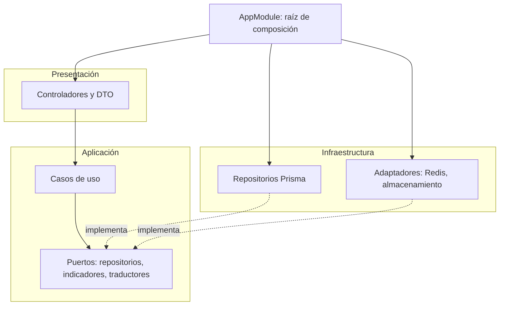
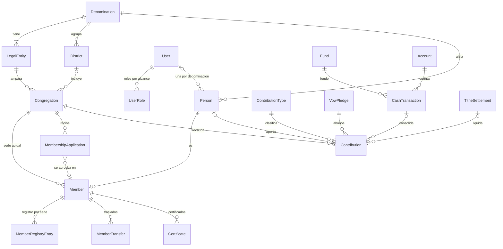

# Plan de implementación Scrum: sistema multi-iglesia

| | |
|---|---|
| **Fecha** | 2026-11-02 |
| **Alcance** | Backend y modelo de datos. El frontend tiene su propia fase |
| **Estado** | Sprint 0 terminado y verificado; listo para el Sprint 1 |
| **Documentos relacionados** | [Auditoría inicial](2026-11-02-0058-auditoria-estado-proyecto.md) · [backend/README.md](../backend/README.md) |

Este plan sustituye al DER propuesto en la sección 10 de la auditoría, que estaba en español. El modelo vigente es `backend/prisma/schema/`, con identificadores en inglés.

## 1. Visión del producto

Un sistema donde cada **denominación** gestiona sus **sedes o congregaciones**, sus **miembros**, la **secretaría** y la **contabilidad**, aislada de las demás denominaciones.

- Un administrador de plataforma crea las denominaciones y sus razones sociales.
- Cada sede, al crearse, elige la razón social a la que pertenece.
- Cualquier persona puede inscribirse como miembro desde un **formulario público**, sin crear cuenta, eligiendo su sede. La secretaría revisa y aprueba.
- Se registran **diezmos, ofrendas, primicias y votos**, con libro de caja por fondo, liquidación del diezmo y presupuesto.
- Reemplaza los Excel actuales de membresía, secretaría y contabilidad.

**Objetivos medibles:**
1. Cero datos de una denominación visibles para otra (garantizado por la base de datos, no solo por la aplicación).
2. Migrar los registros de los Excel con conciliación exacta: miembros, movimientos de caja y saldos.
3. Que la secretaría apruebe una inscripción y emita un certificado sin usar Excel.

## 2. Marco de trabajo

| Elemento | Definición |
|---|---|
| Duración del sprint | 2 semanas |
| Product Owner | Dueño del proyecto: prioriza el backlog y decide sobre el dominio (sección 9) |
| Scrum Master | Facilita ceremonias y elimina bloqueos |
| Equipo | Desarrollo backend y frontend |
| Ceremonias | Planning (2 h) · Daily (15 min) · Review con demo (1 h) · Retrospectiva (1 h) · Refinamiento semanal (1 h) |
| Estimación | Puntos de historia, Fibonacci (1, 2, 3, 5, 8, 13). Una historia de 13 se divide antes de entrar al sprint |

### Definición de preparado (DoR)

- [ ] La historia tiene criterios de aceptación verificables.
- [ ] Las decisiones de dominio que la afectan están tomadas (sección 9).
- [ ] Se conocen los permisos que exige y su alcance (plataforma, denominación o sede).
- [ ] Si toca datos personales, está claro qué se registra en logs y qué no.

### Definición de terminado (DoD)

- [ ] Identificadores de código y esquema en inglés; textos al usuario y documentación en español.
- [ ] Pruebas unitarias de la lógica de negocio y pruebas e2e del endpoint, incluidos los casos de error y de permisos.
- [ ] Una prueba demuestra que un usuario de otra denominación o sede no accede al recurso.
- [ ] `npm run lint:check`, `npm run typecheck`, `npm test`, `npm run test:e2e` y `npm run build` sin errores.
- [ ] DTO validados con `class-validator` y documentados en Swagger; las respuestas nunca devuelven entidades de Prisma.
- [ ] Sin datos personales, contraseñas ni tokens en logs.
- [ ] Si cambia el esquema: migración revisada a mano, con sus reglas `CHECK` si aplica.
- [ ] Revisión de código aprobada.

### Flujo de trabajo con Git

Se sigue GitHub Flow: `main` siempre está desplegable y todo cambio entra por un pull request corto.

| Regla | Definición |
|---|---|
| Rama principal | `main`, protegida: sin push directo; fusionar exige CI en verde (TEC-01) y una revisión aprobada |
| Ramas de trabajo | Una por historia o tarea técnica, creada desde `main` y de vida corta (días, no semanas). Nunca una rama por sprint |
| Nombre | `<tipo>/<id-historia>-<descripcion-corta>`, en inglés y en minúsculas: `feat/a-01-login`, `fix/c-04-duplicate-member`, `chore/tec-01-ci-pipeline` |
| Tipos | Los de Conventional Commits: `feat`, `fix`, `refactor`, `docs`, `test`, `chore`, `ci` |
| Fusión | *Squash merge*: un commit por historia en `main`, con el mensaje en Conventional Commits. La rama se borra al fusionar |
| Seguimiento del sprint | En el tablero (GitHub Projects o milestone por sprint), no en ramas. Al cerrar el sprint se etiqueta `main` con la versión vigente (`v0.2.0`) si se despliega |
| Versión y CHANGELOG | Todo commit que cambia una aplicación sube la versión única de backend y frontend y actualiza `CHANGELOG.md` y el README. Política en «Versionado» del README raíz |

## 3. Decisiones de arquitectura

| # | Decisión | Alternativa descartada | Motivo |
|---|---|---|---|
| 1 | **Monolito modular** con un módulo por contexto | Microservicios | Un equipo, una base de datos y dominios muy relacionados. Los límites de módulo permiten extraer servicios después |
| 2 | **Arquitectura hexagonal por módulo**: `application` (casos de uso y puertos), `infrastructure` (adaptadores), `presentation` (controladores y DTO) | Servicios que usan Prisma directamente | Bajo acoplamiento: la lógica no depende del ORM y se prueba sin base de datos |
| 3 | **Prisma 7** con `@prisma/adapter-mariadb` | TypeORM | Esquema como fuente única y tipado generado, sin decoradores de persistencia en el dominio. La etiqueta `latest` de Prisma apunta a una RC de la 8, así que se fija la 7.10 estable |
| 4 | **NestJS 12 en ESM** con **Vitest** | Jest | NestJS 12 publica sus paquetes en ESM, y Jest no los carga en Node anterior a 24.9 |
| 5 | **TypeScript 6.0** | TypeScript 7 | `@nestjs/swagger` y `typescript-eslint` no admiten la 7 |
| 6 | **Multi-tenant con esquema compartido**: `denominationId` en toda tabla de negocio y FK compuestas | Una base por denominación | Una sola migración y un solo despliegue. La base rechaza cruces entre denominaciones aunque falle el código |
| 7 | **IDs inmutables**: todas las relaciones con `onUpdate: Restrict` y `onDelete: Restrict` (Cascade solo en tokens y permisos de rol) | Valores por defecto de Prisma | Protege el historial y permite reglas `CHECK` sobre columnas con FK |
| 8 | **Redis** para límites de peticiones y revocación de sesiones | Memoria del proceso | Funciona con varias réplicas. Si Redis cae, la API sigue viva y `ready` responde 503 |
| 9 | **Un único filtro de errores** que delega en traductores inyectados (Strategy) | Un filtro global por tecnología | El orden de varios filtros globales depende del orden de los módulos. Así es determinista y extensible |
| 10 | **SmartLogger** sobre `ConsoleLogger`, con redacción de datos | Logs directos | Un solo canal donde garantizar que no se registren datos personales |
| 11 | **Dos usuarios de base de datos** en producción: dueño del esquema (migrador) y usuario de la API sin DDL | Un solo usuario | Si la API fuera comprometida, no podría alterar ni borrar tablas |
| 12 | **Local**: base de datos y Redis en Docker, API y frontend en el equipo. **Producción**: todo en Docker | Todo en Docker en local | Recarga rápida y depuración sencilla en desarrollo |

### Capas

### Aislamiento entre denominaciones

1. **Base de datos:** FK compuestas `(denominationId, id)`. Una sede no puede usar la razón social, las personas ni las cuentas de otra denominación. Se verificó contra MariaDB real.
2. **Aplicación (Sprint 1):** un `TenantContext` por petición, derivado de los roles del usuario. Los repositorios exigen la denominación y la sede en cada consulta; no existe un método que consulte sin alcance.
3. **Pruebas:** cada historia incluye una prueba de acceso cruzado (DoD).

## 4. Modelo de datos

71 tablas en seis contextos, en `backend/prisma/schema/`:

| Archivo | Contexto | Modelos principales |
|---|---|---|
| `organization.prisma` | Organización | `Denomination`, `LegalEntity`, `District`, `Congregation`, geografía |
| `identity.prisma` | Identidad y acceso | `User`, `Role`, `Permission`, `UserRole` (por alcance), `RefreshToken`, `AuditLog` |
| `membership.prisma` | Membresía | `Person`, `Member`, `MemberRegistryEntry`, `MemberTransfer`, `MembershipApplication`, `DataConsent`, `SocioeconomicProfile` |
| `secretariat.prisma` | Secretaría | `PastoralTerm`, `Marriage`, `ChildDedication`, asistencia, `Certificate`, `DocumentSequence`, `MembershipCard` |
| `ministries.prisma` | Ministerios (hipótesis) | `Ministry` > `WorkGroup` > `WorkBlock` > `WorkTeam`, `Schedule`, `Topic` |
| `accounting.prisma` | Contabilidad | `Fund`, `Account`, `ContributionType`, `CashTransaction`, `Contribution`, `VowPledge`, `TitheSettlement`, `Budget` |

### Relaciones centrales

### Glosario del dominio

Los nombres del código están en inglés; el término de negocio se conserva en la documentación.

| Término de negocio | Modelo | Término de negocio | Modelo |
|---|---|---|---|
| Denominación | `Denomination` | Diezmo | `ContributionCategory.TITHE` |
| Razón social | `LegalEntity` | Ofrenda | `ContributionCategory.OFFERING` |
| Sede o congregación | `Congregation` | Primicia | `ContributionCategory.FIRST_FRUITS` |
| Distrito | `District` | Voto (promesa) | `VowPledge` |
| Persona | `Person` | Aporte | `Contribution` |
| Miembro | `Member` | Fondo o comité | `Fund` |
| Libro, folio y código | `MemberRegistryEntry` | Plan de cuentas | `Account` |
| Formulario de inscripción | `MembershipApplication` | Libro de caja | `CashTransaction` |
| Autorización de datos | `DataConsent` | Comprobante | `Voucher` |
| Política de tratamiento | `PrivacyPolicy` | Liquidación del diezmo | `TitheSettlement` |
| Ficha socioeconómica | `SocioeconomicProfile` | Presupuesto fijo o por comités | `Budget` (`FIXED`, `COMMITTEE`) |
| Grado pastoral | `PastoralRank` | Periodo pastoral | `PastoralTerm` |
| Cargo | `ChurchPosition` | Presentación de niños | `ChildDedication` |
| Estudios (seis tablas del diccionario) | `Study` + `StudyType` | Carné | `MembershipCard` |
| Traslado | `MemberTransfer` | Consecutivo | `DocumentSequence` |

### Reglas que garantiza la base de datos

Verificadas contra MariaDB 11.8 en un entorno desechable:

- Ninguna referencia entre denominaciones: sede con razón social ajena, parentescos cruzados, cuentas de otra denominación.
- Comprobantes, movimientos de caja, aportes y liquidaciones de una misma sede.
- Importes positivos; liquidaciones cuyos componentes suman el bruto; mes entre 1 y 12.
- Tipo y número de documento siempre juntos.
- Un voto solo se paga con aportes de la misma persona y del mismo tipo.
- Alcance de rol coherente con sus columnas; un rol revocado se puede volver a conceder.
- Los IDs no se pueden modificar.

### Reglas de aplicación

No se pueden expresar en la base de datos sin sacrificar casos legítimos, así que van en los casos de uso, con pruebas:

- Un periodo contable cerrado no admite movimientos; la fecha del movimiento cae dentro de su periodo.
- Una reversa usa la misma cuenta, fondo e importe, con el sentido contrario.
- Los rangos de liquidación del diezmo no se solapan; un aporte ya liquidado no se anula.
- Un menor necesita un acudiente en la autorización de datos.
- Un certificado se emite en la sede actual del miembro.

## 5. Estado del Sprint 0 (terminado)

**Objetivo:** fundación técnica y modelo de datos completos, verificados y desplegables.

| Entregable | Estado | Verificación |
|---|---|---|
| Dependencias en sus últimas versiones estables: NestJS 12.3, Fastify 5.12, Prisma 7.10, TypeScript 6.0, Vitest 5, ESLint 10 | Hecho | `npm ls` sin conflictos de peers |
| Configuración validada al arrancar, sin exponer valores | Hecho | Pruebas unitarias; arranque con URL inválida sin revelar la contraseña |
| `SmartLogger` con redacción de credenciales, tokens y datos personales | Hecho | 7 pruebas del redactor |
| Filtro único de errores con traductor de Prisma | Hecho | Pruebas unitarias y e2e (409, 404, 500 sin detalle) |
| Salud: `/api/health` (vivo) y `/api/health/ready` (base de datos y Redis) | Hecho | e2e; contenedor real con Redis caído responde 503 |
| Seguridad base: Helmet con CSP estricta, CORS por lista, Swagger desactivado por defecto, sin query string en errores | Hecho | e2e |
| Modelo de datos de 71 tablas, multi-iglesia, con reglas `CHECK` | Hecho | `prisma validate`; migración aplicada en MariaDB real sin desviaciones; pruebas de rechazo |
| Seed idempotente de catálogos y roles | Hecho | Ejecutado dos veces sin errores |
| Migración inicial `20261102141056_init`, con las 19 reglas `CHECK` | Hecho | Aplicada en la base local: 72 tablas, 135 FK con `ON UPDATE RESTRICT`, 22 `CHECK` (19 propias y 3 `json_valid` de MariaDB); `migrate dev` no genera cambios; rechazos de cruce entre denominaciones, documento sin tipo y cambio de ID |
| Docker local (MariaDB y Redis) y de producción (migrador, API sin root, redes separadas) | Hecho | Imágenes construidas y ejecutadas; cierre ordenado con SIGTERM |
| Defectos bloqueantes de la auditoría en el backend | Corregidos | Ruta `dist/main.js`, Fastify en producción, lockfile versionado, healthcheck de MariaDB, `.dockerignore`, migraciones versionables |

**Pendiente del Sprint 0:**

- **Imagen de la API (821 MB):** `@prisma/client` arrastra el CLI de Prisma y TypeScript como dependencias. Hay una historia para reducirla (TEC-04).
- **Auditoría de dependencias:** `npm audit` reporta 5 avisos moderados en `glob` y `minimatch`, transitivos de `@fastify/static`, sin corrección compatible publicada.

## 6. Product backlog

Prioridad: **P1** imprescindible para operar, **P2** importante, **P3** deseable. Las historias de una misma épica se ordenan por dependencia.

### ÉPICA A: Identidad y acceso

| ID | Historia | Pts | Prioridad | Criterios de aceptación |
|---|---|---|---|---|
| A-01 | Como administrador de plataforma, quiero iniciar sesión con correo y contraseña para gestionar el sistema | 5 | P1 | Hash argon2; límite de intentos por IP y cuenta en Redis; bloqueo temporal; mensaje genérico ante credenciales inválidas |
| A-02 | Como usuario, quiero que mi sesión se renueve sin volver a iniciar sesión | 5 | P1 | Access token corto; refresh token rotativo en cookie HttpOnly y SameSite; reutilizar un refresh revoca toda la familia |
| A-03 | Como desarrollador, quiero un `TenantContext` por petición para que ningún repositorio consulte sin alcance | 8 | P1 | Guard global `JwtAuthGuard` con `@Public()`; `PermissionsGuard` con `@RequirePermissions()`; prueba de acceso cruzado |
| A-04 | Como administrador, quiero asignar y revocar roles por alcance | 5 | P1 | `scopeKey` y `activeKey` coherentes; quién concede queda registrado; un rol revocado se puede conceder de nuevo |
| A-05 | Como usuario, quiero recuperar mi contraseña por correo | 5 | P2 | Token de un solo uso con expiración, guardado como hash; respuesta idéntica exista o no el correo |
| A-06 | Como auditor, quiero un registro de las acciones sensibles | 3 | P2 | `AuditLog` sin datos personales en `changes`; consulta por denominación y fecha |

### ÉPICA B: Organización

| ID | Historia | Pts | Prioridad | Criterios de aceptación |
|---|---|---|---|---|
| B-01 | Como administrador de plataforma, quiero crear denominaciones | 3 | P1 | Nombre único; al crearse, también su fondo «Fondo Local», sus tipos de aporte por defecto (diezmo, ofrenda, primicia, voto) y su primera política de datos en borrador |
| B-02 | Como administrador de denominación, quiero registrar sus razones sociales | 3 | P1 | NIT único; varias por denominación |
| B-03 | Como administrador de denominación, quiero crear sedes eligiendo su razón social y su distrito | 5 | P1 | Solo razones sociales y distritos de la misma denominación |
| B-04 | Como visitante, quiero ver las sedes que aceptan inscripciones | 2 | P1 | Endpoint público, paginado, sin datos internos; solo sedes activas con inscripciones abiertas |
| B-05 | Como administrador, quiero cargar la división territorial de Colombia | 3 | P2 | Importación idempotente de departamentos y municipios |

### ÉPICA C: Inscripción pública y membresía

| ID | Historia | Pts | Prioridad | Criterios de aceptación |
|---|---|---|---|---|
| C-01 | Como persona, quiero inscribirme como miembro sin crear una cuenta, eligiendo mi sede | 8 | P1 | Acepta la política de datos vigente; si es menor, exige acudiente; devuelve un código de seguimiento cuyo hash se guarda; límite de envíos por IP; protección anti-bots |
| C-02 | Como persona, quiero consultar el estado de mi solicitud con mi código | 2 | P2 | No revela datos personales, solo el estado |
| C-03 | Como secretaría, quiero revisar las solicitudes de mi sede y detectar duplicados | 5 | P1 | Búsqueda de coincidencias por documento; marca `DUPLICATE` y enlaza `matchedPersonId` |
| C-04 | Como secretaría, quiero aprobar una solicitud y crear la persona y el miembro | 8 | P1 | Transacción única: persona, miembro, registro con número de carné (`DocumentSequence`), autorización de datos y adjuntos |
| C-05 | Como secretaría, quiero gestionar los datos del miembro, su familia, estudios y cargos | 8 | P1 | Ficha socioeconómica con permiso propio; el cónyuge solo se registra en `Marriage` |
| C-06 | Como secretaría, quiero trasladar un miembro a otra sede o a una iglesia externa | 5 | P2 | Nueva entrada de registro en la sede de destino; historial conservado; carta de traslado enlazada |
| C-07 | Como titular de los datos, quiero revocar mi autorización | 3 | P2 | Registro de la revocación y procedimiento de anonimización |

### ÉPICA D: Secretaría

| ID | Historia | Pts | Prioridad | Criterios de aceptación |
|---|---|---|---|---|
| D-01 | Como secretaría, quiero emitir certificados con numeración consecutiva | 8 | P1 | Consecutivo sin huecos por sede y tipo; `snapshot` de lo impreso; PDF generado en el servidor; anulación sin borrado |
| D-02 | Como secretaría, quiero emitir carnés con vencimiento | 3 | P2 | Usa el número de carné de la sede actual |
| D-03 | Como secretaría, quiero registrar la asistencia por reunión y categoría | 3 | P2 | Una sesión por sede, tipo y fecha; total calculado |
| D-04 | Como secretaría, quiero registrar presentaciones de niños y matrimonios | 5 | P2 | Datos de menores con permiso restringido; matrimonio con disolución |
| D-05 | Como secretaría, quiero registrar los periodos pastorales | 2 | P3 | Fechas coherentes; historial por sede |

### ÉPICA E: Contabilidad

| ID | Historia | Pts | Prioridad | Criterios de aceptación |
|---|---|---|---|---|
| E-01 | Como tesorería, quiero administrar fondos, plan de cuentas y tipos de aporte | 5 | P1 | Jerarquía de cuentas; solo cuentas imputables reciben movimientos |
| E-02 | Como tesorería, quiero registrar diezmos, ofrendas, primicias y votos | 8 | P1 | Aporte nominal o anónimo; medio de pago; permiso específico; anulación con motivo, nunca borrado |
| E-03 | Como tesorería, quiero registrar promesas de voto y ver lo abonado | 5 | P1 | Abonos solo de la misma persona y tipo; saldo calculado |
| E-04 | Como tesorería, quiero llevar el libro de caja por fondo, con periodos y comprobantes | 8 | P1 | Periodo cerrado no admite movimientos; corrección por reversa; consolidar aportes en un movimiento |
| E-05 | Como tesorería, quiero liquidar el diezmo de un periodo | 8 | P1 | Porcentajes vigentes copiados; aportes vinculados; sin solapes; anulación con motivo; fórmula cubierta con las filas de referencia |
| E-06 | Como tesorería, quiero elaborar el presupuesto fijo y el de comités | 5 | P2 | Líneas por cuenta y fondo; valor mensual opcional; ejecución contra lo real |
| E-07 | Como pastor o tesorería, quiero reportes de ingresos, egresos y saldos por fondo | 8 | P2 | Coinciden con la conciliación del Excel; exportación limitada por rol |

### ÉPICA F: Ministerios (hipótesis)

| ID | Historia | Pts | Prioridad | Criterios de aceptación |
|---|---|---|---|---|
| F-01 | Validar con el cliente la jerarquía de ministerios, grupos, bloques y equipos | 2 | P2 | Decisión escrita; ajuste del esquema antes de construir |
| F-02 | Gestionar ministerios, equipos, cronogramas y temas | 8 | P3 | Según F-01 |

### ÉPICA G: Migración desde Excel

| ID | Historia | Pts | Prioridad | Criterios de aceptación |
|---|---|---|---|---|
| G-01 | Extraer los Excel a staging fuera del repositorio | 5 | P1 | Script idempotente; datos cifrados; nada en git ni en logs |
| G-02 | Normalizar y revisar: estado civil, grados, documentos, teléfonos, fechas, códigos contables | 8 | P1 | Tablas de equivalencias versionadas; reporte de rechazos sin datos personales |
| G-03 | Cargar y conciliar | 8 | P1 | 269 miembros menos descartes justificados; 184 movimientos (134 entradas y 50 salidas); saldo final igual al Excel |

### ÉPICA T: Deuda técnica y operación

| ID | Historia | Pts | Prioridad | Criterios de aceptación |
|---|---|---|---|---|
| TEC-01 | CI en GitHub Actions: lint, typecheck, pruebas, build, imágenes, arranque con health, gitleaks y Trivy | 5 | P1 | Obligatorio para fusionar en `main` |
| TEC-02 | Backups cifrados de MariaDB fuera del host, con restauración probada | 5 | P1 | Procedimiento documentado y ensayado |
| TEC-03 | TLS y proxy `/api` en Nginx (`location ^~ /api/`), bloqueando `/api/health/ready` desde fuera | 3 | P1 | Hecho en la fase de frontend |
| TEC-04 | Reducir la imagen de la API | 3 | P3 | Por debajo de 400 MB sin perder funcionalidad |
| TEC-05 | Generar los tipos del cliente frontend desde el OpenAPI | 3 | P2 | Sin tipos duplicados a mano |

## 7. Plan de sprints

Capacidad de referencia: 30 a 35 puntos por sprint. Se ajusta tras medir la velocidad real en los dos primeros.

| Sprint | Objetivo | Historias | Pts |
|---|---|---|---|
| 0 | Fundación y modelo de datos | Terminado (sección 5) | — |
| 1 | Acceso seguro y multi-iglesia | A-01, A-02, A-03, A-04, TEC-01 | 28 |
| 2 | Organización e inscripción pública | B-01, B-02, B-03, B-04, C-01, C-02 | 23 |
| 3 | Membresía | C-03, C-04, C-05, A-06 | 24 |
| 4 | Secretaría | D-01, D-02, D-03, C-06, B-05 | 22 |
| 5 | Aportes y caja | E-01, E-02, E-03, E-04 | 26 |
| 6 | Liquidación, presupuesto y reportes | E-05, E-06, E-07, TEC-02 | 26 |
| 7 | Migración y salida a producción | G-01, G-02, G-03, TEC-03, A-05 | 29 |
| 8 | Cierre de alcance | D-04, D-05, C-07, F-01, TEC-04, TEC-05 | 18 |

El frontend avanza en paralelo desde el Sprint 2, una vez existan la autenticación y los primeros endpoints. Su fase empieza corrigiendo los defectos de despliegue de la auditoría (`dist/frontend/browser`, proxy de Nginx, usuario no root).

### Sprint 1 en detalle

**Objetivo:** que solo usuarios autenticados, con el rol y el alcance correctos, puedan acceder, y que ninguna consulta pueda salir de su denominación.

| Tarea | Historia |
|---|---|
| `AuthModule`: estrategias local y JWT, hash argon2, límite de intentos en Redis | A-01 |
| Refresh token rotativo con detección de reutilización | A-02 |
| `TenantContext` por petición, guards globales y decoradores `@Public()` y `@RequirePermissions()` | A-03 |
| Repositorio base que exige alcance; prueba de acceso cruzado reutilizable | A-03 |
| Casos de uso para asignar y revocar roles | A-04 |
| Comando para crear el primer administrador de plataforma, sin credenciales en el código | A-01 |
| Workflow de CI | TEC-01 |

**Demo de cierre:** un administrador de la denominación A inicia sesión y no puede ver ni modificar nada de la denominación B. Se muestra la prueba automática que lo garantiza.

## 8. Riesgos

| Riesgo | Probabilidad | Impacto | Mitigación |
|---|---|---|---|
| Datos personales aún en el historial de git | Alta | Crítico | Limpiar según la sección 3.1 de la auditoría antes de cualquier push |
| Diccionario de datos sin campos | Alta | Alto | El modelo se derivó de los Excel y del PDF; validar con secretaría y tesorería en el refinamiento |
| Requisitos legales de datos sensibles (Ley 1581 de 2012) | Media | Alto | Política de tratamiento, consentimiento y auditoría desde el Sprint 2; asesoría legal |
| Datos de origen inconsistentes | Alta | Medio | Épica G con staging, revisión humana y conciliación |
| Velocidad del equipo desconocida | Media | Medio | Reestimar tras el Sprint 2 |

## 9. Decisiones pendientes del Product Owner

Se tomaron decisiones provisionales para no bloquear el modelo, y la migración inicial las aplica tal como están. Cambiar una exige una migración nueva, por lo que conviene confirmarlas antes de que haya datos reales.

| # | Pregunta | Decisión provisional |
|---|---|---|
| 1 | ¿Una denominación puede tener varias razones sociales? | Sí: `LegalEntity` separada. Si solo hay una, queda una fila |
| 2 | ¿El número de carné se conserva al trasladarse? | No: cada sede asigna el suyo y se conserva el historial |
| 3 | ¿El libro y el folio son por sede o por denominación? | Por sede, sin unicidad, porque los históricos se calculaban con la cédula |
| 4 | ¿El saldo inicial se lleva por fondo o por sede? | Por fondo y año (`FundOpeningBalance`) |
| 5 | ¿Un mismo concepto puede aparecer en dos comités del presupuesto? | Sí: la línea es por cuenta y fondo |
| 6 | ¿Con qué periodicidad se liquida el diezmo? | Por rango libre (`coveredFrom` a `coveredTo`), sin solapes |
| 7 | ¿Cuántas firmas lleva un comprobante? | Una; se añade `VoucherSigner` si hacen falta más |
| 8 | ¿Es correcta la jerarquía de ministerios? | Hipótesis; no se construye hasta validarla (F-01) |
| 9 | ¿Se registra el diezmo por persona? | Sí, a petición del dueño; también se admiten aportes anónimos y colectas agregadas |
