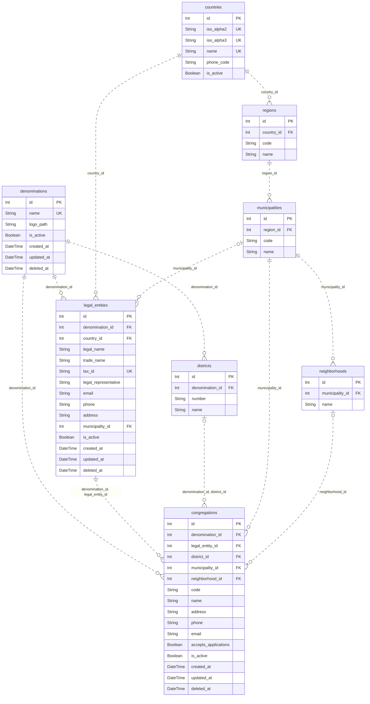
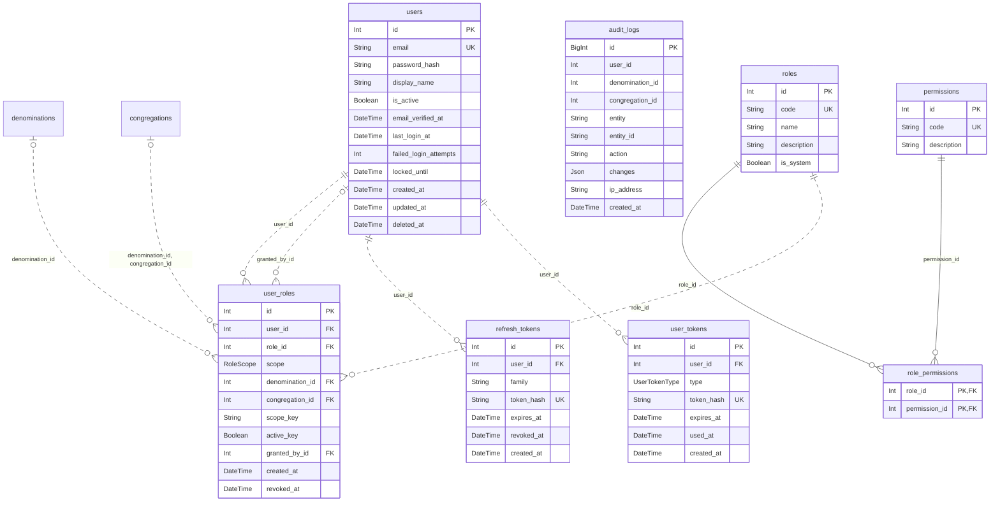
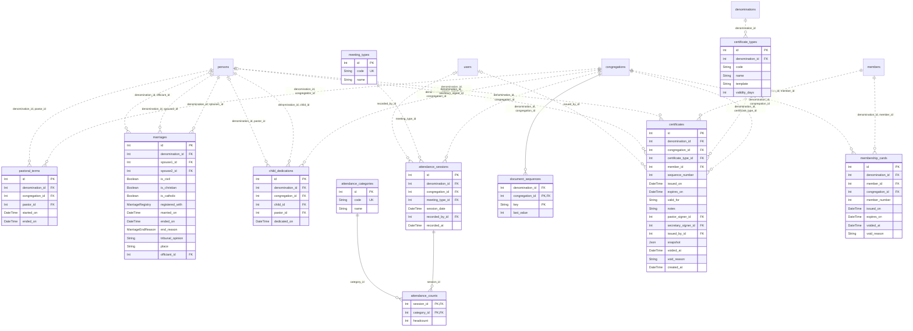
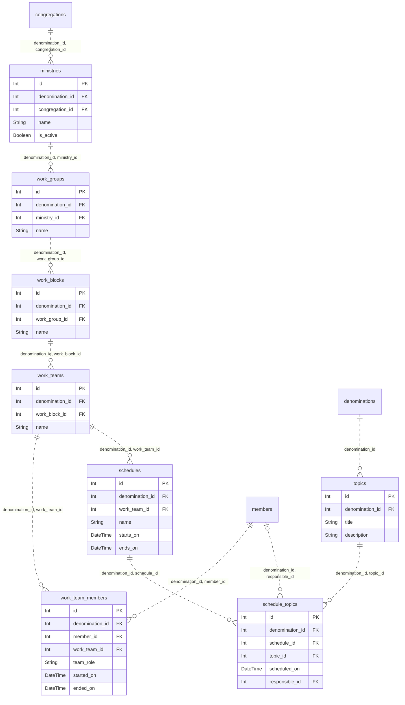
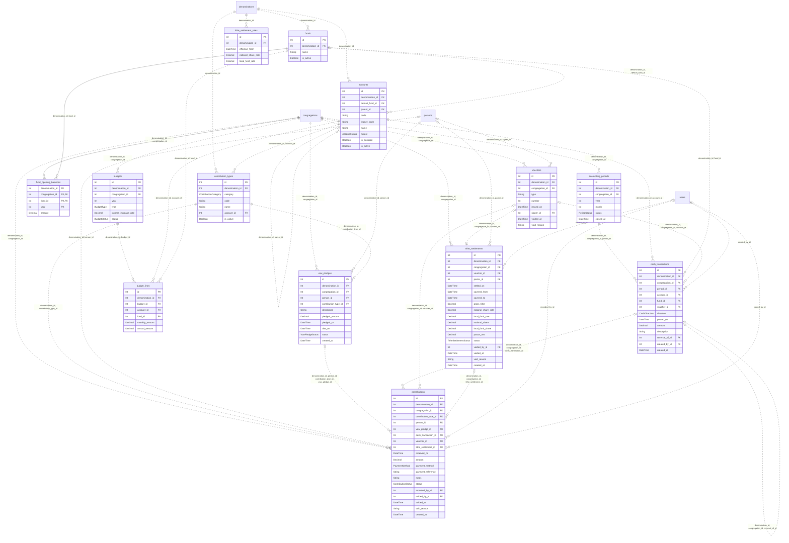

# Modelo de datos

> Generado con `npm run db:dictionary` el 2026-11-02 23:39 a partir de `backend/prisma/schema/*.prisma`.
> No se edita a mano: la fuente es la documentación `///` del esquema Prisma, que también llega a la base
> de datos como COMMENT de tablas y columnas (`npm run db:comments:inject`).

## Resumen

71 tablas, 557 columnas, 23 enumeraciones y 24 reglas CHECK en 6 contextos.

| Contexto | Archivo | Tablas | Enumeraciones | Sin documentar |
| --- | --- | ---: | ---: | ---: |
| [Organización](#contexto-organization) | `organization.prisma` | 8 | 0 | 0 |
| [Identidad y acceso](#contexto-identity) | `identity.prisma` | 8 | 2 | 0 |
| [Membresía](#contexto-membership) | `membership.prisma` | 23 | 9 | 0 |
| [Secretaría](#contexto-secretariat) | `secretariat.prisma` | 11 | 2 | 0 |
| [Ficha](#contexto-ministries) | `ministries.prisma` | 8 | 0 | 0 |
| [Contabilidad](#contexto-accounting) | `accounting.prisma` | 13 | 10 | 0 |

## Índice por contexto

- **[Organización](#contexto-organization)** (`organization.prisma`)
  - [`countries`](#tabla-countries) — País.
  - [`regions`](#tabla-regions) — Departamento, estado o provincia de un país.
  - [`municipalities`](#tabla-municipalities) — Municipio o ciudad.
  - [`neighborhoods`](#tabla-neighborhoods) — Barrio de un municipio.
  - [`denominations`](#tabla-denominations) — Denominación o iglesia cliente: unidad de aislamiento (tenant) de todos los datos de negocio.
  - [`legal_entities`](#tabla-legal-entities) — Razón social (persona jurídica) de una denominación; una denominación puede tener una o varias y cada sede elige la suya.
  - [`districts`](#tabla-districts) — Distrito: agrupación administrativa de sedes dentro de una denominación.
  - [`congregations`](#tabla-congregations) — Sede o congregación local de una denominación, donde se registran miembros, aportes y secretaría.
- **[Identidad y acceso](#contexto-identity)** (`identity.prisma`)
  - [`users`](#tabla-users) — Cuenta de acceso de una persona al sistema: credenciales, verificación de correo y control de bloqueo.
  - [`roles`](#tabla-roles) — Catálogo global de roles: PLATFORM_ADMIN, DENOMINATION_ADMIN, PASTOR, SECRETARY y TREASURER.
  - [`permissions`](#tabla-permissions) — Catálogo global de permisos granulares en formato «recurso.acción», p. ej. members.read.
  - [`role_permissions`](#tabla-role-permissions) — Tabla puente que concede permisos a roles (muchos a muchos); la clave primaria es el par rol y permiso.
  - [`user_roles`](#tabla-user-roles) — Asignación de un rol a un usuario con su alcance: toda la plataforma, una denominación o una sede.
  - [`refresh_tokens`](#tabla-refresh-tokens) — Token de renovación de sesión: una fila por cada rotación.
  - [`user_tokens`](#tabla-user-tokens) — Token de un solo uso de un enlace para verificar el correo, aceptar una invitación o recuperar la contraseña; se envía por correo o lo entrega un administrador.
  - [`audit_logs`](#tabla-audit-logs) — Bitácora de auditoría de solo inserción: una fila por acción relevante (quién, sobre qué entidad y qué cambió).
- **[Membresía](#contexto-membership)** (`membership.prisma`)
  - [`document_types`](#tabla-document-types) — Catálogo global de tipos de documento de identidad (registro civil, tarjeta de identidad, cédula, pasaporte, etc.).
  - [`marital_statuses`](#tabla-marital-statuses) — Catálogo global de estados civiles de una persona.
  - [`education_levels`](#tabla-education-levels) — Catálogo global de niveles educativos de una persona.
  - [`study_types`](#tabla-study-types) — Catálogo global de tipos de estudio.
  - [`pastoral_ranks`](#tabla-pastoral-ranks) — Grado pastoral que cada denominación define y asigna a los miembros que ejercen el ministerio.
  - [`studies`](#tabla-studies) — Estudio concreto (curso, carrera o programa) del catálogo de cada denominación, clasificado por tipo de estudio.
  - [`church_positions`](#tabla-church-positions) — Cargo dentro de la iglesia que cada denominación define; los miembros lo ocupan a través de member_positions.
  - [`persons`](#tabla-persons) — Persona conocida por una denominación: miembro, pariente, acudiente, pastor o aportante.
  - [`person_addresses`](#tabla-person-addresses) — Dirección de residencia de una persona; la vigente se marca con is_current.
  - [`person_contacts`](#tabla-person-contacts) — Medio de contacto de una persona (teléfono o correo); puede tener varios y uno marcado como principal.
  - [`socioeconomic_profiles`](#tabla-socioeconomic-profiles) — Ficha socioeconómica de una persona (una por persona), separada de persons para exigir un permiso específico.
  - [`family_relations`](#tabla-family-relations) — Parentesco entre dos personas de la misma denominación: type dice qué es el pariente para la persona.
  - [`person_studies`](#tabla-person-studies) — Estudio realizado o en curso de una persona, tomado del catálogo de estudios de su denominación.
  - [`members`](#tabla-members) — Membresía de una persona en la denominación: estado, sede actual y datos espirituales.
  - [`member_registry_entries`](#tabla-member-registry-entries) — Registro del miembro en una sede: número de carné, libro y folio.
  - [`member_status_history`](#tabla-member-status-history) — Historial de estados de un miembro: una fila por cada estado que tomó, con la fecha desde la que rige y el motivo.
  - [`member_transfers`](#tabla-member-transfers) — Traslado de un miembro a otra sede de la denominación o a una iglesia fuera del sistema (external_destination_name).
  - [`member_positions`](#tabla-member-positions) — Cargo que ocupa u ocupó un miembro en la iglesia, con su periodo; un cargo sin fecha de fin está vigente.
  - [`privacy_policies`](#tabla-privacy-policies) — Política de tratamiento de datos versionada por denominación.
  - [`data_consents`](#tabla-data-consents) — Autorización de tratamiento de datos que una persona otorga sobre una versión de la política. guardian_id es obligatorio para menores (regla de aplicación).
  - [`person_attachments`](#tabla-person-attachments) — Archivo adjunto de una persona (foto o soporte), guardado fuera de la base con su huella SHA-256.
  - [`membership_applications`](#tabla-membership-applications) — Formulario público de inscripción, sin cuenta de usuario: la persona elige su sede y la secretaría revisa.
  - [`application_attachments`](#tabla-application-attachments) — Foto o soporte adjunto al formulario público de inscripción, guardado fuera de la base con su huella SHA-256.
- **[Secretaría](#contexto-secretariat)** (`secretariat.prisma`)
  - [`pastoral_terms`](#tabla-pastoral-terms) — Periodo de un pastor al frente de una sede, con fecha de inicio y de fin.
  - [`marriages`](#tabla-marriages) — Matrimonio entre dos personas de la denominación; única fuente de verdad del cónyuge.
  - [`child_dedications`](#tabla-child-dedications) — Presentación de un niño o niña ante la iglesia.
  - [`meeting_types`](#tabla-meeting-types) — Catálogo de tipos de reunión en los que se toma asistencia (Escuela Dominical, culto dominical, reunión de oración, etc.).
  - [`attendance_categories`](#tabla-attendance-categories) — Catálogo de categorías en que se cuentan los asistentes de una reunión (niños, adolescentes, hermanas, hermanos, visitas).
  - [`attendance_sessions`](#tabla-attendance-sessions) — Registro de asistencia de una reunión: una sola sesión por sede, tipo de reunión y fecha.
  - [`attendance_counts`](#tabla-attendance-counts) — Cantidad de asistentes de una categoría en una sesión de asistencia; clave primaria sesión más categoría.
  - [`certificate_types`](#tabla-certificate-types) — Tipo de certificado que una denominación puede expedir.
  - [`document_sequences`](#tabla-document-sequences) — Contador de numeración consecutiva por sede y clave: números de miembro, comprobantes y certificados.
  - [`certificates`](#tabla-certificates) — Certificado expedido a un miembro, con número consecutivo por sede y tipo.
  - [`membership_cards`](#tabla-membership-cards) — Carné de membresía emitido por una sede, con fechas de emisión y vencimiento.
- **[Ficha](#contexto-ministries)** (`ministries.prisma`)
  - [`ministries`](#tabla-ministries) — Ministerio de una sede: nivel superior de la jerarquía Ministerio &gt; Grupo &gt; Bloque &gt; Equipo de trabajo.
  - [`work_groups`](#tabla-work-groups) — Grupo de trabajo dentro de un ministerio: segundo nivel de la jerarquía Ministerio &gt; Grupo &gt; Bloque &gt; Equipo.
  - [`work_blocks`](#tabla-work-blocks) — Bloque de trabajo dentro de un grupo de trabajo: tercer nivel de la jerarquía Ministerio &gt; Grupo &gt; Bloque &gt; Equipo.
  - [`work_teams`](#tabla-work-teams) — Equipo de trabajo dentro de un bloque: último nivel de la jerarquía Ministerio &gt; Grupo &gt; Bloque &gt; Equipo; agrupa miembros y tiene cronogramas.
  - [`work_team_members`](#tabla-work-team-members) — Participación de un miembro en un equipo de trabajo durante un periodo, con su rol opcional.
  - [`schedules`](#tabla-schedules) — Cronograma de un equipo de trabajo: plan con vigencia en fechas en el que se programan temas por día.
  - [`topics`](#tabla-topics) — Tema que puede programarse en los cronogramas (enseñanza o contenido a tratar).
  - [`schedule_topics`](#tabla-schedule-topics) — Programación de un tema en una fecha concreta de un cronograma, con un miembro responsable opcional.
- **[Contabilidad](#contexto-accounting)** (`accounting.prisma`)
  - [`funds`](#tabla-funds) — Fondo o comité contable (Fondo Local, Dorcas, Jóvenes, Escuela Dominical, Construcción...).
  - [`accounts`](#tabla-accounts) — Cuenta del plan de cuentas, en jerarquía de grupos y subcuentas.
  - [`contribution_types`](#tabla-contribution-types) — Tipo de aporte (diezmo, ofrenda, primicia, voto u otros que defina la denominación) y la cuenta de ingreso que alimenta.
  - [`fund_opening_balances`](#tabla-fund-opening-balances) — Saldo con el que un fondo inicia un año en una sede.
  - [`accounting_periods`](#tabla-accounting-periods) — Periodo contable mensual que controla en qué fechas se registran movimientos y aportes.
  - [`vouchers`](#tabla-vouchers) — Comprobante numerado que respalda aportes, movimientos de caja y liquidaciones.
  - [`cash_transactions`](#tabla-cash-transactions) — Línea del libro de caja, imputada a una cuenta y un fondo dentro de un periodo contable.
  - [`vow_pledges`](#tabla-vow-pledges) — Promesa de voto que hace una persona por un importe.
  - [`contributions`](#tabla-contributions) — Aporte recibido (diezmo, ofrenda, primicia, pago de voto u otro).
  - [`tithe_settlement_rules`](#tabla-tithe-settlement-rules) — Porcentajes de liquidación del diezmo con su fecha de vigencia (en las fuentes, 21 % nacional y 3 % fondo local).
  - [`tithe_settlements`](#tabla-tithe-settlements) — Liquidación del diezmo de un rango de fechas: reparte el bruto entre parte nacional, fondo local y neto pastoral.
  - [`budgets`](#tabla-budgets) — Presupuesto anual, fijo o por comités, como en los Excel.
  - [`budget_lines`](#tabla-budget-lines) — Línea de un presupuesto: lo planeado en el año para una cuenta y un fondo.

## Convenciones

- **Clave:** PK = clave primaria, FK = clave foránea, UK = única por sí sola (los índices únicos compuestos se listan en cada tabla).
- **Nulo:** «Sí» si la columna admite NULL.
- **Default:** expresión del esquema Prisma; `@updatedAt` lo asigna Prisma en cada actualización.
- **Diagramas:** `||` exactamente uno, `|o` cero o uno, `o{` cero o muchos. Línea continua: la FK es parte de la PK (relación identificadora); punteada: no lo es. Las tablas de otros contextos aparecen sin atributos.

## Organización

Archivo: `prisma/schema/organization.prisma`

Jerarquía multi-iglesia. Denominación -&gt; Razón social y Distrito -&gt; Sede o congregación Regla: toda tabla de negocio lleva denominationId y sus FK compuestas impiden cruzar denominaciones.

### Diagrama entidad-relación

### `countries`

**Modelo Prisma:** `Country`

País. Catálogo global de geografía, compartido por todas las denominaciones y cargado desde prisma/seed-data/countries.json. Lo administra la plataforma: solo los países activos se ofrecen para razones sociales y búsquedas de municipios.

| Columna | Tipo | Nulo | Default | Clave | Descripción |
| --- | --- | :---: | --- | :---: | --- |
| `id` | `INTEGER` | No | `autoincrement()` | PK | Identificador interno autoincremental. |
| `iso_alpha2` | `CHAR(2)` | No |  | UK | Código ISO 3166-1 alfa-2 del país en mayúsculas (CO); único y usado para nombrar su archivo de divisiones. |
| `iso_alpha3` | `CHAR(3)` | Sí |  | UK | Código ISO 3166-1 alfa-3 del país (COL); único, nulo si no tiene uno oficial, como Kosovo. |
| `name` | `VARCHAR(100)` | No |  | UK | Nombre del país en español; único en el catálogo. |
| `phone_code` | `VARCHAR(4)` | Sí |  |  | Indicativo telefónico internacional sin el signo + (57); nulo si no se conoce. |
| `is_active` | `BOOLEAN` | No | `false` |  | Indica si el país está activo en el sistema; lo cambia la plataforma, no se desactiva con razones sociales activas y el seed solo lo fija al crearlo. |

**Restricciones e índices**

- **PK:** (`id`)

**Referenciada por**

- [`regions`](#tabla-regions) (`country_id`)
- [`legal_entities`](#tabla-legal-entities) (`country_id`)

### `regions`

**Modelo Prisma:** `Region`

Departamento, estado o provincia de un país. Catálogo global de geografía, cargado desde prisma/seed-data/divisions/&lt;ISO alfa-2&gt;.json. El código y el nombre son únicos dentro del país.

| Columna | Tipo | Nulo | Default | Clave | Descripción |
| --- | --- | :---: | --- | :---: | --- |
| `id` | `INTEGER` | No | `autoincrement()` | PK | Identificador interno autoincremental. |
| `country_id` | `INTEGER` | No |  | FK | País al que pertenece la subdivisión (FK a countries.id). |
| `code` | `VARCHAR(10)` | Sí |  |  | Código oficial de la subdivisión, único en el país; en Colombia, el código DANE del departamento (05). Nulo si no tiene uno. |
| `name` | `VARCHAR(100)` | No |  |  | Nombre oficial de la subdivisión, único dentro del país. |

**Restricciones e índices**

- **PK:** (`id`)
- **Única:** (`country_id`, `code`)
- **Única:** (`country_id`, `name`)

**Referencia a**

- (`country_id`) → [`countries`](#tabla-countries) (`id`) — ON DELETE RESTRICT, ON UPDATE RESTRICT

**Referenciada por**

- [`municipalities`](#tabla-municipalities) (`region_id`)

### `municipalities`

**Modelo Prisma:** `Municipality`

Municipio o ciudad. Catálogo global de geografía; cada país con municipios tiene su archivo en prisma/seed-data/divisions/&lt;ISO alfa-2&gt;.json. El código es único dentro del departamento, no en el mundo: se resuelve siempre junto con el país.

| Columna | Tipo | Nulo | Default | Clave | Descripción |
| --- | --- | :---: | --- | :---: | --- |
| `id` | `INTEGER` | No | `autoincrement()` | PK | Identificador interno autoincremental. |
| `region_id` | `INTEGER` | No |  | FK | Departamento o estado al que pertenece el municipio (FK a regions.id). |
| `code` | `VARCHAR(10)` | Sí |  |  | Código oficial, único en el departamento; en Colombia, el código DIVIPOLA del DANE (05001). Nulo si no tiene uno. |
| `name` | `VARCHAR(100)` | No |  |  | Nombre oficial del municipio, único dentro del departamento. |

**Restricciones e índices**

- **PK:** (`id`)
- **Única:** (`region_id`, `code`)
- **Única:** (`region_id`, `name`)

**Referencia a**

- (`region_id`) → [`regions`](#tabla-regions) (`id`) — ON DELETE RESTRICT, ON UPDATE RESTRICT

**Referenciada por**

- [`persons`](#tabla-persons) (`document_issue_place_id`)
- [`persons`](#tabla-persons) (`birth_place_id`)
- [`person_addresses`](#tabla-person-addresses) (`municipality_id`)
- [`neighborhoods`](#tabla-neighborhoods) (`municipality_id`)
- [`legal_entities`](#tabla-legal-entities) (`municipality_id`)
- [`congregations`](#tabla-congregations) (`municipality_id`)

### `neighborhoods`

**Modelo Prisma:** `Neighborhood`

Barrio de un municipio. Catálogo global compartido por todas las denominaciones: se crea al vuelo con el texto escrito en sedes, inscripciones y direcciones de personas, y se reutiliza si ya existe en el municipio sin distinguir mayúsculas ni tildes.

| Columna | Tipo | Nulo | Default | Clave | Descripción |
| --- | --- | :---: | --- | :---: | --- |
| `id` | `INTEGER` | No | `autoincrement()` | PK | Identificador interno autoincremental. |
| `municipality_id` | `INTEGER` | No |  | FK | Municipio al que pertenece el barrio (FK a municipalities.id). |
| `name` | `VARCHAR(120)` | No |  |  | Nombre del barrio tal como se escribió por primera vez; único por municipio sin distinguir mayúsculas ni tildes (intercalación). |

**Restricciones e índices**

- **PK:** (`id`)
- **Única:** (`municipality_id`, `name`)

**Referencia a**

- (`municipality_id`) → [`municipalities`](#tabla-municipalities) (`id`) — ON DELETE RESTRICT, ON UPDATE RESTRICT

**Referenciada por**

- [`person_addresses`](#tabla-person-addresses) (`neighborhood_id`)
- [`congregations`](#tabla-congregations) (`neighborhood_id`)

### `denominations`

**Modelo Prisma:** `Denomination`

Denominación o iglesia cliente: unidad de aislamiento (tenant) de todos los datos de negocio. La crea un administrador de plataforma, que la provisiona con un fondo inicial, plan de cuentas, tipos de aporte y de certificado, rangos, cargos y un borrador de política de datos. Inactiva, sus roles no dan acceso.

| Columna | Tipo | Nulo | Default | Clave | Descripción |
| --- | --- | :---: | --- | :---: | --- |
| `id` | `INTEGER` | No | `autoincrement()` | PK | Identificador interno autoincremental. |
| `name` | `VARCHAR(200)` | No |  | UK | Nombre de la denominación; único en la plataforma. |
| `logo_path` | `VARCHAR(255)` | Sí |  |  | Ruta del archivo del logo de la denominación; nulo si no tiene logo. Reservado: el código actual aún no la usa. |
| `is_active` | `BOOLEAN` | No | `true` |  | Indica si la denominación está activa; si es falso, sus roles no dan acceso y sus sedes salen del formulario público. |
| `created_at` | `DATETIME(3)` | No | `now()` |  | Fecha y hora de creación del registro (UTC). |
| `updated_at` | `DATETIME(3)` | No | `@updatedAt` |  | Fecha y hora de la última modificación (UTC). |
| `deleted_at` | `DATETIME(3)` | Sí |  |  | Fecha y hora del borrado lógico (UTC); nulo si el registro está vigente. |

**Restricciones e índices**

- **PK:** (`id`)

**Referenciada por**

- [`funds`](#tabla-funds) (`denomination_id`)
- [`accounts`](#tabla-accounts) (`denomination_id`)
- [`contribution_types`](#tabla-contribution-types) (`denomination_id`)
- [`tithe_settlement_rules`](#tabla-tithe-settlement-rules) (`denomination_id`)
- [`user_roles`](#tabla-user-roles) (`denomination_id`)
- [`pastoral_ranks`](#tabla-pastoral-ranks) (`denomination_id`)
- [`studies`](#tabla-studies) (`denomination_id`)
- [`church_positions`](#tabla-church-positions) (`denomination_id`)
- [`persons`](#tabla-persons) (`denomination_id`)
- [`privacy_policies`](#tabla-privacy-policies) (`denomination_id`)
- [`topics`](#tabla-topics) (`denomination_id`)
- [`legal_entities`](#tabla-legal-entities) (`denomination_id`)
- [`districts`](#tabla-districts) (`denomination_id`)
- [`congregations`](#tabla-congregations) (`denomination_id`)
- [`certificate_types`](#tabla-certificate-types) (`denomination_id`)

### `legal_entities`

**Modelo Prisma:** `LegalEntity`

Razón social (persona jurídica) de una denominación; una denominación puede tener una o varias y cada sede elige la suya. Por denominación. Pertenece a un país: su municipio (opcional) y el de cada una de sus sedes deben ser de ese país. La regla cruza tablas, así que la validan los casos de uso.

| Columna | Tipo | Nulo | Default | Clave | Descripción |
| --- | --- | :---: | --- | :---: | --- |
| `id` | `INTEGER` | No | `autoincrement()` | PK | Identificador interno autoincremental. |
| `denomination_id` | `INTEGER` | No |  | FK | Denominación dueña del registro; aísla los datos entre iglesias (FK a denominations.id). |
| `country_id` | `INTEGER` | No |  | FK | País de la razón social; no puede cambiar mientras tenga sedes (FK a countries.id). |
| `legal_name` | `VARCHAR(200)` | No |  |  | Razón social o nombre legal registrado de la entidad. |
| `trade_name` | `VARCHAR(200)` | Sí |  |  | Nombre comercial o de uso común; nulo si no tiene uno distinto. |
| `tax_id` | `VARCHAR(30)` | No |  | UK | NIT con dígito de verificación en forma canónica (900.123.456-7); único en toda la plataforma, incluso para filas borradas. |
| `legal_representative` | `VARCHAR(200)` | Sí |  |  | Nombre completo del representante legal; los casos de uso lo exigen aunque la columna admita nulo. |
| `email` | `VARCHAR(191)` | Sí |  |  | Correo electrónico de contacto de la razón social, guardado en minúsculas; nulo si no se registró. |
| `phone` | `VARCHAR(30)` | Sí |  |  | Teléfono de contacto de la razón social, en texto libre; nulo si no se registró. |
| `address` | `VARCHAR(200)` | Sí |  |  | Dirección postal de la razón social; nulo si no se registró. |
| `municipality_id` | `INTEGER` | Sí |  | FK | Municipio del domicilio, del mismo país de la razón social; nulo si no se indicó (FK a municipalities.id). |
| `is_active` | `BOOLEAN` | No | `true` |  | Indica si la razón social está activa; una inactiva no se ofrece para nuevas sedes y solo se desactiva sin sedes activas. |
| `created_at` | `DATETIME(3)` | No | `now()` |  | Fecha y hora de creación del registro (UTC). |
| `updated_at` | `DATETIME(3)` | No | `@updatedAt` |  | Fecha y hora de la última modificación (UTC). |
| `deleted_at` | `DATETIME(3)` | Sí |  |  | Fecha y hora del borrado lógico (UTC); nulo si el registro está vigente. |

**Restricciones e índices**

- **PK:** (`id`)
- **Única:** (`denomination_id`, `id`)
- **Índice:** (`country_id`)

**Referencia a**

- (`denomination_id`) → [`denominations`](#tabla-denominations) (`id`) — ON DELETE RESTRICT, ON UPDATE RESTRICT
- (`country_id`) → [`countries`](#tabla-countries) (`id`) — ON DELETE RESTRICT, ON UPDATE RESTRICT
- (`municipality_id`) → [`municipalities`](#tabla-municipalities) (`id`) — ON DELETE RESTRICT, ON UPDATE RESTRICT

**Referenciada por**

- [`congregations`](#tabla-congregations) (`denomination_id`, `legal_entity_id`)

### `districts`

**Modelo Prisma:** `District`

Distrito: agrupación administrativa de sedes dentro de una denominación. Por denominación; una sede pertenece a lo sumo a un distrito. El número es único en la denominación y no tiene borrado lógico ni estado activo.

| Columna | Tipo | Nulo | Default | Clave | Descripción |
| --- | --- | :---: | --- | :---: | --- |
| `id` | `INTEGER` | No | `autoincrement()` | PK | Identificador interno autoincremental. |
| `denomination_id` | `INTEGER` | No |  | FK | Denominación dueña del registro; aísla los datos entre iglesias (FK a denominations.id). |
| `number` | `VARCHAR(20)` | No |  |  | Número o código del distrito, guardado como texto; único dentro de la denominación. |
| `name` | `VARCHAR(150)` | Sí |  |  | Nombre descriptivo del distrito; nulo si solo se identifica por su número. |

**Restricciones e índices**

- **PK:** (`id`)
- **Única:** (`denomination_id`, `number`)
- **Única:** (`denomination_id`, `id`)

**Referencia a**

- (`denomination_id`) → [`denominations`](#tabla-denominations) (`id`) — ON DELETE RESTRICT, ON UPDATE RESTRICT

**Referenciada por**

- [`congregations`](#tabla-congregations) (`denomination_id`, `district_id`)

### `congregations`

**Modelo Prisma:** `Congregation`

Sede o congregación local de una denominación, donde se registran miembros, aportes y secretaría. Por denominación. Al crearse elige su razón social (y opcionalmente su distrito) de la misma denominación; nombre y código son únicos en ella.

| Columna | Tipo | Nulo | Default | Clave | Descripción |
| --- | --- | :---: | --- | :---: | --- |
| `id` | `INTEGER` | No | `autoincrement()` | PK | Identificador interno autoincremental. |
| `denomination_id` | `INTEGER` | No |  | FK | Denominación dueña del registro; aísla los datos entre iglesias (FK a denominations.id). |
| `legal_entity_id` | `INTEGER` | No |  | FK | Razón social de la sede, de la misma denominación por FK compuesta con denomination_id (FK a legal_entities.id). |
| `district_id` | `INTEGER` | Sí |  | FK | Distrito de la sede, de la misma denominación por FK compuesta con denomination_id; nulo si no está en ningún distrito (FK a districts.id). |
| `municipality_id` | `INTEGER` | No |  | FK | Municipio de la sede, obligatorio y del país de la razón social según los casos de uso (FK a municipalities.id). |
| `neighborhood_id` | `INTEGER` | Sí |  | FK | Barrio de la sede dentro de su municipio; nulo si no se indicó (FK a neighborhoods.id). |
| `code` | `VARCHAR(10)` | No |  |  | Abreviatura estable de 2 a 10 letras o números en mayúsculas (MSC); prefijo del código de miembro y de carné, no cambia al renombrar. |
| `name` | `VARCHAR(150)` | No |  |  | Nombre de la sede; único en la denominación sin distinguir mayúsculas ni tildes. |
| `address` | `VARCHAR(200)` | Sí |  |  | Dirección postal de la sede; la gestión de sedes del administrador la exige, pero el registro público de sede la deja opcional, así que puede ser nula. |
| `phone` | `VARCHAR(30)` | Sí |  |  | Teléfono de contacto de la sede, en texto libre; nulo si no se registró. |
| `email` | `VARCHAR(191)` | Sí |  |  | Correo electrónico de contacto de la sede, guardado en minúsculas; nulo si no se registró. |
| `accepts_applications` | `BOOLEAN` | No | `true` |  | Indica si la sede recibe inscripciones; si es falso no aparece en el formulario público. Una sede inactiva nunca las recibe. |
| `is_active` | `BOOLEAN` | No | `true` |  | Indica si la sede está activa; al desactivarla se cierran sus inscripciones y los roles ligados a ella dejan de dar acceso. |
| `created_at` | `DATETIME(3)` | No | `now()` |  | Fecha y hora de creación del registro (UTC). |
| `updated_at` | `DATETIME(3)` | No | `@updatedAt` |  | Fecha y hora de la última modificación (UTC). |
| `deleted_at` | `DATETIME(3)` | Sí |  |  | Fecha y hora del borrado lógico (UTC); nulo si el registro está vigente. |

**Restricciones e índices**

- **PK:** (`id`)
- **Única:** (`denomination_id`, `name`)
- **Única:** (`denomination_id`, `code`)
- **Única:** (`denomination_id`, `id`)
- **Índice:** (`denomination_id`, `accepts_applications`, `is_active`)

**Referencia a**

- (`denomination_id`) → [`denominations`](#tabla-denominations) (`id`) — ON DELETE RESTRICT, ON UPDATE RESTRICT
- (`denomination_id`, `legal_entity_id`) → [`legal_entities`](#tabla-legal-entities) (`denomination_id`, `id`) — ON DELETE RESTRICT, ON UPDATE RESTRICT
- (`denomination_id`, `district_id`) → [`districts`](#tabla-districts) (`denomination_id`, `id`) — ON DELETE RESTRICT, ON UPDATE RESTRICT
- (`municipality_id`) → [`municipalities`](#tabla-municipalities) (`id`) — ON DELETE RESTRICT, ON UPDATE RESTRICT
- (`neighborhood_id`) → [`neighborhoods`](#tabla-neighborhoods) (`id`) — ON DELETE RESTRICT, ON UPDATE RESTRICT

**Referenciada por**

- [`fund_opening_balances`](#tabla-fund-opening-balances) (`denomination_id`, `congregation_id`)
- [`accounting_periods`](#tabla-accounting-periods) (`denomination_id`, `congregation_id`)
- [`vouchers`](#tabla-vouchers) (`denomination_id`, `congregation_id`)
- [`vow_pledges`](#tabla-vow-pledges) (`denomination_id`, `congregation_id`)
- [`contributions`](#tabla-contributions) (`denomination_id`, `congregation_id`)
- [`tithe_settlements`](#tabla-tithe-settlements) (`denomination_id`, `congregation_id`)
- [`budgets`](#tabla-budgets) (`denomination_id`, `congregation_id`)
- [`user_roles`](#tabla-user-roles) (`denomination_id`, `congregation_id`)
- [`members`](#tabla-members) (`denomination_id`, `congregation_id`)
- [`member_registry_entries`](#tabla-member-registry-entries) (`denomination_id`, `congregation_id`)
- [`member_transfers`](#tabla-member-transfers) (`denomination_id`, `origin_congregation_id`)
- [`member_transfers`](#tabla-member-transfers) (`denomination_id`, `destination_congregation_id`)
- [`membership_applications`](#tabla-membership-applications) (`denomination_id`, `congregation_id`)
- [`ministries`](#tabla-ministries) (`denomination_id`, `congregation_id`)
- [`pastoral_terms`](#tabla-pastoral-terms) (`denomination_id`, `congregation_id`)
- [`child_dedications`](#tabla-child-dedications) (`denomination_id`, `congregation_id`)
- [`attendance_sessions`](#tabla-attendance-sessions) (`denomination_id`, `congregation_id`)
- [`document_sequences`](#tabla-document-sequences) (`denomination_id`, `congregation_id`)
- [`certificates`](#tabla-certificates) (`denomination_id`, `congregation_id`)
- [`membership_cards`](#tabla-membership-cards) (`denomination_id`, `congregation_id`)

## Identidad y acceso

Archivo: `prisma/schema/identity.prisma`

Multiusuario con roles por alcance. Un usuario puede tener roles en varias denominaciones o sedes.

### Diagrama entidad-relación

### `users`

**Modelo Prisma:** `User`

Cuenta de acceso de una persona al sistema: credenciales, verificación de correo y control de bloqueo. Ámbito global: una misma cuenta puede tener roles en varias denominaciones o sedes mediante user_roles. Admite borrado lógico.

| Columna | Tipo | Nulo | Default | Clave | Descripción |
| --- | --- | :---: | --- | :---: | --- |
| `id` | `INTEGER` | No | `autoincrement()` | PK | Identificador interno autoincremental. |
| `email` | `VARCHAR(191)` | No |  | UK | Correo electrónico de inicio de sesión, único en toda la plataforma; se guarda recortado y en minúsculas. |
| `password_hash` | `VARCHAR(255)` | No |  |  | Hash autodescriptivo de la contraseña (scrypt con coste y sal); un valor inutilizable marca una cuenta invitada sin contraseña aún. |
| `display_name` | `VARCHAR(150)` | Sí |  |  | Nombre visible de la cuenta en la interfaz; si es nulo se muestra el correo. |
| `is_active` | `BOOLEAN` | No | `true` |  | Indica si la cuenta está activa; si es falso no puede iniciar sesión ni aceptar invitaciones. |
| `email_verified_at` | `DATETIME(3)` | Sí |  |  | Fecha y hora en que se confirmó el correo (UTC); nulo si aún no se ha verificado. |
| `last_login_at` | `DATETIME(3)` | Sí |  |  | Fecha y hora del último inicio de sesión exitoso (UTC); nulo si nunca ha ingresado. |
| `failed_login_attempts` | `INTEGER` | No | `0` |  | Intentos fallidos consecutivos de inicio de sesión; al llegar a 5 bloquea la cuenta y vuelve a 0, igual que tras un ingreso exitoso o un cambio de contraseña. |
| `locked_until` | `DATETIME(3)` | Sí |  |  | Fecha y hora hasta la que la cuenta está bloqueada por intentos fallidos (UTC, 15 minutos); nulo si no está bloqueada. |
| `created_at` | `DATETIME(3)` | No | `now()` |  | Fecha y hora de creación del registro (UTC). |
| `updated_at` | `DATETIME(3)` | No | `@updatedAt` |  | Fecha y hora de la última modificación (UTC). |
| `deleted_at` | `DATETIME(3)` | Sí |  |  | Fecha y hora del borrado lógico (UTC); nulo si el registro está vigente. |

**Restricciones e índices**

- **PK:** (`id`)

**Referenciada por**

- [`cash_transactions`](#tabla-cash-transactions) (`created_by_id`)
- [`contributions`](#tabla-contributions) (`recorded_by_id`)
- [`contributions`](#tabla-contributions) (`voided_by_id`)
- [`tithe_settlements`](#tabla-tithe-settlements) (`voided_by_id`)
- [`user_roles`](#tabla-user-roles) (`user_id`)
- [`user_roles`](#tabla-user-roles) (`granted_by_id`)
- [`refresh_tokens`](#tabla-refresh-tokens) (`user_id`)
- [`user_tokens`](#tabla-user-tokens) (`user_id`)
- [`persons`](#tabla-persons) (`user_id`)
- [`member_status_history`](#tabla-member-status-history) (`user_id`)
- [`member_transfers`](#tabla-member-transfers) (`approved_by_id`)
- [`membership_applications`](#tabla-membership-applications) (`reviewer_id`)
- [`attendance_sessions`](#tabla-attendance-sessions) (`recorded_by_id`)
- [`certificates`](#tabla-certificates) (`issued_by_id`)

### `roles`

**Modelo Prisma:** `Role`

Catálogo global de roles: PLATFORM_ADMIN, DENOMINATION_ADMIN, PASTOR, SECRETARY y TREASURER. Cada rol agrupa permisos vía role_permissions y se asigna a usuarios con un alcance en user_roles. Lo siembra el seed.

| Columna | Tipo | Nulo | Default | Clave | Descripción |
| --- | --- | :---: | --- | :---: | --- |
| `id` | `INTEGER` | No | `autoincrement()` | PK | Identificador interno autoincremental. |
| `code` | `VARCHAR(50)` | No |  | UK | Código estable y único del rol que usa la aplicación, p. ej. PASTOR o TREASURER. |
| `name` | `VARCHAR(100)` | No |  |  | Nombre legible del rol en español, p. ej. Tesorero(a). |
| `description` | `VARCHAR(255)` | Sí |  |  | Descripción opcional del rol. |
| `is_system` | `BOOLEAN` | No | `false` |  | Indica si el rol es de sistema (lo crea el seed con valor verdadero); hoy no existe alta de roles desde la aplicación, por lo que todos son de sistema. |

**Restricciones e índices**

- **PK:** (`id`)

**Referenciada por**

- [`role_permissions`](#tabla-role-permissions) (`role_id`)
- [`user_roles`](#tabla-user-roles) (`role_id`)

### `permissions`

**Modelo Prisma:** `Permission`

Catálogo global de permisos granulares en formato «recurso.acción», p. ej. members.read. Lo siembra el seed y se asocia a los roles mediante role_permissions.

| Columna | Tipo | Nulo | Default | Clave | Descripción |
| --- | --- | :---: | --- | :---: | --- |
| `id` | `INTEGER` | No | `autoincrement()` | PK | Identificador interno autoincremental. |
| `code` | `VARCHAR(80)` | No |  | UK | Código único del permiso en formato «recurso.acción», p. ej. members.write o audit-logs.read. |
| `description` | `VARCHAR(255)` | Sí |  |  | Descripción opcional del permiso. |

**Restricciones e índices**

- **PK:** (`id`)

**Referenciada por**

- [`role_permissions`](#tabla-role-permissions) (`permission_id`)

### `role_permissions`

**Modelo Prisma:** `RolePermission`

Tabla puente que concede permisos a roles (muchos a muchos); la clave primaria es el par rol y permiso. Ámbito global; el seed la sincroniza con el código y retira los permisos que ya no tiene el rol.

| Columna | Tipo | Nulo | Default | Clave | Descripción |
| --- | --- | :---: | --- | :---: | --- |
| `role_id` | `INTEGER` | No |  | PK, FK | Rol que recibe el permiso (FK a roles.id). |
| `permission_id` | `INTEGER` | No |  | PK, FK | Permiso concedido al rol (FK a permissions.id). |

**Restricciones e índices**

- **PK:** (`role_id`, `permission_id`)

**Referencia a**

- (`role_id`) → [`roles`](#tabla-roles) (`id`) — ON DELETE CASCADE, ON UPDATE RESTRICT
- (`permission_id`) → [`permissions`](#tabla-permissions) (`id`) — ON DELETE CASCADE, ON UPDATE RESTRICT

### `user_roles`

**Modelo Prisma:** `UserRole`

Asignación de un rol a un usuario con su alcance: toda la plataforma, una denominación o una sede. Un usuario puede tener varias. La revocación es lógica (revoked_at). La coherencia entre alcance, scope_key y active_key se exige con CHECK en sql/constraints.sql.

| Columna | Tipo | Nulo | Default | Clave | Descripción |
| --- | --- | :---: | --- | :---: | --- |
| `id` | `INTEGER` | No | `autoincrement()` | PK | Identificador interno autoincremental. |
| `user_id` | `INTEGER` | No |  | FK | Usuario que recibe el rol (FK a users.id). |
| `role_id` | `INTEGER` | No |  | FK | Rol asignado (FK a roles.id). |
| `scope` | `ENUM` [RoleScope](#enum-rolescope) | No |  |  | Alcance del rol: PLATFORM (toda la plataforma), DENOMINATION (una denominación) o CONGREGATION (una sede). |
| `denomination_id` | `INTEGER` | Sí |  | FK | Denominación dueña del registro; aísla los datos entre iglesias. Nula solo con alcance PLATFORM (FK a denominations.id). |
| `congregation_id` | `INTEGER` | Sí |  | FK | Sede a la que pertenece el registro; solo se informa con alcance CONGREGATION y debe ser de la misma denominación (FK compuesta a congregations.id). |
| `scope_key` | `VARCHAR(40)` | No |  |  | Clave de unicidad del alcance, porque un índice único admite varios NULL: «P», «D:&lt;denominationId&gt;» o «C:&lt;congregationId&gt;». |
| `active_key` | `BOOLEAN` | Sí | `true` |  | Marca de vigencia para la unicidad: 1 mientras el rol está vigente y nulo al revocarlo, para poder concederlo de nuevo. |
| `granted_by_id` | `INTEGER` | Sí |  | FK | Usuario que concedió el rol; nulo si lo asignó el sistema (registro público de sede o consola) (FK a users.id). |
| `created_at` | `DATETIME(3)` | No | `now()` |  | Fecha y hora de creación del registro (UTC); equivale a la fecha de concesión del rol. |
| `revoked_at` | `DATETIME(3)` | Sí |  |  | Fecha y hora de revocación del rol (UTC); nulo mientras está vigente. |

**Restricciones e índices**

- **PK:** (`id`)
- **Única:** (`user_id`, `role_id`, `scope_key`, `active_key`)
- **Índice:** (`denomination_id`, `congregation_id`)
- **CHECK `chk_user_roles_scope`:** `(scope = 'PLATFORM' AND denomination_id IS NULL AND congregation_id IS NULL AND scope_key = 'P') OR (scope = 'DENOMINATION' AND denomination_id IS NOT NULL AND congregation_id IS NULL AND scope_key = CONCAT('D:', denomination_id)) OR (scope = 'CONGREGATION' AND denomination_id IS NOT NULL AND congregation_id IS NOT NULL AND scope_key = CONCAT('C:', congregation_id))` — El alcance del rol debe coincidir con las columnas que lo identifican y con su clave.
- **CHECK `chk_user_roles_active`:** `(revoked_at IS NULL AND active_key = 1) OR (revoked_at IS NOT NULL AND active_key IS NULL)` — Un rol vigente ocupa la clave única; al revocarlo, la libera para poder concederlo de nuevo.

**Referencia a**

- (`user_id`) → [`users`](#tabla-users) (`id`) — ON DELETE RESTRICT, ON UPDATE RESTRICT
- (`role_id`) → [`roles`](#tabla-roles) (`id`) — ON DELETE RESTRICT, ON UPDATE RESTRICT
- (`denomination_id`) → [`denominations`](#tabla-denominations) (`id`) — ON DELETE RESTRICT, ON UPDATE RESTRICT
- (`denomination_id`, `congregation_id`) → [`congregations`](#tabla-congregations) (`denomination_id`, `id`) — ON DELETE RESTRICT, ON UPDATE RESTRICT
- (`granted_by_id`) → [`users`](#tabla-users) (`id`) — ON DELETE RESTRICT, ON UPDATE RESTRICT

### `refresh_tokens`

**Modelo Prisma:** `RefreshToken`

Token de renovación de sesión: una fila por cada rotación. Las filas con la misma family forman una sesión. Reusar un token ya rotado, pasados 10 s de gracia, revoca toda la familia; la sesión vence a los REFRESH_MAX_LIFETIME. Ámbito global por usuario; solo se guarda el hash.

| Columna | Tipo | Nulo | Default | Clave | Descripción |
| --- | --- | :---: | --- | :---: | --- |
| `id` | `INTEGER` | No | `autoincrement()` | PK | Identificador interno autoincremental. |
| `user_id` | `INTEGER` | No |  | FK | Usuario dueño de la sesión (FK a users.id). |
| `family` | `VARCHAR(36)` | No |  |  | UUID de la sesión (sid del token de acceso) que agrupa todas las rotaciones del token de renovación. |
| `token_hash` | `VARCHAR(128)` | No |  | UK | Hash SHA-256 en hexadecimal (64 caracteres) del token opaco; el token en claro nunca se almacena. |
| `expires_at` | `DATETIME(3)` | No |  |  | Fecha y hora de vencimiento del token (UTC), según REFRESH_TTL (7 días por defecto). |
| `revoked_at` | `DATETIME(3)` | Sí |  |  | Fecha y hora de revocación (UTC): rotación, cierre de sesión, reutilización, tope de duración, cambio de contraseña o cuenta sin acceso; nulo si sigue activo. |
| `created_at` | `DATETIME(3)` | No | `now()` |  | Fecha y hora de creación del registro (UTC); la más antigua de la familia marca el inicio de la sesión. |

**Restricciones e índices**

- **PK:** (`id`)
- **Índice:** (`user_id`)
- **Índice:** (`family`)

**Referencia a**

- (`user_id`) → [`users`](#tabla-users) (`id`) — ON DELETE CASCADE, ON UPDATE RESTRICT

### `user_tokens`

**Modelo Prisma:** `UserToken`

Token de un solo uso de un enlace para verificar el correo, aceptar una invitación o recuperar la contraseña; se envía por correo o lo entrega un administrador. Ámbito global por usuario; solo se guarda el hash del enlace.

| Columna | Tipo | Nulo | Default | Clave | Descripción |
| --- | --- | :---: | --- | :---: | --- |
| `id` | `INTEGER` | No | `autoincrement()` | PK | Identificador interno autoincremental. |
| `user_id` | `INTEGER` | No |  | FK | Usuario al que pertenece el token (FK a users.id). |
| `type` | `ENUM` [UserTokenType](#enum-usertokentype) | No |  |  | Propósito: EMAIL_VERIFICATION (confirmar correo o aceptar invitación) o PASSWORD_RESET (restablecer la contraseña). |
| `token_hash` | `VARCHAR(128)` | No |  | UK | Hash SHA-256 en hexadecimal (64 caracteres) del token del enlace; el token en claro nunca se almacena. |
| `expires_at` | `DATETIME(3)` | No |  |  | Vencimiento del enlace (UTC): 72 h verificación o invitación; restablecimiento 30 min si lo pide el usuario o 24 h si lo emite un administrador. |
| `used_at` | `DATETIME(3)` | Sí |  |  | Fecha y hora en que el token dejó de ser válido (UTC): se usó o fue invalidado al emitirse uno nuevo o completarse el flujo; nulo si sigue pendiente. |
| `created_at` | `DATETIME(3)` | No | `now()` |  | Fecha y hora de creación del registro (UTC). |

**Restricciones e índices**

- **PK:** (`id`)
- **Índice:** (`user_id`, `type`)

**Referencia a**

- (`user_id`) → [`users`](#tabla-users) (`id`) — ON DELETE CASCADE, ON UPDATE RESTRICT

### `audit_logs`

**Modelo Prisma:** `AuditLog`

Bitácora de auditoría de solo inserción: una fila por acción relevante (quién, sobre qué entidad y qué cambió). Se filtra por denominación y sede. Sin FK para que sobreviva a cambios en usuarios, denominaciones o sedes. changes nunca guarda datos personales.

| Columna | Tipo | Nulo | Default | Clave | Descripción |
| --- | --- | :---: | --- | :---: | --- |
| `id` | `BIGINT` | No | `autoincrement()` | PK | Identificador interno autoincremental. |
| `user_id` | `INTEGER` | Sí |  |  | Usuario que realizó la acción; nulo si fue anónima o del sistema. Referencia lógica a users.id, sin FK. |
| `denomination_id` | `INTEGER` | Sí |  |  | Denominación dueña del registro; aísla los datos entre iglesias. Nula en acciones sin denominación. Referencia lógica a denominations.id, sin FK. |
| `congregation_id` | `INTEGER` | Sí |  |  | Sede a la que pertenece el registro; nula si la acción no es de una sede. Referencia lógica a congregations.id, sin FK. |
| `entity` | `VARCHAR(80)` | No |  |  | Nombre del modelo afectado, p. ej. User, Congregation o Certificate. |
| `entity_id` | `VARCHAR(40)` | No |  |  | Identificador de la fila afectada, guardado como texto. |
| `action` | `VARCHAR(40)` | No |  |  | Verbo de la acción en mayúsculas con guion bajo, p. ej. LOGIN, FUND_CREATED o CERTIFICATE_ISSUED. |
| `changes` | `JSON` | Sí |  |  | Diferencias en JSON con forma {campo: {from, to}}, solo de campos no sensibles; nulo si la acción no cambia datos. |
| `ip_address` | `VARCHAR(45)` | Sí |  |  | Dirección IPv4 o IPv6 desde la que se hizo la petición; nula si no se conoce. |
| `created_at` | `DATETIME(3)` | No | `now()` |  | Fecha y hora de creación del registro (UTC). |

**Restricciones e índices**

- **PK:** (`id`)
- **Índice:** (`denomination_id`, `entity`, `entity_id`)
- **Índice:** (`denomination_id`, `created_at`)
- **Índice:** (`congregation_id`, `created_at`)
- **Índice:** (`created_at`)

### Enumeraciones de Identidad y acceso

#### `RoleScope`

| Valor | Descripción |
| --- | --- |
| `PLATFORM` |  |
| `DENOMINATION` |  |
| `CONGREGATION` |  |

Usada por: [`user_roles`](#tabla-user-roles).`scope`

#### `UserTokenType`

| Valor | Descripción |
| --- | --- |
| `EMAIL_VERIFICATION` |  |
| `PASSWORD_RESET` |  |

Usada por: [`user_tokens`](#tabla-user-tokens).`type`

## Membresía

Archivo: `prisma/schema/membership.prisma`

Personas, miembros y formulario público de inscripción. La persona pertenece a una denominación: los datos no se comparten entre denominaciones.

### Diagrama entidad-relación

```mermaid
erDiagram
  document_types {
    Int id PK
    String code UK
    String name
  }
  marital_statuses {
    Int id PK
    String code UK
    String name
  }
  education_levels {
    Int id PK
    String code UK
    String name
  }
  study_types {
    Int id PK
    String code UK
    String name
  }
  pastoral_ranks {
    Int id PK
    Int denomination_id FK
    String name
    Boolean is_active
  }
  studies {
    Int id PK
    Int denomination_id FK
    Int study_type_id FK
    String name
    Boolean is_active
  }
  church_positions {
    Int id PK
    Int denomination_id FK
    String name
    Boolean is_active
  }
  persons {
    Int id PK
    Int denomination_id FK
    Int user_id FK
    Int document_type_id FK
    String document_number
    Int document_issue_place_id FK
    String document_issue_place_text
    String full_name
    String first_name
    String last_name
    String second_last_name
    Sex sex
    DateTime birth_date
    Int birth_place_id FK
    String birth_place_text
    Int marital_status_id FK
    Int education_level_id FK
    Int last_grade_completed
    String profession
    String occupation
    String workplace
    Int children_count
    String photo_path
    DateTime created_at
    DateTime updated_at
    DateTime deleted_at
  }
  person_addresses {
    Int id PK
    Int denomination_id FK
    Int person_id FK
    Int municipality_id FK
    Int neighborhood_id FK
    String address
    Boolean is_current
  }
  person_contacts {
    Int id PK
    Int denomination_id FK
    Int person_id FK
    ContactType type
    String value
    Boolean is_primary
  }
  socioeconomic_profiles {
    Int person_id PK, FK
    Int denomination_id FK
    Boolean has_health_coverage
    Boolean has_pension
    Boolean has_occupational_risk_coverage
    Boolean is_subsidized_regime
    Boolean has_family_compensation
    Int sisben_level
    Boolean is_displaced
    DateTime updated_at
  }
  family_relations {
    Int id PK
    Int denomination_id FK
    Int person_id FK
    Int relative_id FK
    FamilyRelationType type
  }
  person_studies {
    Int id PK
    Int denomination_id FK
    Int person_id FK
    Int study_id FK
    StudyStatus status
    DateTime completed_on
    String institution
    Int year
  }
  members {
    Int id PK
    Int denomination_id FK
    Int person_id FK, UK
    Int congregation_id FK
    MemberStatus status
    DateTime joined_on
    DateTime converted_on
    Boolean is_baptized
    DateTime water_baptism_on
    String baptism_place
    Int baptizing_pastor_id FK
    DateTime holy_spirit_baptism_on
    DateTime reconciled_on
    String previous_congregation_name
    Int pastoral_rank_id FK
    Boolean is_christian_education_teacher
    String desired_areas
    String pastor_notes
    DateTime created_at
    DateTime updated_at
    DateTime deleted_at
  }
  member_registry_entries {
    Int id PK
    Int denomination_id FK
    Int member_id FK
    Int congregation_id FK
    Int member_number
    Int legacy_code
    String registry_book
    String registry_folio
    DateTime started_on
    DateTime ended_on
  }
  member_status_history {
    Int id PK
    Int denomination_id FK
    Int member_id FK
    Int user_id FK
    MemberStatus status
    DateTime started_on
    String reason
    DateTime created_at
  }
  member_transfers {
    Int id PK
    Int denomination_id FK
    Int member_id FK
    Int origin_congregation_id FK
    Int destination_congregation_id FK
    String external_destination_name
    TransferStatus status
    DateTime transfer_date
    Int approved_by_id FK
    DateTime approved_at
    Int certificate_id FK
    String notes
    DateTime created_at
  }
  member_positions {
    Int id PK
    Int denomination_id FK
    Int member_id FK
    Int position_id FK
    DateTime started_on
    DateTime ended_on
  }
  privacy_policies {
    Int id PK
    Int denomination_id FK
    String version
    String content
    DateTime effective_from
    PolicyStatus status
    DateTime published_at
  }
  data_consents {
    Int id PK
    Int denomination_id FK
    Int person_id FK
    Int guardian_id FK
    Int policy_id FK
    ConsentChannel channel
    DateTime granted_at
    DateTime revoked_at
  }
  person_attachments {
    Int id PK
    Int denomination_id FK
    Int person_id FK
    String type
    String storage_path
    String sha256
    DateTime created_at
  }
  membership_applications {
    Int id PK
    Int denomination_id FK
    Int congregation_id FK
    Int policy_id FK
    String tracking_code_hash UK
    ApplicationStatus status
    Int document_type_id FK
    String document_number
    String first_name
    String last_name
    String email
    String phone
    DateTime birth_date
    String guardian_name
    String guardian_document
    Json form_data
    DateTime consented_at
    Int reviewer_id FK
    DateTime reviewed_at
    String rejection_reason
    Int matched_person_id FK
    Int member_id FK
    DateTime created_at
    DateTime updated_at
  }
  application_attachments {
    Int id PK
    Int denomination_id FK
    Int application_id FK
    String type
    String storage_path
    String sha256
    DateTime created_at
  }
  denominations ||..o{ pastoral_ranks : "denomination_id"
  denominations ||..o{ studies : "denomination_id"
  study_types ||..o{ studies : "study_type_id"
  denominations ||..o{ church_positions : "denomination_id"
  denominations ||..o{ persons : "denomination_id"
  users |o..o{ persons : "user_id"
  document_types |o..o{ persons : "document_type_id"
  municipalities |o..o{ persons : "document_issue_place_id"
  municipalities |o..o{ persons : "birth_place_id"
  marital_statuses |o..o{ persons : "marital_status_id"
  education_levels |o..o{ persons : "education_level_id"
  persons ||..o{ person_addresses : "denomination_id, person_id"
  municipalities |o..o{ person_addresses : "municipality_id"
  neighborhoods |o..o{ person_addresses : "neighborhood_id"
  persons ||..o{ person_contacts : "denomination_id, person_id"
  persons ||--o| socioeconomic_profiles : "denomination_id, person_id"
  persons ||..o{ family_relations : "denomination_id, person_id"
  persons ||..o{ family_relations : "denomination_id, relative_id"
  persons ||..o{ person_studies : "denomination_id, person_id"
  studies ||..o{ person_studies : "denomination_id, study_id"
  persons ||..o| members : "denomination_id, person_id"
  congregations ||..o{ members : "denomination_id, congregation_id"
  persons |o..o{ members : "denomination_id, baptizing_pastor_id"
  pastoral_ranks |o..o{ members : "denomination_id, pastoral_rank_id"
  members ||..o{ member_registry_entries : "denomination_id, member_id"
  congregations ||..o{ member_registry_entries : "denomination_id, congregation_id"
  members ||..o{ member_status_history : "denomination_id, member_id"
  users |o..o{ member_status_history : "user_id"
  members ||..o{ member_transfers : "denomination_id, member_id"
  congregations ||..o{ member_transfers : "denomination_id, origin_congregation_id"
  congregations |o..o{ member_transfers : "denomination_id, destination_congregation_id"
  users |o..o{ member_transfers : "approved_by_id"
  certificates |o..o{ member_transfers : "denomination_id, certificate_id"
  members ||..o{ member_positions : "denomination_id, member_id"
  church_positions ||..o{ member_positions : "denomination_id, position_id"
  denominations ||..o{ privacy_policies : "denomination_id"
  persons ||..o{ data_consents : "denomination_id, person_id"
  persons |o..o{ data_consents : "denomination_id, guardian_id"
  privacy_policies ||..o{ data_consents : "denomination_id, policy_id"
  persons ||..o{ person_attachments : "denomination_id, person_id"
  congregations ||..o{ membership_applications : "denomination_id, congregation_id"
  privacy_policies ||..o{ membership_applications : "denomination_id, policy_id"
  document_types |o..o{ membership_applications : "document_type_id"
  users |o..o{ membership_applications : "reviewer_id"
  persons |o..o{ membership_applications : "denomination_id, matched_person_id"
  members |o..o{ membership_applications : "denomination_id, member_id"
  membership_applications ||..o{ application_attachments : "denomination_id, application_id"
```

### `document_types`

**Modelo Prisma:** `DocumentType`

Catálogo global de tipos de documento de identidad (registro civil, tarjeta de identidad, cédula, pasaporte, etc.). Lo carga el seed y lo comparten todas las denominaciones.

| Columna | Tipo | Nulo | Default | Clave | Descripción |
| --- | --- | :---: | --- | :---: | --- |
| `id` | `INTEGER` | No | `autoincrement()` | PK | Identificador interno autoincremental. |
| `code` | `VARCHAR(10)` | No |  | UK | Código único del tipo de documento: RC, TI, CC, CE, PAS, NUIP, o UNKNOWN para registros importados sin tipo conocido. |
| `name` | `VARCHAR(80)` | No |  |  | Nombre del tipo de documento que se muestra al usuario. |

**Restricciones e índices**

- **PK:** (`id`)

**Referenciada por**

- [`persons`](#tabla-persons) (`document_type_id`)
- [`membership_applications`](#tabla-membership-applications) (`document_type_id`)

### `marital_statuses`

**Modelo Prisma:** `MaritalStatus`

Catálogo global de estados civiles de una persona. Lo carga el seed y es común a todas las denominaciones.

| Columna | Tipo | Nulo | Default | Clave | Descripción |
| --- | --- | :---: | --- | :---: | --- |
| `id` | `INTEGER` | No | `autoincrement()` | PK | Identificador interno autoincremental. |
| `code` | `VARCHAR(20)` | No |  | UK | Código único del estado civil: SINGLE, MARRIED, COMMON_LAW, SEPARATED, DIVORCED o WIDOWED. |
| `name` | `VARCHAR(80)` | No |  |  | Nombre del estado civil que se muestra al usuario. |

**Restricciones e índices**

- **PK:** (`id`)

**Referenciada por**

- [`persons`](#tabla-persons) (`marital_status_id`)

### `education_levels`

**Modelo Prisma:** `EducationLevel`

Catálogo global de niveles educativos de una persona. Lo carga el seed y es común a todas las denominaciones.

| Columna | Tipo | Nulo | Default | Clave | Descripción |
| --- | --- | :---: | --- | :---: | --- |
| `id` | `INTEGER` | No | `autoincrement()` | PK | Identificador interno autoincremental. |
| `code` | `VARCHAR(20)` | No |  | UK | Código único del nivel: NONE, PRIMARY, SECONDARY, TECHNICAL, TECHNOLOGIST, UNIVERSITY o POSTGRADUATE. |
| `name` | `VARCHAR(80)` | No |  |  | Nombre del nivel educativo que se muestra al usuario. |

**Restricciones e índices**

- **PK:** (`id`)

**Referenciada por**

- [`persons`](#tabla-persons) (`education_level_id`)

### `study_types`

**Modelo Prisma:** `StudyType`

Catálogo global de tipos de estudio. Unifica las tablas del diccionario de origen: cursos, técnicos, universitarios, iniciales, teológicos y educación cristiana (C 101 a C 401). Lo carga el seed.

| Columna | Tipo | Nulo | Default | Clave | Descripción |
| --- | --- | :---: | --- | :---: | --- |
| `id` | `INTEGER` | No | `autoincrement()` | PK | Identificador interno autoincremental. |
| `code` | `VARCHAR(30)` | No |  | UK | Código único del tipo: COURSE, TECHNICAL, UNIVERSITY, INITIAL, THEOLOGICAL, CHRISTIAN_EDUCATION u OTHER. |
| `name` | `VARCHAR(80)` | No |  |  | Nombre del tipo de estudio que se muestra al usuario. |

**Restricciones e índices**

- **PK:** (`id`)

**Referenciada por**

- [`studies`](#tabla-studies) (`study_type_id`)

### `pastoral_ranks`

**Modelo Prisma:** `PastoralRank`

Grado pastoral que cada denominación define y asigna a los miembros que ejercen el ministerio. Ámbito: por denominación; el nombre es único dentro de ella.

| Columna | Tipo | Nulo | Default | Clave | Descripción |
| --- | --- | :---: | --- | :---: | --- |
| `id` | `INTEGER` | No | `autoincrement()` | PK | Identificador interno autoincremental. |
| `denomination_id` | `INTEGER` | No |  | FK | Denominación dueña del registro; aísla los datos entre iglesias (FK a denominations.id). |
| `name` | `VARCHAR(80)` | No |  |  | Nombre del grado pastoral, único dentro de la denominación. |
| `is_active` | `BOOLEAN` | No | `true` |  | Indica si el grado está activo y disponible para asignarse a miembros. |

**Restricciones e índices**

- **PK:** (`id`)
- **Única:** (`denomination_id`, `name`)
- **Única:** (`denomination_id`, `id`)

**Referencia a**

- (`denomination_id`) → [`denominations`](#tabla-denominations) (`id`) — ON DELETE RESTRICT, ON UPDATE RESTRICT

**Referenciada por**

- [`members`](#tabla-members) (`denomination_id`, `pastoral_rank_id`)

### `studies`

**Modelo Prisma:** `Study`

Estudio concreto (curso, carrera o programa) del catálogo de cada denominación, clasificado por tipo de estudio. Ámbito: por denominación; el nombre es único por tipo.

| Columna | Tipo | Nulo | Default | Clave | Descripción |
| --- | --- | :---: | --- | :---: | --- |
| `id` | `INTEGER` | No | `autoincrement()` | PK | Identificador interno autoincremental. |
| `denomination_id` | `INTEGER` | No |  | FK | Denominación dueña del registro; aísla los datos entre iglesias (FK a denominations.id). |
| `study_type_id` | `INTEGER` | No |  | FK | Tipo de estudio al que pertenece (FK a study_types.id). |
| `name` | `VARCHAR(150)` | No |  |  | Nombre del estudio o programa, único por tipo dentro de la denominación. |
| `is_active` | `BOOLEAN` | No | `true` |  | Indica si el estudio está activo y disponible para registrarse en las personas. |

**Restricciones e índices**

- **PK:** (`id`)
- **Única:** (`denomination_id`, `study_type_id`, `name`)
- **Única:** (`denomination_id`, `id`)

**Referencia a**

- (`denomination_id`) → [`denominations`](#tabla-denominations) (`id`) — ON DELETE RESTRICT, ON UPDATE RESTRICT
- (`study_type_id`) → [`study_types`](#tabla-study-types) (`id`) — ON DELETE RESTRICT, ON UPDATE RESTRICT

**Referenciada por**

- [`person_studies`](#tabla-person-studies) (`denomination_id`, `study_id`)

### `church_positions`

**Modelo Prisma:** `ChurchPosition`

Cargo dentro de la iglesia que cada denominación define; los miembros lo ocupan a través de member_positions. Ámbito: por denominación; el nombre es único dentro de ella.

| Columna | Tipo | Nulo | Default | Clave | Descripción |
| --- | --- | :---: | --- | :---: | --- |
| `id` | `INTEGER` | No | `autoincrement()` | PK | Identificador interno autoincremental. |
| `denomination_id` | `INTEGER` | No |  | FK | Denominación dueña del registro; aísla los datos entre iglesias (FK a denominations.id). |
| `name` | `VARCHAR(120)` | No |  |  | Nombre del cargo, único dentro de la denominación. |
| `is_active` | `BOOLEAN` | No | `true` |  | Indica si el cargo está activo y disponible para asignarse a miembros. |

**Restricciones e índices**

- **PK:** (`id`)
- **Única:** (`denomination_id`, `name`)
- **Única:** (`denomination_id`, `id`)

**Referencia a**

- (`denomination_id`) → [`denominations`](#tabla-denominations) (`id`) — ON DELETE RESTRICT, ON UPDATE RESTRICT

**Referenciada por**

- [`member_positions`](#tabla-member-positions) (`denomination_id`, `position_id`)

### `persons`

**Modelo Prisma:** `Person`

Persona conocida por una denominación: miembro, pariente, acudiente, pastor o aportante. Ámbito: por denominación. Tipo y número de documento van juntos (CHECK chk_persons_document) y son únicos en la denominación. Los campos «Text» guardan lugares que no se pueden identificar en el catálogo de municipios.

| Columna | Tipo | Nulo | Default | Clave | Descripción |
| --- | --- | :---: | --- | :---: | --- |
| `id` | `INTEGER` | No | `autoincrement()` | PK | Identificador interno autoincremental. |
| `denomination_id` | `INTEGER` | No |  | FK | Denominación dueña del registro; aísla los datos entre iglesias (FK a denominations.id). |
| `user_id` | `INTEGER` | Sí |  | FK | Cuenta de usuario vinculada si la persona accede al sistema; a lo sumo una persona por cuenta y denominación (FK a users.id). |
| `document_type_id` | `INTEGER` | Sí |  | FK | Tipo de documento de identidad; nulo solo si tampoco hay número (CHECK) (FK a document_types.id). |
| `document_number` | `VARCHAR(30)` | Sí |  |  | Número de documento normalizado: sin puntos, espacios ni guiones y en mayúsculas; único por tipo en la denominación. |
| `document_issue_place_id` | `INTEGER` | Sí |  | FK | Municipio de expedición del documento, cuando se identifica en el catálogo (FK a municipalities.id). |
| `document_issue_place_text` | `VARCHAR(150)` | Sí |  |  | Lugar de expedición del documento en texto libre, cuando no se pudo identificar en el catálogo de municipios. |
| `full_name` | `VARCHAR(200)` | Sí |  |  | Nombre completo en una sola cadena, para parientes de los que las fuentes solo traen el nombre en una celda; si hay nombres y apellidos, prevalecen. |
| `first_name` | `VARCHAR(100)` | Sí |  |  | Nombres de pila de la persona. |
| `last_name` | `VARCHAR(80)` | Sí |  |  | Primer apellido de la persona. |
| `second_last_name` | `VARCHAR(80)` | Sí |  |  | Segundo apellido de la persona; opcional. |
| `sex` | `ENUM` [Sex](#enum-sex) | Sí |  |  | Sexo de la persona: FEMALE (femenino) o MALE (masculino); nulo si no se conoce. |
| `birth_date` | `DATE` | Sí |  |  | Fecha de nacimiento (fecha ISO, sin hora); define la edad y si la persona es menor de 18 años. |
| `birth_place_id` | `INTEGER` | Sí |  | FK | Municipio de nacimiento, cuando se identifica en el catálogo (FK a municipalities.id). |
| `birth_place_text` | `VARCHAR(150)` | Sí |  |  | Lugar de nacimiento en texto libre, cuando no se pudo identificar en el catálogo de municipios. |
| `marital_status_id` | `INTEGER` | Sí |  | FK | Estado civil de la persona (FK a marital_statuses.id). |
| `education_level_id` | `INTEGER` | Sí |  | FK | Nivel educativo alcanzado por la persona (FK a education_levels.id). |
| `last_grade_completed` | `INTEGER` | Sí |  |  | Último grado escolar aprobado, como número entero; nulo si no se conoce. |
| `profession` | `VARCHAR(120)` | Sí |  |  | Profesión u oficio para el que se formó la persona, en texto libre. |
| `occupation` | `VARCHAR(120)` | Sí |  |  | Ocupación o actividad que la persona ejerce actualmente, en texto libre. |
| `workplace` | `VARCHAR(150)` | Sí |  |  | Lugar o empresa donde trabaja la persona, en texto libre. |
| `children_count` | `INTEGER` | Sí |  |  | Número de hijos declarado por la persona. |
| `photo_path` | `VARCHAR(255)` | Sí |  |  | Ruta de la foto de la persona en el almacenamiento de archivos; nula si no tiene foto. |
| `created_at` | `DATETIME(3)` | No | `now()` |  | Fecha y hora de creación del registro (UTC). |
| `updated_at` | `DATETIME(3)` | No | `@updatedAt` |  | Fecha y hora de la última modificación (UTC). |
| `deleted_at` | `DATETIME(3)` | Sí |  |  | Fecha y hora del borrado lógico (UTC); nulo si el registro está vigente. |

**Restricciones e índices**

- **PK:** (`id`)
- **Única:** (`denomination_id`, `id`)
- **Única:** (`denomination_id`, `document_type_id`, `document_number`)
- **Única:** (`denomination_id`, `user_id`)
- **Índice:** (`denomination_id`, `document_number`)
- **Índice:** (`denomination_id`, `last_name`, `first_name`)
- **Índice:** (`denomination_id`, `birth_date`)
- **CHECK `chk_persons_document`:** `(document_type_id IS NULL) = (document_number IS NULL)` — Un índice único no protege si falta el tipo: tipo y número van siempre juntos.

**Referencia a**

- (`denomination_id`) → [`denominations`](#tabla-denominations) (`id`) — ON DELETE RESTRICT, ON UPDATE RESTRICT
- (`user_id`) → [`users`](#tabla-users) (`id`) — ON DELETE RESTRICT, ON UPDATE RESTRICT
- (`document_type_id`) → [`document_types`](#tabla-document-types) (`id`) — ON DELETE RESTRICT, ON UPDATE RESTRICT
- (`document_issue_place_id`) → [`municipalities`](#tabla-municipalities) (`id`) — ON DELETE RESTRICT, ON UPDATE RESTRICT
- (`birth_place_id`) → [`municipalities`](#tabla-municipalities) (`id`) — ON DELETE RESTRICT, ON UPDATE RESTRICT
- (`marital_status_id`) → [`marital_statuses`](#tabla-marital-statuses) (`id`) — ON DELETE RESTRICT, ON UPDATE RESTRICT
- (`education_level_id`) → [`education_levels`](#tabla-education-levels) (`id`) — ON DELETE RESTRICT, ON UPDATE RESTRICT

**Referenciada por**

- [`vouchers`](#tabla-vouchers) (`denomination_id`, `signer_id`)
- [`vow_pledges`](#tabla-vow-pledges) (`denomination_id`, `person_id`)
- [`contributions`](#tabla-contributions) (`denomination_id`, `person_id`)
- [`tithe_settlements`](#tabla-tithe-settlements) (`denomination_id`, `pastor_id`)
- [`person_addresses`](#tabla-person-addresses) (`denomination_id`, `person_id`)
- [`person_contacts`](#tabla-person-contacts) (`denomination_id`, `person_id`)
- [`socioeconomic_profiles`](#tabla-socioeconomic-profiles) (`denomination_id`, `person_id`)
- [`family_relations`](#tabla-family-relations) (`denomination_id`, `person_id`)
- [`family_relations`](#tabla-family-relations) (`denomination_id`, `relative_id`)
- [`person_studies`](#tabla-person-studies) (`denomination_id`, `person_id`)
- [`members`](#tabla-members) (`denomination_id`, `person_id`)
- [`members`](#tabla-members) (`denomination_id`, `baptizing_pastor_id`)
- [`data_consents`](#tabla-data-consents) (`denomination_id`, `person_id`)
- [`data_consents`](#tabla-data-consents) (`denomination_id`, `guardian_id`)
- [`person_attachments`](#tabla-person-attachments) (`denomination_id`, `person_id`)
- [`membership_applications`](#tabla-membership-applications) (`denomination_id`, `matched_person_id`)
- [`pastoral_terms`](#tabla-pastoral-terms) (`denomination_id`, `pastor_id`)
- [`marriages`](#tabla-marriages) (`denomination_id`, `spouse1_id`)
- [`marriages`](#tabla-marriages) (`denomination_id`, `spouse2_id`)
- [`marriages`](#tabla-marriages) (`denomination_id`, `officiant_id`)
- [`child_dedications`](#tabla-child-dedications) (`denomination_id`, `child_id`)
- [`child_dedications`](#tabla-child-dedications) (`denomination_id`, `pastor_id`)
- [`certificates`](#tabla-certificates) (`denomination_id`, `pastor_signer_id`)
- [`certificates`](#tabla-certificates) (`denomination_id`, `secretary_signer_id`)

### `person_addresses`

**Modelo Prisma:** `PersonAddress`

Dirección de residencia de una persona; la vigente se marca con is_current. Se borra al anonimizar la persona. Ámbito: por denominación.

| Columna | Tipo | Nulo | Default | Clave | Descripción |
| --- | --- | :---: | --- | :---: | --- |
| `id` | `INTEGER` | No | `autoincrement()` | PK | Identificador interno autoincremental. |
| `denomination_id` | `INTEGER` | No |  | FK | Denominación dueña del registro; aísla los datos entre iglesias (FK a denominations.id). |
| `person_id` | `INTEGER` | No |  | FK | Persona a la que pertenece la dirección (FK a persons.id). |
| `municipality_id` | `INTEGER` | Sí |  | FK | Municipio de la dirección (FK a municipalities.id). |
| `neighborhood_id` | `INTEGER` | Sí |  | FK | Barrio de la dirección, cuando está en el catálogo (FK a neighborhoods.id). |
| `address` | `VARCHAR(200)` | No |  |  | Dirección escrita (calle, número y complemento); puede quedar vacía si solo se conoce el municipio. |
| `is_current` | `BOOLEAN` | No | `true` |  | Indica si es la dirección vigente de la persona; la aplicación consulta y edita solo la vigente. |

**Restricciones e índices**

- **PK:** (`id`)
- **Índice:** (`person_id`, `is_current`)

**Referencia a**

- (`denomination_id`, `person_id`) → [`persons`](#tabla-persons) (`denomination_id`, `id`) — ON DELETE RESTRICT, ON UPDATE RESTRICT
- (`municipality_id`) → [`municipalities`](#tabla-municipalities) (`id`) — ON DELETE RESTRICT, ON UPDATE RESTRICT
- (`neighborhood_id`) → [`neighborhoods`](#tabla-neighborhoods) (`id`) — ON DELETE RESTRICT, ON UPDATE RESTRICT

### `person_contacts`

**Modelo Prisma:** `PersonContact`

Medio de contacto de una persona (teléfono o correo); puede tener varios y uno marcado como principal. Se borra al anonimizar la persona. Ámbito: por denominación.

| Columna | Tipo | Nulo | Default | Clave | Descripción |
| --- | --- | :---: | --- | :---: | --- |
| `id` | `INTEGER` | No | `autoincrement()` | PK | Identificador interno autoincremental. |
| `denomination_id` | `INTEGER` | No |  | FK | Denominación dueña del registro; aísla los datos entre iglesias (FK a denominations.id). |
| `person_id` | `INTEGER` | No |  | FK | Persona a la que pertenece el contacto (FK a persons.id). |
| `type` | `ENUM` [ContactType](#enum-contacttype) | No |  |  | Tipo de contacto: LANDLINE (teléfono fijo), MOBILE (celular), EMAIL (correo electrónico) o WORK_PHONE (teléfono del trabajo). |
| `value` | `VARCHAR(191)` | No |  |  | Número de teléfono o dirección de correo según el tipo; el correo se guarda en minúsculas. |
| `is_primary` | `BOOLEAN` | No | `false` |  | Indica si es el contacto principal de la persona; se muestra primero. |

**Restricciones e índices**

- **PK:** (`id`)
- **Índice:** (`person_id`, `type`)
- **Índice:** (`denomination_id`, `value`)

**Referencia a**

- (`denomination_id`, `person_id`) → [`persons`](#tabla-persons) (`denomination_id`, `id`) — ON DELETE RESTRICT, ON UPDATE RESTRICT

### `socioeconomic_profiles`

**Modelo Prisma:** `SocioeconomicProfile`

Ficha socioeconómica de una persona (una por persona), separada de persons para exigir un permiso específico. Son afiliaciones SÍ/NO, no datos médicos; nulo significa sin respuesta. Se borra al anonimizar. Ámbito: por denominación.

| Columna | Tipo | Nulo | Default | Clave | Descripción |
| --- | --- | :---: | --- | :---: | --- |
| `person_id` | `INTEGER` | No |  | PK, FK | Persona dueña de la ficha; es también la clave primaria (FK a persons.id). |
| `denomination_id` | `INTEGER` | No |  | FK | Denominación dueña del registro; aísla los datos entre iglesias (FK a denominations.id). |
| `has_health_coverage` | `BOOLEAN` | Sí |  |  | Indica si la persona está afiliada al sistema de salud; nulo si no se sabe. |
| `has_pension` | `BOOLEAN` | Sí |  |  | Indica si la persona está afiliada a un fondo de pensiones; nulo si no se sabe. |
| `has_occupational_risk_coverage` | `BOOLEAN` | Sí |  |  | Indica si la persona está afiliada a riesgos laborales; nulo si no se sabe. |
| `is_subsidized_regime` | `BOOLEAN` | Sí |  |  | Indica si la persona pertenece al régimen subsidiado de salud; nulo si no se sabe. |
| `has_family_compensation` | `BOOLEAN` | Sí |  |  | Indica si la persona está afiliada a una caja de compensación familiar; nulo si no se sabe. |
| `sisben_level` | `INTEGER` | Sí |  |  | Nivel del SISBÉN, entero de 1 a 6 validado por la aplicación; nulo si no se conoce. |
| `is_displaced` | `BOOLEAN` | Sí |  |  | Indica si la persona pertenece a población desplazada; nulo si no se sabe. |
| `updated_at` | `DATETIME(3)` | No | `@updatedAt` |  | Fecha y hora de la última modificación (UTC). |

**Restricciones e índices**

- **PK:** (`person_id`)
- **Única:** (`denomination_id`, `person_id`)

**Referencia a**

- (`denomination_id`, `person_id`) → [`persons`](#tabla-persons) (`denomination_id`, `id`) — ON DELETE RESTRICT, ON UPDATE RESTRICT

### `family_relations`

**Modelo Prisma:** `FamilyRelation`

Parentesco entre dos personas de la misma denominación: type dice qué es el pariente para la persona. Padre o madre se guardan también en sentido inverso (CHILD); el acudiente no. El cónyuge vive en marriages.

| Columna | Tipo | Nulo | Default | Clave | Descripción |
| --- | --- | :---: | --- | :---: | --- |
| `id` | `INTEGER` | No | `autoincrement()` | PK | Identificador interno autoincremental. |
| `denomination_id` | `INTEGER` | No |  | FK | Denominación dueña del registro; aísla los datos entre iglesias (FK a denominations.id). |
| `person_id` | `INTEGER` | No |  | FK | Persona de la que se registra el parentesco (FK a persons.id). |
| `relative_id` | `INTEGER` | No |  | FK | Pariente relacionado; distinto de person_id por la regla CHECK chk_family_relations_people (FK a persons.id). |
| `type` | `ENUM` [FamilyRelationType](#enum-familyrelationtype) | No |  |  | Qué es el pariente para la persona: FATHER (padre), MOTHER (madre), CHILD (hijo o hija) o GUARDIAN (acudiente o tutor). |

**Restricciones e índices**

- **PK:** (`id`)
- **Única:** (`person_id`, `relative_id`, `type`)
- **CHECK `chk_family_relations_people`:** `person_id <> relative_id`

**Referencia a**

- (`denomination_id`, `person_id`) → [`persons`](#tabla-persons) (`denomination_id`, `id`) — ON DELETE RESTRICT, ON UPDATE RESTRICT
- (`denomination_id`, `relative_id`) → [`persons`](#tabla-persons) (`denomination_id`, `id`) — ON DELETE RESTRICT, ON UPDATE RESTRICT

### `person_studies`

**Modelo Prisma:** `PersonStudy`

Estudio realizado o en curso de una persona, tomado del catálogo de estudios de su denominación. Cada estudio se registra una sola vez por persona. Ámbito: por denominación.

| Columna | Tipo | Nulo | Default | Clave | Descripción |
| --- | --- | :---: | --- | :---: | --- |
| `id` | `INTEGER` | No | `autoincrement()` | PK | Identificador interno autoincremental. |
| `denomination_id` | `INTEGER` | No |  | FK | Denominación dueña del registro; aísla los datos entre iglesias (FK a denominations.id). |
| `person_id` | `INTEGER` | No |  | FK | Persona que realizó o cursa el estudio (FK a persons.id). |
| `study_id` | `INTEGER` | No |  | FK | Estudio del catálogo de la denominación (FK a studies.id). |
| `status` | `ENUM` [StudyStatus](#enum-studystatus) | No | `COMPLETED` |  | Estado del estudio: IN_PROGRESS (en curso) o COMPLETED (terminado, valor por defecto). |
| `completed_on` | `DATE` | Sí |  |  | Fecha de terminación del estudio (fecha ISO, sin hora); nula si sigue en curso o no se conoce. |
| `institution` | `VARCHAR(150)` | Sí |  |  | Institución donde se cursó el estudio, en texto libre (hasta 150 caracteres). |
| `year` | `INTEGER` | Sí |  |  | Año de finalización o, si sigue en curso, año de inicio; entre 1900 y 2200 (CHECK chk_person_studies_year). |

**Restricciones e índices**

- **PK:** (`id`)
- **Única:** (`person_id`, `study_id`)
- **CHECK `chk_person_studies_year`:** `year IS NULL OR year BETWEEN 1900 AND 2200`

**Referencia a**

- (`denomination_id`, `person_id`) → [`persons`](#tabla-persons) (`denomination_id`, `id`) — ON DELETE RESTRICT, ON UPDATE RESTRICT
- (`denomination_id`, `study_id`) → [`studies`](#tabla-studies) (`denomination_id`, `id`) — ON DELETE RESTRICT, ON UPDATE RESTRICT

### `members`

**Modelo Prisma:** `Member`

Membresía de una persona en la denominación: estado, sede actual y datos espirituales. Una persona tiene a lo sumo un miembro. congregation_id es la sede actual; el registro de cada sede (número, libro y folio) vive en member_registry_entries. Ámbito: por denominación y sede.

| Columna | Tipo | Nulo | Default | Clave | Descripción |
| --- | --- | :---: | --- | :---: | --- |
| `id` | `INTEGER` | No | `autoincrement()` | PK | Identificador interno autoincremental. |
| `denomination_id` | `INTEGER` | No |  | FK | Denominación dueña del registro; aísla los datos entre iglesias (FK a denominations.id). |
| `person_id` | `INTEGER` | No |  | FK, UK | Persona que es miembro; única, porque una persona tiene a lo sumo un registro de membresía (FK a persons.id). |
| `congregation_id` | `INTEGER` | No |  | FK | Sede actual del miembro; cambia con un traslado interno (FK a congregations.id). |
| `status` | `ENUM` [MemberStatus](#enum-memberstatus) | No | `ACTIVE` |  | Estado: ACTIVE (activo), INACTIVE (inactivo), TRANSFERRED (trasladado a una iglesia fuera del sistema) o DECEASED (fallecido, definitivo). |
| `joined_on` | `DATE` | Sí |  |  | Fecha de ingreso como miembro (fecha ISO); al aprobar una solicitud es el día de la aprobación. |
| `converted_on` | `DATE` | Sí |  |  | Fecha de conversión a la fe (fecha ISO); nula si no se conoce. |
| `is_baptized` | `BOOLEAN` | Sí |  |  | Indica si fue bautizado en agua; nulo significa desconocido, porque los formularios marcan el bautizo sin dar siempre la fecha. |
| `water_baptism_on` | `DATE` | Sí |  |  | Fecha del bautismo en agua (fecha ISO); nula si no se conoce. |
| `baptism_place` | `VARCHAR(150)` | Sí |  |  | Lugar o iglesia donde fue bautizado, en texto libre. |
| `baptizing_pastor_id` | `INTEGER` | Sí |  | FK | Pastor que realizó el bautismo, registrado como persona (FK a persons.id). |
| `holy_spirit_baptism_on` | `DATE` | Sí |  |  | Fecha del bautismo en el Espíritu Santo (fecha ISO); nula si no se conoce. |
| `reconciled_on` | `DATE` | Sí |  |  | Fecha de reconciliación con la iglesia tras haberse apartado (fecha ISO); nula si no aplica. |
| `previous_congregation_name` | `VARCHAR(150)` | Sí |  |  | Nombre de la iglesia de procedencia en texto libre, si el miembro venía de otra congregación. |
| `pastoral_rank_id` | `INTEGER` | Sí |  | FK | Grado pastoral del miembro, si ejerce el ministerio (FK a pastoral_ranks.id). |
| `is_christian_education_teacher` | `BOOLEAN` | No | `false` |  | Indica si el miembro es maestro de educación cristiana. |
| `desired_areas` | `VARCHAR(255)` | Sí |  |  | Campos o áreas de servicio en los que desea participar, según el formulario; se borra al anonimizar. |
| `pastor_notes` | `TEXT` | Sí |  |  | Observaciones confidenciales del pastor; acceso restringido y se borran al anonimizar. |
| `created_at` | `DATETIME(3)` | No | `now()` |  | Fecha y hora de creación del registro (UTC). |
| `updated_at` | `DATETIME(3)` | No | `@updatedAt` |  | Fecha y hora de la última modificación (UTC). |
| `deleted_at` | `DATETIME(3)` | Sí |  |  | Fecha y hora del borrado lógico (UTC); nulo si el registro está vigente. |

**Restricciones e índices**

- **PK:** (`id`)
- **Única:** (`denomination_id`, `id`)
- **Única:** (`denomination_id`, `person_id`)
- **Índice:** (`congregation_id`, `status`)

**Referencia a**

- (`denomination_id`, `person_id`) → [`persons`](#tabla-persons) (`denomination_id`, `id`) — ON DELETE RESTRICT, ON UPDATE RESTRICT
- (`denomination_id`, `congregation_id`) → [`congregations`](#tabla-congregations) (`denomination_id`, `id`) — ON DELETE RESTRICT, ON UPDATE RESTRICT
- (`denomination_id`, `baptizing_pastor_id`) → [`persons`](#tabla-persons) (`denomination_id`, `id`) — ON DELETE RESTRICT, ON UPDATE RESTRICT
- (`denomination_id`, `pastoral_rank_id`) → [`pastoral_ranks`](#tabla-pastoral-ranks) (`denomination_id`, `id`) — ON DELETE RESTRICT, ON UPDATE RESTRICT

**Referenciada por**

- [`member_registry_entries`](#tabla-member-registry-entries) (`denomination_id`, `member_id`)
- [`member_status_history`](#tabla-member-status-history) (`denomination_id`, `member_id`)
- [`member_transfers`](#tabla-member-transfers) (`denomination_id`, `member_id`)
- [`member_positions`](#tabla-member-positions) (`denomination_id`, `member_id`)
- [`membership_applications`](#tabla-membership-applications) (`denomination_id`, `member_id`)
- [`work_team_members`](#tabla-work-team-members) (`denomination_id`, `member_id`)
- [`schedule_topics`](#tabla-schedule-topics) (`denomination_id`, `responsible_id`)
- [`certificates`](#tabla-certificates) (`denomination_id`, `member_id`)
- [`membership_cards`](#tabla-membership-cards) (`denomination_id`, `member_id`)

### `member_registry_entries`

**Modelo Prisma:** `MemberRegistryEntry`

Registro del miembro en una sede: número de carné, libro y folio. Un traslado interno cierra la entrada vigente y abre otra en la sede destino; la reactivación sin entrada abierta abre una nueva. Libro y folio no son únicos: los históricos se calculaban con la cédula. Ámbito: por sede.

| Columna | Tipo | Nulo | Default | Clave | Descripción |
| --- | --- | :---: | --- | :---: | --- |
| `id` | `INTEGER` | No | `autoincrement()` | PK | Identificador interno autoincremental. |
| `denomination_id` | `INTEGER` | No |  | FK | Denominación dueña del registro; aísla los datos entre iglesias (FK a denominations.id). |
| `member_id` | `INTEGER` | No |  | FK | Miembro registrado (FK a members.id). |
| `congregation_id` | `INTEGER` | No |  | FK | Sede a la que pertenece el registro (FK a congregations.id). |
| `member_number` | `INTEGER` | No |  |  | Número de miembro consecutivo de la sede, asignado con document_sequences; único por sede y se muestra como código de sede y número (SC-0130). |
| `legacy_code` | `INTEGER` | Sí |  |  | Código del miembro en la columna CÓDIGO de los Excel de origen; único por sede y nulo en registros creados en el sistema. |
| `registry_book` | `VARCHAR(20)` | Sí |  |  | Libro físico de registro de la secretaría; al aprobar una solicitud se sugiere a razón de 100 miembros por libro y es editable; nulo en entradas abiertas por traslado o reactivación. |
| `registry_folio` | `VARCHAR(20)` | Sí |  |  | Folio dentro del libro de registro; se sugiere a partir del número de miembro y es editable; nulo en entradas abiertas por traslado o reactivación. |
| `started_on` | `DATE` | No |  |  | Fecha de inicio del registro en la sede (fecha ISO): ingreso, traslado interno o reactivación del miembro. |
| `ended_on` | `DATE` | Sí |  |  | Fecha de cierre del registro en la sede (fecha ISO): por traslado interno o externo o por fallecimiento; nula en la entrada vigente. |

**Restricciones e índices**

- **PK:** (`id`)
- **Única:** (`congregation_id`, `member_number`)
- **Única:** (`congregation_id`, `legacy_code`)
- **Índice:** (`member_id`)
- **Índice:** (`congregation_id`, `registry_book`, `registry_folio`)

**Referencia a**

- (`denomination_id`, `member_id`) → [`members`](#tabla-members) (`denomination_id`, `id`) — ON DELETE RESTRICT, ON UPDATE RESTRICT
- (`denomination_id`, `congregation_id`) → [`congregations`](#tabla-congregations) (`denomination_id`, `id`) — ON DELETE RESTRICT, ON UPDATE RESTRICT

### `member_status_history`

**Modelo Prisma:** `MemberStatusHistory`

Historial de estados de un miembro: una fila por cada estado que tomó, con la fecha desde la que rige y el motivo. Ámbito: por denominación.

| Columna | Tipo | Nulo | Default | Clave | Descripción |
| --- | --- | :---: | --- | :---: | --- |
| `id` | `INTEGER` | No | `autoincrement()` | PK | Identificador interno autoincremental. |
| `denomination_id` | `INTEGER` | No |  | FK | Denominación dueña del registro; aísla los datos entre iglesias (FK a denominations.id). |
| `member_id` | `INTEGER` | No |  | FK | Miembro cuyo estado cambió (FK a members.id). |
| `user_id` | `INTEGER` | Sí |  | FK | Usuario que registró el cambio de estado; nulo si no se conoce (FK a users.id). |
| `status` | `ENUM` [MemberStatus](#enum-memberstatus) | No |  |  | Estado que tomó el miembro: ACTIVE (activo), INACTIVE (inactivo), TRANSFERRED (trasladado) o DECEASED (fallecido). |
| `started_on` | `DATE` | No |  |  | Fecha desde la que rige el estado (fecha ISO). |
| `reason` | `VARCHAR(255)` | Sí |  |  | Motivo del cambio de estado en texto libre, por ejemplo el ingreso por solicitud o el traslado a otra iglesia. |
| `created_at` | `DATETIME(3)` | No | `now()` |  | Fecha y hora de creación del registro (UTC). |

**Restricciones e índices**

- **PK:** (`id`)
- **Índice:** (`member_id`, `started_on`)

**Referencia a**

- (`denomination_id`, `member_id`) → [`members`](#tabla-members) (`denomination_id`, `id`) — ON DELETE RESTRICT, ON UPDATE RESTRICT
- (`user_id`) → [`users`](#tabla-users) (`id`) — ON DELETE RESTRICT, ON UPDATE RESTRICT

### `member_transfers`

**Modelo Prisma:** `MemberTransfer`

Traslado de un miembro a otra sede de la denominación o a una iglesia fuera del sistema (external_destination_name). Entre denominaciones del sistema se crea una persona nueva. La aplicación lo registra ya completado. Ámbito: por denominación.

| Columna | Tipo | Nulo | Default | Clave | Descripción |
| --- | --- | :---: | --- | :---: | --- |
| `id` | `INTEGER` | No | `autoincrement()` | PK | Identificador interno autoincremental. |
| `denomination_id` | `INTEGER` | No |  | FK | Denominación dueña del registro; aísla los datos entre iglesias (FK a denominations.id). |
| `member_id` | `INTEGER` | No |  | FK | Miembro trasladado (FK a members.id). |
| `origin_congregation_id` | `INTEGER` | No |  | FK | Sede de la que sale el miembro (FK a congregations.id). |
| `destination_congregation_id` | `INTEGER` | Sí |  | FK | Sede destino de un traslado interno, distinta del origen (CHECK); nula si el destino es externo (FK a congregations.id). |
| `external_destination_name` | `VARCHAR(150)` | Sí |  |  | Nombre de la iglesia destino fuera del sistema (3 a 150 caracteres); obligatorio si no hay sede destino (CHECK). |
| `status` | `ENUM` [TransferStatus](#enum-transferstatus) | No | `REQUESTED` |  | Estado: REQUESTED (solicitado), APPROVED (aprobado), REJECTED (rechazado), COMPLETED (realizado) o CANCELLED (cancelado); hoy se guarda COMPLETED. |
| `transfer_date` | `DATE` | No |  |  | Fecha efectiva del traslado (fecha ISO); no puede ser futura ni anterior al registro vigente en la sede de origen. |
| `approved_by_id` | `INTEGER` | Sí |  | FK | Usuario que aprobó y registró el traslado (FK a users.id). |
| `approved_at` | `DATETIME(3)` | Sí |  |  | Fecha y hora de aprobación del traslado (UTC). |
| `certificate_id` | `INTEGER` | Sí |  | FK | Carta de traslado emitida para este traslado, si existe (FK a certificates.id). |
| `notes` | `VARCHAR(255)` | Sí |  |  | Motivo del traslado indicado por quien lo registra. |
| `created_at` | `DATETIME(3)` | No | `now()` |  | Fecha y hora de creación del registro (UTC). |

**Restricciones e índices**

- **PK:** (`id`)
- **Índice:** (`member_id`)
- **Índice:** (`destination_congregation_id`, `status`)
- **CHECK `chk_member_transfers_congregations`:** `origin_congregation_id <> destination_congregation_id`
- **CHECK `chk_member_transfers_destination`:** `destination_congregation_id IS NOT NULL OR external_destination_name IS NOT NULL`

**Referencia a**

- (`denomination_id`, `member_id`) → [`members`](#tabla-members) (`denomination_id`, `id`) — ON DELETE RESTRICT, ON UPDATE RESTRICT
- (`denomination_id`, `origin_congregation_id`) → [`congregations`](#tabla-congregations) (`denomination_id`, `id`) — ON DELETE RESTRICT, ON UPDATE RESTRICT
- (`denomination_id`, `destination_congregation_id`) → [`congregations`](#tabla-congregations) (`denomination_id`, `id`) — ON DELETE RESTRICT, ON UPDATE RESTRICT
- (`approved_by_id`) → [`users`](#tabla-users) (`id`) — ON DELETE RESTRICT, ON UPDATE RESTRICT
- (`denomination_id`, `certificate_id`) → [`certificates`](#tabla-certificates) (`denomination_id`, `id`) — ON DELETE RESTRICT, ON UPDATE RESTRICT

### `member_positions`

**Modelo Prisma:** `MemberPosition`

Cargo que ocupa u ocupó un miembro en la iglesia, con su periodo; un cargo sin fecha de fin está vigente. Ámbito: por denominación.

| Columna | Tipo | Nulo | Default | Clave | Descripción |
| --- | --- | :---: | --- | :---: | --- |
| `id` | `INTEGER` | No | `autoincrement()` | PK | Identificador interno autoincremental. |
| `denomination_id` | `INTEGER` | No |  | FK | Denominación dueña del registro; aísla los datos entre iglesias (FK a denominations.id). |
| `member_id` | `INTEGER` | No |  | FK | Miembro que ocupa el cargo (FK a members.id). |
| `position_id` | `INTEGER` | No |  | FK | Cargo ocupado (FK a church_positions.id). |
| `started_on` | `DATE` | Sí |  |  | Fecha de inicio en el cargo (fecha ISO); nula si no se conoce. |
| `ended_on` | `DATE` | Sí |  |  | Fecha de fin en el cargo (fecha ISO); nula si sigue vigente. Se cierra sola cuando el miembro pasa a inactivo o fallecido o se traslada a otra iglesia. |

**Restricciones e índices**

- **PK:** (`id`)
- **Índice:** (`member_id`)

**Referencia a**

- (`denomination_id`, `member_id`) → [`members`](#tabla-members) (`denomination_id`, `id`) — ON DELETE RESTRICT, ON UPDATE RESTRICT
- (`denomination_id`, `position_id`) → [`church_positions`](#tabla-church-positions) (`denomination_id`, `id`) — ON DELETE RESTRICT, ON UPDATE RESTRICT

### `privacy_policies`

**Modelo Prisma:** `PrivacyPolicy`

Política de tratamiento de datos versionada por denominación. Rige la publicada con la fecha de vigencia más reciente ya alcanzada; el borrador no se muestra al público y, sin política vigente, el formulario público se cierra.

| Columna | Tipo | Nulo | Default | Clave | Descripción |
| --- | --- | :---: | --- | :---: | --- |
| `id` | `INTEGER` | No | `autoincrement()` | PK | Identificador interno autoincremental. |
| `denomination_id` | `INTEGER` | No |  | FK | Denominación dueña del registro; aísla los datos entre iglesias (FK a denominations.id). |
| `version` | `VARCHAR(20)` | No |  |  | Etiqueta de versión de la política (hasta 20 caracteres), única dentro de la denominación. |
| `content` | `TEXT` | No |  |  | Texto completo de la política que acepta el solicitante (50 a 30000 caracteres). |
| `effective_from` | `DATE` | No |  |  | Fecha desde la que rige la política (fecha ISO); una política publicada con fecha futura queda programada. |
| `status` | `ENUM` [PolicyStatus](#enum-policystatus) | No | `DRAFT` |  | Estado: DRAFT (borrador, editable y no visible al público) o PUBLISHED (publicada). |
| `published_at` | `DATETIME(3)` | Sí |  |  | Fecha y hora de publicación (UTC); presente solo si el estado es PUBLISHED (CHECK chk_privacy_policies_published). |

**Restricciones e índices**

- **PK:** (`id`)
- **Única:** (`denomination_id`, `version`)
- **Única:** (`denomination_id`, `id`)
- **CHECK `chk_privacy_policies_published`:** `(status = 'PUBLISHED') = (published_at IS NOT NULL)` — Solo una política publicada tiene fecha de publicación.

**Referencia a**

- (`denomination_id`) → [`denominations`](#tabla-denominations) (`id`) — ON DELETE RESTRICT, ON UPDATE RESTRICT

**Referenciada por**

- [`data_consents`](#tabla-data-consents) (`denomination_id`, `policy_id`)
- [`membership_applications`](#tabla-membership-applications) (`denomination_id`, `policy_id`)

### `data_consents`

**Modelo Prisma:** `DataConsent`

Autorización de tratamiento de datos que una persona otorga sobre una versión de la política. guardian_id es obligatorio para menores (regla de aplicación). Se revoca marcando revoked_at. Ámbito: por denominación.

| Columna | Tipo | Nulo | Default | Clave | Descripción |
| --- | --- | :---: | --- | :---: | --- |
| `id` | `INTEGER` | No | `autoincrement()` | PK | Identificador interno autoincremental. |
| `denomination_id` | `INTEGER` | No |  | FK | Denominación dueña del registro; aísla los datos entre iglesias (FK a denominations.id). |
| `person_id` | `INTEGER` | No |  | FK | Titular de los datos que otorga la autorización (FK a persons.id). |
| `guardian_id` | `INTEGER` | Sí |  | FK | Acudiente que autoriza en nombre de un menor de 18 años; nulo para adultos (FK a persons.id). |
| `policy_id` | `INTEGER` | No |  | FK | Versión de la política de tratamiento aceptada (FK a privacy_policies.id). |
| `channel` | `ENUM` [ConsentChannel](#enum-consentchannel) | No |  |  | Canal de la autorización: WEB_FORM (formulario público de inscripción) o PAPER (formato en papel registrado por la secretaría). |
| `granted_at` | `DATETIME(3)` | No |  |  | Fecha y hora en que se otorgó la autorización (UTC). |
| `revoked_at` | `DATETIME(3)` | Sí |  |  | Fecha y hora de la revocación por el titular (UTC); nula si la autorización sigue vigente. |

**Restricciones e índices**

- **PK:** (`id`)
- **Índice:** (`person_id`)

**Referencia a**

- (`denomination_id`, `person_id`) → [`persons`](#tabla-persons) (`denomination_id`, `id`) — ON DELETE RESTRICT, ON UPDATE RESTRICT
- (`denomination_id`, `guardian_id`) → [`persons`](#tabla-persons) (`denomination_id`, `id`) — ON DELETE RESTRICT, ON UPDATE RESTRICT
- (`denomination_id`, `policy_id`) → [`privacy_policies`](#tabla-privacy-policies) (`denomination_id`, `id`) — ON DELETE RESTRICT, ON UPDATE RESTRICT

### `person_attachments`

**Modelo Prisma:** `PersonAttachment`

Archivo adjunto de una persona (foto o soporte), guardado fuera de la base con su huella SHA-256. Se borra al anonimizar la persona. Ámbito: por denominación.

| Columna | Tipo | Nulo | Default | Clave | Descripción |
| --- | --- | :---: | --- | :---: | --- |
| `id` | `INTEGER` | No | `autoincrement()` | PK | Identificador interno autoincremental. |
| `denomination_id` | `INTEGER` | No |  | FK | Denominación dueña del registro; aísla los datos entre iglesias (FK a denominations.id). |
| `person_id` | `INTEGER` | No |  | FK | Persona a la que pertenece el adjunto (FK a persons.id). |
| `type` | `VARCHAR(40)` | No |  |  | Clase de adjunto en texto libre (hasta 40 caracteres), por ejemplo foto o soporte de documento. |
| `storage_path` | `VARCHAR(255)` | No |  |  | Ruta del archivo en el almacenamiento de archivos. |
| `sha256` | `CHAR(64)` | No |  |  | Huella SHA-256 del contenido del archivo en hexadecimal (64 caracteres), para verificar su integridad. |
| `created_at` | `DATETIME(3)` | No | `now()` |  | Fecha y hora de creación del registro (UTC). |

**Restricciones e índices**

- **PK:** (`id`)
- **Índice:** (`person_id`)

**Referencia a**

- (`denomination_id`, `person_id`) → [`persons`](#tabla-persons) (`denomination_id`, `id`) — ON DELETE RESTRICT, ON UPDATE RESTRICT

### `membership_applications`

**Modelo Prisma:** `MembershipApplication`

Formulario público de inscripción, sin cuenta de usuario: la persona elige su sede y la secretaría revisa. No crea persona ni miembro hasta aprobarse; form_data guarda el resto del formulario validado. Una persona que se reintegra puede tener varias solicitudes. Ámbito: por sede.

| Columna | Tipo | Nulo | Default | Clave | Descripción |
| --- | --- | :---: | --- | :---: | --- |
| `id` | `INTEGER` | No | `autoincrement()` | PK | Identificador interno autoincremental. |
| `denomination_id` | `INTEGER` | No |  | FK | Denominación dueña del registro; aísla los datos entre iglesias (FK a denominations.id). |
| `congregation_id` | `INTEGER` | No |  | FK | Sede elegida por el solicitante, que revisa la solicitud (FK a congregations.id). |
| `policy_id` | `INTEGER` | No |  | FK | Política de tratamiento vigente que aceptó el solicitante (FK a privacy_policies.id). |
| `tracking_code_hash` | `VARCHAR(128)` | No |  | UK | Huella SHA-256 en hexadecimal del código de seguimiento entregado al solicitante para consultar el estado; el código no se guarda. |
| `status` | `ENUM` [ApplicationStatus](#enum-applicationstatus) | No | `PENDING` |  | Estado: PENDING (pendiente), IN_REVIEW (en revisión), APPROVED (aprobada), REJECTED (rechazada) o DUPLICATE (duplicado de una persona existente). |
| `document_type_id` | `INTEGER` | Sí |  | FK | Tipo de documento del solicitante (FK a document_types.id). |
| `document_number` | `VARCHAR(30)` | Sí |  |  | Número de documento del solicitante, normalizado; sirve para detectar personas ya registradas en la denominación. |
| `first_name` | `VARCHAR(100)` | No |  |  | Nombres del solicitante. |
| `last_name` | `VARCHAR(160)` | No |  |  | Primer apellido del solicitante; el segundo apellido va en form_data. |
| `email` | `VARCHAR(191)` | Sí |  |  | Correo electrónico de contacto del solicitante; opcional. |
| `phone` | `VARCHAR(30)` | Sí |  |  | Teléfono de contacto del solicitante (7 a 20 caracteres: dígitos, +, espacios o guiones), obligatorio en el formulario público. |
| `birth_date` | `DATE` | Sí |  |  | Fecha de nacimiento del solicitante (fecha ISO); determina si es menor de edad y necesita acudiente. |
| `guardian_name` | `VARCHAR(200)` | Sí |  |  | Nombre completo del acudiente cuando el solicitante es menor de edad; el detalle va en form_data. |
| `guardian_document` | `VARCHAR(30)` | Sí |  |  | Número de documento normalizado del acudiente de un menor; su tipo va en form_data. |
| `form_data` | `JSON` | No |  |  | Respuestas validadas sin columna propia (JSON): segundo apellido, sexo, estado civil, dirección, municipio, barrio, ocupación, iglesia de procedencia, bautismo y acudiente. |
| `consented_at` | `DATETIME(3)` | No |  |  | Fecha y hora en que el solicitante aceptó la política de tratamiento (UTC); al aprobarse se copia a data_consents. |
| `reviewer_id` | `INTEGER` | Sí |  | FK | Usuario de la secretaría que tomó la solicitud en revisión o la decidió (FK a users.id). |
| `reviewed_at` | `DATETIME(3)` | Sí |  |  | Fecha y hora de la decisión: aprobación, rechazo o duplicado (UTC); nula mientras está pendiente o en revisión. |
| `rejection_reason` | `VARCHAR(255)` | Sí |  |  | Motivo del rechazo (10 a 255 caracteres), que leen el siguiente revisor y la auditoría; nulo si no fue rechazada. |
| `matched_person_id` | `INTEGER` | Sí |  | FK | Persona existente con la que coincide, cuando la solicitud se marca como duplicado (FK a persons.id). |
| `member_id` | `INTEGER` | Sí |  | FK | Miembro creado o reactivado al aprobar la solicitud (FK a members.id). |
| `created_at` | `DATETIME(3)` | No | `now()` |  | Fecha y hora de creación del registro (UTC). |
| `updated_at` | `DATETIME(3)` | No | `@updatedAt` |  | Fecha y hora de la última modificación (UTC). |

**Restricciones e índices**

- **PK:** (`id`)
- **Única:** (`denomination_id`, `id`)
- **Índice:** (`congregation_id`, `status`, `created_at`)
- **Índice:** (`denomination_id`, `document_type_id`, `document_number`)

**Referencia a**

- (`denomination_id`, `congregation_id`) → [`congregations`](#tabla-congregations) (`denomination_id`, `id`) — ON DELETE RESTRICT, ON UPDATE RESTRICT
- (`denomination_id`, `policy_id`) → [`privacy_policies`](#tabla-privacy-policies) (`denomination_id`, `id`) — ON DELETE RESTRICT, ON UPDATE RESTRICT
- (`document_type_id`) → [`document_types`](#tabla-document-types) (`id`) — ON DELETE RESTRICT, ON UPDATE RESTRICT
- (`reviewer_id`) → [`users`](#tabla-users) (`id`) — ON DELETE RESTRICT, ON UPDATE RESTRICT
- (`denomination_id`, `matched_person_id`) → [`persons`](#tabla-persons) (`denomination_id`, `id`) — ON DELETE RESTRICT, ON UPDATE RESTRICT
- (`denomination_id`, `member_id`) → [`members`](#tabla-members) (`denomination_id`, `id`) — ON DELETE RESTRICT, ON UPDATE RESTRICT

**Referenciada por**

- [`application_attachments`](#tabla-application-attachments) (`denomination_id`, `application_id`)

### `application_attachments`

**Modelo Prisma:** `ApplicationAttachment`

Foto o soporte adjunto al formulario público de inscripción, guardado fuera de la base con su huella SHA-256. Previsto: copiarse a person_attachments al aprobar la solicitud (aún no implementado). Ámbito: por denominación.

| Columna | Tipo | Nulo | Default | Clave | Descripción |
| --- | --- | :---: | --- | :---: | --- |
| `id` | `INTEGER` | No | `autoincrement()` | PK | Identificador interno autoincremental. |
| `denomination_id` | `INTEGER` | No |  | FK | Denominación dueña del registro; aísla los datos entre iglesias (FK a denominations.id). |
| `application_id` | `INTEGER` | No |  | FK | Solicitud a la que pertenece el adjunto (FK a membership_applications.id). |
| `type` | `VARCHAR(40)` | No |  |  | Clase de adjunto en texto libre (hasta 40 caracteres), por ejemplo foto o soporte de documento. |
| `storage_path` | `VARCHAR(255)` | No |  |  | Ruta del archivo en el almacenamiento de archivos. |
| `sha256` | `CHAR(64)` | No |  |  | Huella SHA-256 del contenido del archivo en hexadecimal (64 caracteres), para verificar su integridad. |
| `created_at` | `DATETIME(3)` | No | `now()` |  | Fecha y hora de creación del registro (UTC). |

**Restricciones e índices**

- **PK:** (`id`)
- **Índice:** (`application_id`)

**Referencia a**

- (`denomination_id`, `application_id`) → [`membership_applications`](#tabla-membership-applications) (`denomination_id`, `id`) — ON DELETE RESTRICT, ON UPDATE RESTRICT

### Enumeraciones de Membresía

#### `Sex`

| Valor | Descripción |
| --- | --- |
| `FEMALE` |  |
| `MALE` |  |

Usada por: [`persons`](#tabla-persons).`sex`

#### `ContactType`

| Valor | Descripción |
| --- | --- |
| `LANDLINE` |  |
| `MOBILE` |  |
| `EMAIL` |  |
| `WORK_PHONE` |  |

Usada por: [`person_contacts`](#tabla-person-contacts).`type`

#### `FamilyRelationType`

El cónyuge no está aquí: su única fuente de verdad es Marriage.

| Valor | Descripción |
| --- | --- |
| `FATHER` |  |
| `MOTHER` |  |
| `CHILD` |  |
| `GUARDIAN` |  |

Usada por: [`family_relations`](#tabla-family-relations).`type`

#### `StudyStatus`

| Valor | Descripción |
| --- | --- |
| `IN_PROGRESS` |  |
| `COMPLETED` |  |

Usada por: [`person_studies`](#tabla-person-studies).`status`

#### `MemberStatus`

| Valor | Descripción |
| --- | --- |
| `ACTIVE` |  |
| `INACTIVE` |  |
| `TRANSFERRED` |  |
| `DECEASED` |  |

Usada por: [`members`](#tabla-members).`status`, [`member_status_history`](#tabla-member-status-history).`status`

#### `TransferStatus`

| Valor | Descripción |
| --- | --- |
| `REQUESTED` |  |
| `APPROVED` |  |
| `REJECTED` |  |
| `COMPLETED` |  |
| `CANCELLED` |  |

Usada por: [`member_transfers`](#tabla-member-transfers).`status`

#### `ApplicationStatus`

| Valor | Descripción |
| --- | --- |
| `PENDING` |  |
| `IN_REVIEW` |  |
| `APPROVED` |  |
| `REJECTED` |  |
| `DUPLICATE` |  |

Usada por: [`membership_applications`](#tabla-membership-applications).`status`

#### `ConsentChannel`

| Valor | Descripción |
| --- | --- |
| `WEB_FORM` |  |
| `PAPER` |  |

Usada por: [`data_consents`](#tabla-data-consents).`channel`

#### `PolicyStatus`

| Valor | Descripción |
| --- | --- |
| `DRAFT` |  |
| `PUBLISHED` |  |

Usada por: [`privacy_policies`](#tabla-privacy-policies).`status`

## Secretaría

Archivo: `prisma/schema/secretariat.prisma`

Pastores, ceremonias, asistencia, certificados y carnés.

### Diagrama entidad-relación

### `pastoral_terms`

**Modelo Prisma:** `PastoralTerm`

Periodo de un pastor al frente de una sede, con fecha de inicio y de fin. Ámbito: por sede, dentro de la denominación. Los periodos de una misma sede nunca se solapan (la API lo valida con bloqueo de la sede); el pastor vigente es el del periodo que cubre la fecha actual y solo puede haber un periodo abierto (sin fecha de fin).

| Columna | Tipo | Nulo | Default | Clave | Descripción |
| --- | --- | :---: | --- | :---: | --- |
| `id` | `INTEGER` | No | `autoincrement()` | PK | Identificador interno autoincremental. |
| `denomination_id` | `INTEGER` | No |  | FK | Denominación dueña del registro; aísla los datos entre iglesias (FK a denominations.id). |
| `congregation_id` | `INTEGER` | No |  | FK | Sede a la que pertenece el registro: la sede que el pastor dirige durante el periodo (FK a congregations.id). |
| `pastor_id` | `INTEGER` | No |  | FK | Persona que ejerce como pastor de la sede durante el periodo (FK a persons.id). |
| `started_on` | `DATE` | No |  |  | Fecha de inicio del periodo pastoral (fecha ISO, sin hora). |
| `ended_on` | `DATE` | Sí |  |  | Último día del periodo (fecha ISO, inclusiva); nulo si el periodo está abierto, sin cierre definido. No puede ser anterior a started_on; al registrar puede ser futura. |

**Restricciones e índices**

- **PK:** (`id`)
- **Índice:** (`congregation_id`, `started_on`)

**Referencia a**

- (`denomination_id`, `congregation_id`) → [`congregations`](#tabla-congregations) (`denomination_id`, `id`) — ON DELETE RESTRICT, ON UPDATE RESTRICT
- (`denomination_id`, `pastor_id`) → [`persons`](#tabla-persons) (`denomination_id`, `id`) — ON DELETE RESTRICT, ON UPDATE RESTRICT

### `marriages`

**Modelo Prisma:** `Marriage`

Matrimonio entre dos personas de la denominación; única fuente de verdad del cónyuge. Ámbito: por denominación, sin sede (una sede ve los de sus miembros). spouse1_id es siempre el menor de los dos (CHECK); nadie tiene dos matrimonios vigentes y la disolución guarda fecha y motivo sin borrar el registro.

| Columna | Tipo | Nulo | Default | Clave | Descripción |
| --- | --- | :---: | --- | :---: | --- |
| `id` | `INTEGER` | No | `autoincrement()` | PK | Identificador interno autoincremental. |
| `denomination_id` | `INTEGER` | No |  | FK | Denominación dueña del registro; aísla los datos entre iglesias (FK a denominations.id). |
| `spouse1_id` | `INTEGER` | No |  | FK | Cónyuge con el id menor de la pareja; el CHECK exige spouse1_id menor que spouse2_id para no duplicar la pareja (FK a persons.id). |
| `spouse2_id` | `INTEGER` | No |  | FK | Cónyuge con el id mayor de la pareja (FK a persons.id). |
| `is_civil` | `BOOLEAN` | No | `false` |  | Indica si hubo rito civil; puede coexistir con los demás ritos. La API lo marca cuando registered_with es NOTARY. |
| `is_christian` | `BOOLEAN` | No | `false` |  | Indica si hubo rito cristiano; puede coexistir con los demás ritos. La API lo marca cuando registered_with es CHURCH. |
| `is_catholic` | `BOOLEAN` | No | `false` |  | Indica si hubo rito católico, dato de los formularios de la iglesia; la API actual siempre lo registra en falso. |
| `registered_with` | `ENUM` [MarriageRegistry](#enum-marriageregistry) | Sí |  |  | Dónde quedó registrado: NOTARY = notaría (civil), CHURCH = iglesia (cristiano). Si es nulo se deduce de is_civil o is_christian. |
| `married_on` | `DATE` | Sí |  |  | Fecha de celebración (fecha ISO); no puede ser futura y ambos cónyuges deben ser mayores de edad ese día. Nula si se desconoce. |
| `ended_on` | `DATE` | Sí |  |  | Fecha de disolución (fecha ISO); nula si el matrimonio está vigente. No puede ser futura ni anterior a married_on. |
| `end_reason` | `ENUM` [MarriageEndReason](#enum-marriageendreason) | Sí |  |  | Motivo de la disolución: DIVORCE = divorcio, DEATH = fallecimiento de un cónyuge, ANNULMENT = anulación. Nulo si está vigente. |
| `tribunal_opinion` | `VARCHAR(255)` | Sí |  |  | Concepto del tribunal eclesiástico sobre el matrimonio. Dato de acceso restringido: la API nunca lo selecciona ni lo expone. |
| `place` | `VARCHAR(150)` | Sí |  |  | Lugar donde se celebró la ceremonia (texto libre, máximo 150 caracteres). |
| `officiant_id` | `INTEGER` | Sí |  | FK | Persona que ofició la ceremonia; no puede ser uno de los cónyuges (CHECK). Nulo si no se registró (FK a persons.id). |

**Restricciones e índices**

- **PK:** (`id`)
- **Índice:** (`spouse1_id`)
- **Índice:** (`spouse2_id`)
- **CHECK `chk_marriages_spouses`:** `spouse1_id < spouse2_id` — Con un orden fijo, una misma pareja no se puede registrar en ambos sentidos.
- **CHECK `chk_marriages_officiant`:** `officiant_id IS NULL OR (officiant_id <> spouse1_id AND officiant_id <> spouse2_id)` — El oficiante no puede ser uno de los contrayentes.

**Referencia a**

- (`denomination_id`, `spouse1_id`) → [`persons`](#tabla-persons) (`denomination_id`, `id`) — ON DELETE RESTRICT, ON UPDATE RESTRICT
- (`denomination_id`, `spouse2_id`) → [`persons`](#tabla-persons) (`denomination_id`, `id`) — ON DELETE RESTRICT, ON UPDATE RESTRICT
- (`denomination_id`, `officiant_id`) → [`persons`](#tabla-persons) (`denomination_id`, `id`) — ON DELETE RESTRICT, ON UPDATE RESTRICT

### `child_dedications`

**Modelo Prisma:** `ChildDedication`

Presentación de un niño o niña ante la iglesia. Ámbito: por sede. Contiene datos de menores: cada consulta individual queda auditada. Un niño tiene una sola presentación; el padre, la madre o el acudiente no se guardan aquí, se vinculan en family_relations.

| Columna | Tipo | Nulo | Default | Clave | Descripción |
| --- | --- | :---: | --- | :---: | --- |
| `id` | `INTEGER` | No | `autoincrement()` | PK | Identificador interno autoincremental. |
| `denomination_id` | `INTEGER` | No |  | FK | Denominación dueña del registro; aísla los datos entre iglesias (FK a denominations.id). |
| `congregation_id` | `INTEGER` | No |  | FK | Sede a la que pertenece el registro: donde se hizo la presentación, que debe ser la sede del niño si es miembro (FK a congregations.id). |
| `child_id` | `INTEGER` | No |  | FK | Niño o niña presentado; la API impide registrar una segunda presentación de la misma persona (FK a persons.id). |
| `pastor_id` | `INTEGER` | Sí |  | FK | Pastor que hizo la presentación; nulo si no se registró (FK a persons.id). |
| `dedicated_on` | `DATE` | No |  |  | Fecha de la presentación (fecha ISO); no puede ser futura ni anterior al nacimiento. |

**Restricciones e índices**

- **PK:** (`id`)
- **Índice:** (`congregation_id`, `dedicated_on`)

**Referencia a**

- (`denomination_id`, `congregation_id`) → [`congregations`](#tabla-congregations) (`denomination_id`, `id`) — ON DELETE RESTRICT, ON UPDATE RESTRICT
- (`denomination_id`, `child_id`) → [`persons`](#tabla-persons) (`denomination_id`, `id`) — ON DELETE RESTRICT, ON UPDATE RESTRICT
- (`denomination_id`, `pastor_id`) → [`persons`](#tabla-persons) (`denomination_id`, `id`) — ON DELETE RESTRICT, ON UPDATE RESTRICT

### `meeting_types`

**Modelo Prisma:** `MeetingType`

Catálogo de tipos de reunión en los que se toma asistencia (Escuela Dominical, culto dominical, reunión de oración, etc.). Ámbito: global, compartido por todas las denominaciones; lo carga el seed.

| Columna | Tipo | Nulo | Default | Clave | Descripción |
| --- | --- | :---: | --- | :---: | --- |
| `id` | `INTEGER` | No | `autoincrement()` | PK | Identificador interno autoincremental. |
| `code` | `VARCHAR(30)` | No |  | UK | Código estable y único del tipo de reunión (por ejemplo SUNDAY_SCHOOL); la API identifica el tipo por este código. |
| `name` | `VARCHAR(80)` | No |  |  | Nombre visible del tipo de reunión en español. |

**Restricciones e índices**

- **PK:** (`id`)

**Referenciada por**

- [`attendance_sessions`](#tabla-attendance-sessions) (`meeting_type_id`)

### `attendance_categories`

**Modelo Prisma:** `AttendanceCategory`

Catálogo de categorías en que se cuentan los asistentes de una reunión (niños, adolescentes, hermanas, hermanos, visitas). Ámbito: global, compartido por todas las denominaciones; lo carga el seed.

| Columna | Tipo | Nulo | Default | Clave | Descripción |
| --- | --- | :---: | --- | :---: | --- |
| `id` | `INTEGER` | No | `autoincrement()` | PK | Identificador interno autoincremental. |
| `code` | `VARCHAR(30)` | No |  | UK | Código estable y único de la categoría (por ejemplo CHILDREN); la API identifica la categoría por este código. |
| `name` | `VARCHAR(80)` | No |  |  | Nombre visible de la categoría en español. |

**Restricciones e índices**

- **PK:** (`id`)

**Referenciada por**

- [`attendance_counts`](#tabla-attendance-counts) (`category_id`)

### `attendance_sessions`

**Modelo Prisma:** `AttendanceSession`

Registro de asistencia de una reunión: una sola sesión por sede, tipo de reunión y fecha. Ámbito: por sede. El total no se guarda: es la suma de sus conteos por categoría en attendance_counts.

| Columna | Tipo | Nulo | Default | Clave | Descripción |
| --- | --- | :---: | --- | :---: | --- |
| `id` | `INTEGER` | No | `autoincrement()` | PK | Identificador interno autoincremental. |
| `denomination_id` | `INTEGER` | No |  | FK | Denominación dueña del registro; aísla los datos entre iglesias (FK a denominations.id). |
| `congregation_id` | `INTEGER` | No |  | FK | Sede a la que pertenece el registro: donde se realizó la reunión (FK a congregations.id). |
| `meeting_type_id` | `INTEGER` | No |  | FK | Tipo de reunión a la que corresponde la sesión (FK a meeting_types.id). |
| `session_date` | `DATE` | No |  |  | Fecha en que se realizó la reunión (fecha ISO); no puede ser futura según la hora de Bogotá. |
| `recorded_by_id` | `INTEGER` | Sí |  | FK | Usuario que registró la sesión o hizo la última corrección de sus conteos; nulo si no se conoce (FK a users.id). |
| `recorded_at` | `DATETIME(3)` | No | `now()` |  | Fecha y hora del registro o de la última corrección de los conteos (UTC). |

**Restricciones e índices**

- **PK:** (`id`)
- **Única:** (`congregation_id`, `meeting_type_id`, `session_date`)

**Referencia a**

- (`denomination_id`, `congregation_id`) → [`congregations`](#tabla-congregations) (`denomination_id`, `id`) — ON DELETE RESTRICT, ON UPDATE RESTRICT
- (`meeting_type_id`) → [`meeting_types`](#tabla-meeting-types) (`id`) — ON DELETE RESTRICT, ON UPDATE RESTRICT
- (`recorded_by_id`) → [`users`](#tabla-users) (`id`) — ON DELETE RESTRICT, ON UPDATE RESTRICT

**Referenciada por**

- [`attendance_counts`](#tabla-attendance-counts) (`session_id`)

### `attendance_counts`

**Modelo Prisma:** `AttendanceCount`

Cantidad de asistentes de una categoría en una sesión de asistencia; clave primaria sesión más categoría. Ámbito: por sede, heredado de la sesión. Se guarda una fila por cada categoría del catálogo (0 si nadie asistió); corregir la sesión reemplaza todas sus filas.

| Columna | Tipo | Nulo | Default | Clave | Descripción |
| --- | --- | :---: | --- | :---: | --- |
| `session_id` | `INTEGER` | No |  | PK, FK | Sesión de asistencia a la que pertenece el conteo (FK a attendance_sessions.id). |
| `category_id` | `INTEGER` | No |  | PK, FK | Categoría de asistentes contada (FK a attendance_categories.id). |
| `headcount` | `INTEGER` | No |  |  | Número de asistentes de la categoría: entero de 0 a 2000 (el CHECK exige no negativo; el tope lo valida la API). |

**Restricciones e índices**

- **PK:** (`session_id`, `category_id`)
- **CHECK `chk_attendance_counts_headcount`:** `headcount >= 0`

**Referencia a**

- (`session_id`) → [`attendance_sessions`](#tabla-attendance-sessions) (`id`) — ON DELETE RESTRICT, ON UPDATE RESTRICT
- (`category_id`) → [`attendance_categories`](#tabla-attendance-categories) (`id`) — ON DELETE RESTRICT, ON UPDATE RESTRICT

### `certificate_types`

**Modelo Prisma:** `CertificateType`

Tipo de certificado que una denominación puede expedir. Ámbito: por denominación. Al crear la denominación se cargan MEM (membresía), TRA (traslado), BAU (bautismo) y ASI (asistencia); cada tipo lleva su propio consecutivo por sede.

| Columna | Tipo | Nulo | Default | Clave | Descripción |
| --- | --- | :---: | --- | :---: | --- |
| `id` | `INTEGER` | No | `autoincrement()` | PK | Identificador interno autoincremental. |
| `denomination_id` | `INTEGER` | No |  | FK | Denominación dueña del registro; aísla los datos entre iglesias (FK a denominations.id). |
| `code` | `VARCHAR(30)` | No |  |  | Código corto del tipo, único por denominación (A-Z, 0-9 y guion bajo); forma la clave del consecutivo y el número impreso, como en CERT-MEM-2026-0031. |
| `name` | `VARCHAR(100)` | No |  |  | Nombre visible del tipo de certificado, por ejemplo Certificado de membresía. |
| `template` | `TEXT` | Sí |  |  | Cuerpo personalizado con marcadores {{memberName}}, {{document}}, {{memberCode}}, {{congregation}}, {{sede}}, {{joinedOn}}, {{baptismDate}}; nulo usa el texto por defecto. |
| `validity_days` | `INTEGER` | Sí |  |  | Días de vigencia del certificado contados desde su expedición; nulo si el certificado no vence. |

**Restricciones e índices**

- **PK:** (`id`)
- **Única:** (`denomination_id`, `code`)
- **Única:** (`denomination_id`, `id`)

**Referencia a**

- (`denomination_id`) → [`denominations`](#tabla-denominations) (`id`) — ON DELETE RESTRICT, ON UPDATE RESTRICT

**Referenciada por**

- [`certificates`](#tabla-certificates) (`denomination_id`, `certificate_type_id`)

### `document_sequences`

**Modelo Prisma:** `DocumentSequence`

Contador de numeración consecutiva por sede y clave: números de miembro, comprobantes y certificados. Ámbito: por sede. Se incrementa dentro de la transacción que guarda el documento, así que no deja huecos ni colisiones; nunca se reinicia (el año solo es formato).

| Columna | Tipo | Nulo | Default | Clave | Descripción |
| --- | --- | :---: | --- | :---: | --- |
| `denomination_id` | `INTEGER` | No |  | FK | Denominación dueña del registro; aísla los datos entre iglesias (FK a denominations.id). |
| `congregation_id` | `INTEGER` | No |  | PK, FK | Sede a la que pertenece el registro: la sede dueña del contador (FK a congregations.id). |
| `key` | `VARCHAR(60)` | No |  | PK | Clave del contador (máximo 60): MEMBER = número de miembro, VOUCHER:«tipo» = comprobantes, CERT:«código» = certificados por tipo. |
| `last_value` | `INTEGER` | No | `0` |  | Último número asignado con esta clave; el siguiente documento recibe este valor más uno. Empieza en 0. |

**Restricciones e índices**

- **PK:** (`congregation_id`, `key`)

**Referencia a**

- (`denomination_id`, `congregation_id`) → [`congregations`](#tabla-congregations) (`denomination_id`, `id`) — ON DELETE RESTRICT, ON UPDATE RESTRICT

### `certificates`

**Modelo Prisma:** `Certificate`

Certificado expedido a un miembro, con número consecutivo por sede y tipo. Ámbito: por sede; se expide en la sede actual del miembro (lo valida la API). snapshot conserva lo impreso, así que el documento no cambia si cambian los datos; los certificados se anulan, nunca se borran.

| Columna | Tipo | Nulo | Default | Clave | Descripción |
| --- | --- | :---: | --- | :---: | --- |
| `id` | `INTEGER` | No | `autoincrement()` | PK | Identificador interno autoincremental. |
| `denomination_id` | `INTEGER` | No |  | FK | Denominación dueña del registro; aísla los datos entre iglesias (FK a denominations.id). |
| `congregation_id` | `INTEGER` | No |  | FK | Sede a la que pertenece el registro: la sede que expide el certificado (FK a congregations.id). |
| `certificate_type_id` | `INTEGER` | No |  | FK | Tipo de certificado expedido (FK a certificate_types.id). |
| `member_id` | `INTEGER` | No |  | FK | Miembro al que se le expide el certificado (FK a members.id). |
| `sequence_number` | `INTEGER` | No |  |  | Consecutivo sin huecos por sede y tipo, tomado de document_sequences; se imprime como CERT-«código»-«año»-0000. |
| `issued_on` | `DATE` | No |  |  | Fecha de expedición (fecha ISO): el día de la emisión según la hora de Bogotá; su año aparece en el número impreso. |
| `expires_on` | `DATE` | Sí |  |  | Fecha de vencimiento (fecha ISO): issued_on más validity_days del tipo; nula si el tipo no vence. |
| `valid_for` | `VARCHAR(150)` | Sí |  |  | Texto de destino o trámite para el que se expide el certificado («válido para»); la API actual no lo diligencia y queda nulo. |
| `notes` | `VARCHAR(255)` | Sí |  |  | Observaciones opcionales que se imprimen en el certificado (máximo 255 caracteres). |
| `pastor_signer_id` | `INTEGER` | No |  | FK | Pastor que firma el certificado; es obligatorio para expedirlo (FK a persons.id). |
| `secretary_signer_id` | `INTEGER` | Sí |  | FK | Firmante por la secretaría (rol SECRETARY de la sede, de preferencia quien expide); nulo si no hay firma o el firmante no tiene persona vinculada (nombre solo en snapshot) (FK a persons.id). |
| `issued_by_id` | `INTEGER` | Sí |  | FK | Usuario del sistema que expidió el certificado; nulo si no hay usuario asociado (FK a users.id). |
| `snapshot` | `JSON` | No |  |  | Copia JSON de lo impreso: número, título, membrete, textos, firmantes y datos del miembro; no se modifica después de expedido. |
| `voided_at` | `DATETIME(3)` | Sí |  |  | Fecha y hora de anulación (UTC); nula si el certificado está vigente. |
| `void_reason` | `VARCHAR(255)` | Sí |  |  | Motivo de la anulación (10 a 255 caracteres, obligatorio al anular en la API); solo puede tener valor si voided_at lo tiene (CHECK). |
| `created_at` | `DATETIME(3)` | No | `now()` |  | Fecha y hora de creación del registro (UTC). |

**Restricciones e índices**

- **PK:** (`id`)
- **Única:** (`congregation_id`, `certificate_type_id`, `sequence_number`)
- **Única:** (`denomination_id`, `id`)
- **Índice:** (`member_id`)
- **Índice:** (`congregation_id`, `issued_on`)
- **CHECK `chk_certificates_void_reason`:** `void_reason IS NULL OR voided_at IS NOT NULL`

**Referencia a**

- (`denomination_id`, `congregation_id`) → [`congregations`](#tabla-congregations) (`denomination_id`, `id`) — ON DELETE RESTRICT, ON UPDATE RESTRICT
- (`denomination_id`, `certificate_type_id`) → [`certificate_types`](#tabla-certificate-types) (`denomination_id`, `id`) — ON DELETE RESTRICT, ON UPDATE RESTRICT
- (`denomination_id`, `member_id`) → [`members`](#tabla-members) (`denomination_id`, `id`) — ON DELETE RESTRICT, ON UPDATE RESTRICT
- (`denomination_id`, `pastor_signer_id`) → [`persons`](#tabla-persons) (`denomination_id`, `id`) — ON DELETE RESTRICT, ON UPDATE RESTRICT
- (`denomination_id`, `secretary_signer_id`) → [`persons`](#tabla-persons) (`denomination_id`, `id`) — ON DELETE RESTRICT, ON UPDATE RESTRICT
- (`issued_by_id`) → [`users`](#tabla-users) (`id`) — ON DELETE RESTRICT, ON UPDATE RESTRICT

**Referenciada por**

- [`member_transfers`](#tabla-member-transfers) (`denomination_id`, `certificate_id`)

### `membership_cards`

**Modelo Prisma:** `MembershipCard`

Carné de membresía emitido por una sede, con fechas de emisión y vencimiento. Ámbito: por sede. Un miembro tiene a lo sumo un carné válido por sede; al emitir uno nuevo se anulan los válidos de sedes anteriores. Los carnés se anulan, nunca se borran.

| Columna | Tipo | Nulo | Default | Clave | Descripción |
| --- | --- | :---: | --- | :---: | --- |
| `id` | `INTEGER` | No | `autoincrement()` | PK | Identificador interno autoincremental. |
| `denomination_id` | `INTEGER` | No |  | FK | Denominación dueña del registro; aísla los datos entre iglesias (FK a denominations.id). |
| `member_id` | `INTEGER` | No |  | FK | Miembro titular del carné (FK a members.id). |
| `congregation_id` | `INTEGER` | No |  | FK | Sede a la que pertenece el registro: la que emitió el carné; se conserva aunque el miembro se traslade (FK a congregations.id). |
| `member_number` | `INTEGER` | No |  |  | Número del miembro en el registro de la sede emisora (consecutivo MEMBER); se imprime como «código de sede»-0000, por ejemplo SC-0153, y se conserva tras un traslado. |
| `issued_on` | `DATE` | No |  |  | Fecha de emisión del carné (fecha ISO); no puede ser futura. |
| `expires_on` | `DATE` | No |  |  | Fecha de vencimiento (fecha ISO), posterior a issued_on; el carné es válido si no está anulado y esta fecha no ha pasado. |
| `voided_at` | `DATETIME(3)` | Sí |  |  | Fecha y hora de anulación (UTC); nula si el carné no se ha anulado. |
| `void_reason` | `VARCHAR(255)` | Sí |  |  | Motivo de la anulación (máximo 255); existe si y solo si voided_at tiene valor (CHECK). Si lo reemplaza un carné nuevo, el motivo es automático. |

**Restricciones e índices**

- **PK:** (`id`)
- **Índice:** (`member_id`)
- **CHECK `chk_membership_cards_void`:** `(voided_at IS NULL) = (void_reason IS NULL)` — Un carné anulado siempre tiene motivo, y un motivo solo existe si fue anulado.

**Referencia a**

- (`denomination_id`, `member_id`) → [`members`](#tabla-members) (`denomination_id`, `id`) — ON DELETE RESTRICT, ON UPDATE RESTRICT
- (`denomination_id`, `congregation_id`) → [`congregations`](#tabla-congregations) (`denomination_id`, `id`) — ON DELETE RESTRICT, ON UPDATE RESTRICT

### Enumeraciones de Secretaría

#### `MarriageRegistry`

| Valor | Descripción |
| --- | --- |
| `NOTARY` |  |
| `CHURCH` |  |

Usada por: [`marriages`](#tabla-marriages).`registered_with`

#### `MarriageEndReason`

| Valor | Descripción |
| --- | --- |
| `DIVORCE` |  |
| `DEATH` |  |
| `ANNULMENT` |  |

Usada por: [`marriages`](#tabla-marriages).`end_reason`

## Ficha

Archivo: `prisma/schema/ministries.prisma`

Ministerios y organización. HIPÓTESIS: el diccionario solo da los nombres de estas tablas. La jerarquía Ministerio &gt; Grupo &gt; Bloque &gt; Equipo debe validarse con el cliente antes de construir sus módulos.

### Diagrama entidad-relación

### `ministries`

**Modelo Prisma:** `Ministry`

Ministerio de una sede: nivel superior de la jerarquía Ministerio &gt; Grupo &gt; Bloque &gt; Equipo de trabajo. Ámbito por sede. Nombre único dentro de la sede. Estructura provisional (hipótesis) pendiente de validar con el cliente; aún no la usa ningún módulo.

| Columna | Tipo | Nulo | Default | Clave | Descripción |
| --- | --- | :---: | --- | :---: | --- |
| `id` | `INTEGER` | No | `autoincrement()` | PK | Identificador interno autoincremental. |
| `denomination_id` | `INTEGER` | No |  | FK | Denominación dueña del registro; aísla los datos entre iglesias (referencia denominations.id mediante la FK compuesta a congregations). |
| `congregation_id` | `INTEGER` | No |  | FK | Sede a la que pertenece el ministerio (FK compuesta a congregations.id junto con denomination_id). |
| `name` | `VARCHAR(120)` | No |  |  | Nombre del ministerio, único dentro de la sede (máx. 120 caracteres). |
| `is_active` | `BOOLEAN` | No | `true` |  | Indica si el ministerio está activo; falso lo conserva como histórico sin borrarlo. |

**Restricciones e índices**

- **PK:** (`id`)
- **Única:** (`congregation_id`, `name`)
- **Única:** (`denomination_id`, `id`)

**Referencia a**

- (`denomination_id`, `congregation_id`) → [`congregations`](#tabla-congregations) (`denomination_id`, `id`) — ON DELETE RESTRICT, ON UPDATE RESTRICT

**Referenciada por**

- [`work_groups`](#tabla-work-groups) (`denomination_id`, `ministry_id`)

### `work_groups`

**Modelo Prisma:** `WorkGroup`

Grupo de trabajo dentro de un ministerio: segundo nivel de la jerarquía Ministerio &gt; Grupo &gt; Bloque &gt; Equipo. Ámbito por denominación, heredando la sede del ministerio. Nombre único dentro del ministerio. Estructura provisional (hipótesis) pendiente de validar con el cliente.

| Columna | Tipo | Nulo | Default | Clave | Descripción |
| --- | --- | :---: | --- | :---: | --- |
| `id` | `INTEGER` | No | `autoincrement()` | PK | Identificador interno autoincremental. |
| `denomination_id` | `INTEGER` | No |  | FK | Denominación dueña del registro; aísla los datos entre iglesias (referencia denominations.id mediante la FK compuesta a ministries). |
| `ministry_id` | `INTEGER` | No |  | FK | Ministerio al que pertenece el grupo (FK compuesta a ministries.id junto con denomination_id). |
| `name` | `VARCHAR(120)` | No |  |  | Nombre del grupo de trabajo, único dentro del ministerio (máx. 120 caracteres). |

**Restricciones e índices**

- **PK:** (`id`)
- **Única:** (`ministry_id`, `name`)
- **Única:** (`denomination_id`, `id`)

**Referencia a**

- (`denomination_id`, `ministry_id`) → [`ministries`](#tabla-ministries) (`denomination_id`, `id`) — ON DELETE RESTRICT, ON UPDATE RESTRICT

**Referenciada por**

- [`work_blocks`](#tabla-work-blocks) (`denomination_id`, `work_group_id`)

### `work_blocks`

**Modelo Prisma:** `WorkBlock`

Bloque de trabajo dentro de un grupo de trabajo: tercer nivel de la jerarquía Ministerio &gt; Grupo &gt; Bloque &gt; Equipo. Ámbito por denominación, heredando la sede del ministerio. Nombre único dentro del grupo. Estructura provisional (hipótesis) pendiente de validar con el cliente.

| Columna | Tipo | Nulo | Default | Clave | Descripción |
| --- | --- | :---: | --- | :---: | --- |
| `id` | `INTEGER` | No | `autoincrement()` | PK | Identificador interno autoincremental. |
| `denomination_id` | `INTEGER` | No |  | FK | Denominación dueña del registro; aísla los datos entre iglesias (referencia denominations.id mediante la FK compuesta a work_groups). |
| `work_group_id` | `INTEGER` | No |  | FK | Grupo de trabajo al que pertenece el bloque (FK compuesta a work_groups.id junto con denomination_id). |
| `name` | `VARCHAR(120)` | No |  |  | Nombre del bloque de trabajo, único dentro del grupo (máx. 120 caracteres). |

**Restricciones e índices**

- **PK:** (`id`)
- **Única:** (`work_group_id`, `name`)
- **Única:** (`denomination_id`, `id`)

**Referencia a**

- (`denomination_id`, `work_group_id`) → [`work_groups`](#tabla-work-groups) (`denomination_id`, `id`) — ON DELETE RESTRICT, ON UPDATE RESTRICT

**Referenciada por**

- [`work_teams`](#tabla-work-teams) (`denomination_id`, `work_block_id`)

### `work_teams`

**Modelo Prisma:** `WorkTeam`

Equipo de trabajo dentro de un bloque: último nivel de la jerarquía Ministerio &gt; Grupo &gt; Bloque &gt; Equipo; agrupa miembros y tiene cronogramas. Ámbito por denominación, heredando la sede del ministerio. Nombre único dentro del bloque. Estructura provisional (hipótesis) pendiente de validar con el cliente.

| Columna | Tipo | Nulo | Default | Clave | Descripción |
| --- | --- | :---: | --- | :---: | --- |
| `id` | `INTEGER` | No | `autoincrement()` | PK | Identificador interno autoincremental. |
| `denomination_id` | `INTEGER` | No |  | FK | Denominación dueña del registro; aísla los datos entre iglesias (referencia denominations.id mediante la FK compuesta a work_blocks). |
| `work_block_id` | `INTEGER` | No |  | FK | Bloque de trabajo al que pertenece el equipo (FK compuesta a work_blocks.id junto con denomination_id). |
| `name` | `VARCHAR(120)` | No |  |  | Nombre del equipo de trabajo, único dentro del bloque (máx. 120 caracteres). |

**Restricciones e índices**

- **PK:** (`id`)
- **Única:** (`work_block_id`, `name`)
- **Única:** (`denomination_id`, `id`)

**Referencia a**

- (`denomination_id`, `work_block_id`) → [`work_blocks`](#tabla-work-blocks) (`denomination_id`, `id`) — ON DELETE RESTRICT, ON UPDATE RESTRICT

**Referenciada por**

- [`work_team_members`](#tabla-work-team-members) (`denomination_id`, `work_team_id`)
- [`schedules`](#tabla-schedules) (`denomination_id`, `work_team_id`)

### `work_team_members`

**Modelo Prisma:** `WorkTeamMember`

Participación de un miembro en un equipo de trabajo durante un periodo, con su rol opcional. Ámbito por denominación (miembro y equipo de la misma). Un miembro puede repetir equipo en periodos distintos; la participación vigente es la que no tiene fecha de fin. Estructura provisional (hipótesis) pendiente de validar con el cliente.

| Columna | Tipo | Nulo | Default | Clave | Descripción |
| --- | --- | :---: | --- | :---: | --- |
| `id` | `INTEGER` | No | `autoincrement()` | PK | Identificador interno autoincremental. |
| `denomination_id` | `INTEGER` | No |  | FK | Denominación dueña del registro; aísla los datos entre iglesias (referencia denominations.id mediante las FK compuestas a members y work_teams). |
| `member_id` | `INTEGER` | No |  | FK | Miembro que integra el equipo (FK compuesta a members.id junto con denomination_id). |
| `work_team_id` | `INTEGER` | No |  | FK | Equipo de trabajo que integra el miembro (FK compuesta a work_teams.id junto con denomination_id). |
| `team_role` | `VARCHAR(80)` | Sí |  |  | Rol o función del miembro dentro del equipo, en texto libre (máx. 80 caracteres); nulo si no tiene uno definido. |
| `started_on` | `DATE` | No |  |  | Fecha de inicio de la participación en el equipo (fecha calendario AAAA-MM-DD, sin hora). |
| `ended_on` | `DATE` | Sí |  |  | Fecha de fin de la participación (fecha calendario AAAA-MM-DD); nula mientras el miembro sigue en el equipo. |

**Restricciones e índices**

- **PK:** (`id`)
- **Índice:** (`member_id`)
- **Índice:** (`work_team_id`)

**Referencia a**

- (`denomination_id`, `member_id`) → [`members`](#tabla-members) (`denomination_id`, `id`) — ON DELETE RESTRICT, ON UPDATE RESTRICT
- (`denomination_id`, `work_team_id`) → [`work_teams`](#tabla-work-teams) (`denomination_id`, `id`) — ON DELETE RESTRICT, ON UPDATE RESTRICT

### `schedules`

**Modelo Prisma:** `Schedule`

Cronograma de un equipo de trabajo: plan con vigencia en fechas en el que se programan temas por día. Ámbito por denominación, heredando la sede del equipo. Estructura provisional (hipótesis) pendiente de validar con el cliente.

| Columna | Tipo | Nulo | Default | Clave | Descripción |
| --- | --- | :---: | --- | :---: | --- |
| `id` | `INTEGER` | No | `autoincrement()` | PK | Identificador interno autoincremental. |
| `denomination_id` | `INTEGER` | No |  | FK | Denominación dueña del registro; aísla los datos entre iglesias (referencia denominations.id mediante la FK compuesta a work_teams). |
| `work_team_id` | `INTEGER` | No |  | FK | Equipo de trabajo que planifica el cronograma (FK compuesta a work_teams.id junto con denomination_id). |
| `name` | `VARCHAR(120)` | No |  |  | Nombre descriptivo del cronograma (máx. 120 caracteres). |
| `starts_on` | `DATE` | No |  |  | Fecha de inicio de la vigencia del cronograma (fecha calendario AAAA-MM-DD, sin hora). |
| `ends_on` | `DATE` | Sí |  |  | Fecha de fin de la vigencia (fecha calendario AAAA-MM-DD); nula si el cronograma no tiene fin definido. |

**Restricciones e índices**

- **PK:** (`id`)
- **Única:** (`denomination_id`, `id`)
- **Índice:** (`work_team_id`)

**Referencia a**

- (`denomination_id`, `work_team_id`) → [`work_teams`](#tabla-work-teams) (`denomination_id`, `id`) — ON DELETE RESTRICT, ON UPDATE RESTRICT

**Referenciada por**

- [`schedule_topics`](#tabla-schedule-topics) (`denomination_id`, `schedule_id`)

### `topics`

**Modelo Prisma:** `Topic`

Tema que puede programarse en los cronogramas (enseñanza o contenido a tratar). Catálogo por denominación, compartido por todas sus sedes. Título único dentro de la denominación. Estructura provisional (hipótesis) pendiente de validar con el cliente.

| Columna | Tipo | Nulo | Default | Clave | Descripción |
| --- | --- | :---: | --- | :---: | --- |
| `id` | `INTEGER` | No | `autoincrement()` | PK | Identificador interno autoincremental. |
| `denomination_id` | `INTEGER` | No |  | FK | Denominación dueña del registro; aísla los datos entre iglesias (FK a denominations.id). |
| `title` | `VARCHAR(150)` | No |  |  | Título del tema, único dentro de la denominación (máx. 150 caracteres). |
| `description` | `TEXT` | Sí |  |  | Descripción o contenido del tema en texto libre; nula si no se registró. |

**Restricciones e índices**

- **PK:** (`id`)
- **Única:** (`denomination_id`, `title`)
- **Única:** (`denomination_id`, `id`)

**Referencia a**

- (`denomination_id`) → [`denominations`](#tabla-denominations) (`id`) — ON DELETE RESTRICT, ON UPDATE RESTRICT

**Referenciada por**

- [`schedule_topics`](#tabla-schedule-topics) (`denomination_id`, `topic_id`)

### `schedule_topics`

**Modelo Prisma:** `ScheduleTopic`

Programación de un tema en una fecha concreta de un cronograma, con un miembro responsable opcional. Ámbito por denominación (cronograma, tema y responsable de la misma). Estructura provisional (hipótesis) pendiente de validar con el cliente.

| Columna | Tipo | Nulo | Default | Clave | Descripción |
| --- | --- | :---: | --- | :---: | --- |
| `id` | `INTEGER` | No | `autoincrement()` | PK | Identificador interno autoincremental. |
| `denomination_id` | `INTEGER` | No |  | FK | Denominación dueña del registro; aísla los datos entre iglesias (referencia denominations.id mediante las FK compuestas a schedules, topics y members). |
| `schedule_id` | `INTEGER` | No |  | FK | Cronograma en el que se programa el tema (FK compuesta a schedules.id junto con denomination_id). |
| `topic_id` | `INTEGER` | No |  | FK | Tema que se programa (FK compuesta a topics.id junto con denomination_id). |
| `scheduled_on` | `DATE` | No |  |  | Fecha en que se tratará el tema (fecha calendario AAAA-MM-DD, sin hora). |
| `responsible_id` | `INTEGER` | Sí |  | FK | Miembro responsable de dictar o dirigir el tema (FK compuesta a members.id junto con denomination_id); nulo si aún no se asignó. |

**Restricciones e índices**

- **PK:** (`id`)
- **Índice:** (`schedule_id`, `scheduled_on`)

**Referencia a**

- (`denomination_id`, `schedule_id`) → [`schedules`](#tabla-schedules) (`denomination_id`, `id`) — ON DELETE RESTRICT, ON UPDATE RESTRICT
- (`denomination_id`, `topic_id`) → [`topics`](#tabla-topics) (`denomination_id`, `id`) — ON DELETE RESTRICT, ON UPDATE RESTRICT
- (`denomination_id`, `responsible_id`) → [`members`](#tabla-members) (`denomination_id`, `id`) — ON DELETE RESTRICT, ON UPDATE RESTRICT

## Contabilidad

Archivo: `prisma/schema/accounting.prisma`

Libro de caja por sede y fondo, aportes y presupuesto. Dinero en Decimal(14,2), nunca Float. Los registros no se borran: se anulan o se revierten. Las FK incluyen denominationId y congregationId, para que comprobantes, movimientos y aportes pertenezcan a la misma sede.

### Diagrama entidad-relación

### `funds`

**Modelo Prisma:** `Fund`

Fondo o comité contable (Fondo Local, Dorcas, Jóvenes, Escuela Dominical, Construcción...). Ámbito: por denominación, compartido por todas sus sedes. Cada movimiento de caja y cada línea de presupuesto se imputa a un fondo; el nombre es único dentro de la denominación.

| Columna | Tipo | Nulo | Default | Clave | Descripción |
| --- | --- | :---: | --- | :---: | --- |
| `id` | `INTEGER` | No | `autoincrement()` | PK | Identificador interno autoincremental. |
| `denomination_id` | `INTEGER` | No |  | FK | Denominación dueña del registro; aísla los datos entre iglesias (FK a denominations.id). |
| `name` | `VARCHAR(120)` | No |  |  | Nombre del fondo o comité, único dentro de la denominación (máx. 120 caracteres). |
| `is_active` | `BOOLEAN` | No | `true` |  | Indica si el fondo está activo; un fondo inactivo no recibe movimientos de caja nuevos. |

**Restricciones e índices**

- **PK:** (`id`)
- **Única:** (`denomination_id`, `name`)
- **Única:** (`denomination_id`, `id`)

**Referencia a**

- (`denomination_id`) → [`denominations`](#tabla-denominations) (`id`) — ON DELETE RESTRICT, ON UPDATE RESTRICT

**Referenciada por**

- [`accounts`](#tabla-accounts) (`denomination_id`, `default_fund_id`)
- [`fund_opening_balances`](#tabla-fund-opening-balances) (`denomination_id`, `fund_id`)
- [`cash_transactions`](#tabla-cash-transactions) (`denomination_id`, `fund_id`)
- [`budget_lines`](#tabla-budget-lines) (`denomination_id`, `fund_id`)

### `accounts`

**Modelo Prisma:** `Account`

Cuenta del plan de cuentas, en jerarquía de grupos y subcuentas. Ámbito: por denominación. Solo las cuentas imputables reciben movimientos; una subcuenta hereda la naturaleza del padre y su código empieza por el del padre. El código legado no es único: en los Excel un grupo y su hijo comparten código.

| Columna | Tipo | Nulo | Default | Clave | Descripción |
| --- | --- | :---: | --- | :---: | --- |
| `id` | `INTEGER` | No | `autoincrement()` | PK | Identificador interno autoincremental. |
| `denomination_id` | `INTEGER` | No |  | FK | Denominación dueña del registro; aísla los datos entre iglesias (FK a denominations.id). |
| `default_fund_id` | `INTEGER` | Sí |  | FK | Fondo sugerido al consolidar aportes y liquidar el diezmo; si es nulo se usa el fondo activo más antiguo o el Fondo Local, respectivamente. El fondo real queda en cada movimiento (FK a funds.id). |
| `parent_id` | `INTEGER` | Sí |  | FK | Cuenta grupo de la que depende esta subcuenta; nulo en las cuentas raíz (FK a accounts.id). |
| `code` | `VARCHAR(20)` | No |  |  | Código numérico de la cuenta (solo dígitos, máx. 20), único en la denominación; el de una subcuenta empieza por el de su padre. |
| `legacy_code` | `VARCHAR(20)` | Sí |  |  | Código que tenía la cuenta en los libros Excel de origen; informativo y no único. |
| `name` | `VARCHAR(150)` | No |  |  | Nombre de la cuenta (máx. 150 caracteres). |
| `nature` | `ENUM` [AccountNature](#enum-accountnature) | No |  |  | Naturaleza: INCOME (ingreso, recibe entradas) o EXPENSE (egreso, recibe salidas); la subcuenta hereda la del padre y no cambia después de creada. |
| `is_postable` | `BOOLEAN` | No | `true` |  | Indica si la cuenta es imputable y recibe movimientos; las cuentas grupo, con subcuentas, no lo son. |
| `is_active` | `BOOLEAN` | No | `true` |  | Indica si la cuenta está activa; una cuenta inactiva no admite movimientos nuevos. |

**Restricciones e índices**

- **PK:** (`id`)
- **Única:** (`denomination_id`, `code`)
- **Única:** (`denomination_id`, `id`)

**Referencia a**

- (`denomination_id`) → [`denominations`](#tabla-denominations) (`id`) — ON DELETE RESTRICT, ON UPDATE RESTRICT
- (`denomination_id`, `default_fund_id`) → [`funds`](#tabla-funds) (`denomination_id`, `id`) — ON DELETE RESTRICT, ON UPDATE RESTRICT
- (`denomination_id`, `parent_id`) → [`accounts`](#tabla-accounts) (`denomination_id`, `id`) — ON DELETE RESTRICT, ON UPDATE RESTRICT

**Referenciada por**

- [`accounts`](#tabla-accounts) (`denomination_id`, `parent_id`)
- [`contribution_types`](#tabla-contribution-types) (`denomination_id`, `account_id`)
- [`cash_transactions`](#tabla-cash-transactions) (`denomination_id`, `account_id`)
- [`budget_lines`](#tabla-budget-lines) (`denomination_id`, `account_id`)

### `contribution_types`

**Modelo Prisma:** `ContributionType`

Tipo de aporte (diezmo, ofrenda, primicia, voto u otros que defina la denominación) y la cuenta de ingreso que alimenta. Ámbito: por denominación. Su categoría determina el comportamiento: solo TITHE entra en la liquidación del diezmo y solo VOW admite promesas de voto.

| Columna | Tipo | Nulo | Default | Clave | Descripción |
| --- | --- | :---: | --- | :---: | --- |
| `id` | `INTEGER` | No | `autoincrement()` | PK | Identificador interno autoincremental. |
| `denomination_id` | `INTEGER` | No |  | FK | Denominación dueña del registro; aísla los datos entre iglesias (FK a denominations.id). |
| `category` | `ENUM` [ContributionCategory](#enum-contributioncategory) | No |  |  | Categoría: TITHE (diezmo, se liquida), OFFERING (ofrenda), FIRST_FRUITS (primicia), VOW (voto, admite promesa) u OTHER (otro). |
| `code` | `VARCHAR(30)` | No |  |  | Código corto en mayúsculas (A-Z, 0-9 y guion bajo, de 2 a 30 caracteres), único en la denominación. |
| `name` | `VARCHAR(100)` | No |  |  | Nombre visible del tipo de aporte (máx. 100 caracteres). |
| `account_id` | `INTEGER` | No |  | FK | Cuenta de ingreso imputable donde se contabilizan los aportes de este tipo (FK a accounts.id). |
| `is_active` | `BOOLEAN` | No | `true` |  | Indica si el tipo está activo; un tipo inactivo no admite aportes nuevos. |

**Restricciones e índices**

- **PK:** (`id`)
- **Única:** (`denomination_id`, `code`)
- **Única:** (`denomination_id`, `id`)

**Referencia a**

- (`denomination_id`) → [`denominations`](#tabla-denominations) (`id`) — ON DELETE RESTRICT, ON UPDATE RESTRICT
- (`denomination_id`, `account_id`) → [`accounts`](#tabla-accounts) (`denomination_id`, `id`) — ON DELETE RESTRICT, ON UPDATE RESTRICT

**Referenciada por**

- [`vow_pledges`](#tabla-vow-pledges) (`denomination_id`, `contribution_type_id`)
- [`contributions`](#tabla-contributions) (`denomination_id`, `contribution_type_id`)

### `fund_opening_balances`

**Modelo Prisma:** `FundOpeningBalance`

Saldo con el que un fondo inicia un año en una sede. Ámbito: por sede; uno por sede, fondo y año. Los saldos mensuales no se guardan: se calculan con los movimientos. Lo define tesorería o se arrastra automáticamente al cerrar el periodo de diciembre del año anterior.

| Columna | Tipo | Nulo | Default | Clave | Descripción |
| --- | --- | :---: | --- | :---: | --- |
| `denomination_id` | `INTEGER` | No |  | FK | Denominación dueña del registro; aísla los datos entre iglesias (FK a denominations.id). |
| `congregation_id` | `INTEGER` | No |  | PK, FK | Sede a la que pertenece el registro (FK a congregations.id). |
| `fund_id` | `INTEGER` | No |  | PK, FK | Fondo al que corresponde el saldo inicial (FK a funds.id). |
| `year` | `INTEGER` | No |  | PK | Año calendario (cuatro dígitos) que abre con este saldo. |
| `amount` | `DECIMAL(14, 2)` | No |  |  | Saldo del fondo en la sede al 1 de enero del año, en la moneda de la denominación (dos decimales). |

**Restricciones e índices**

- **PK:** (`congregation_id`, `fund_id`, `year`)

**Referencia a**

- (`denomination_id`, `congregation_id`) → [`congregations`](#tabla-congregations) (`denomination_id`, `id`) — ON DELETE RESTRICT, ON UPDATE RESTRICT
- (`denomination_id`, `fund_id`) → [`funds`](#tabla-funds) (`denomination_id`, `id`) — ON DELETE RESTRICT, ON UPDATE RESTRICT

### `accounting_periods`

**Modelo Prisma:** `AccountingPeriod`

Periodo contable mensual que controla en qué fechas se registran movimientos y aportes. Ámbito: por sede; uno por sede, año y mes. Un periodo cerrado no admite registros. Se cierra en orden, después de terminar el mes y sin aportes por consolidar; al cerrarlo se abre el siguiente.

| Columna | Tipo | Nulo | Default | Clave | Descripción |
| --- | --- | :---: | --- | :---: | --- |
| `id` | `INTEGER` | No | `autoincrement()` | PK | Identificador interno autoincremental. |
| `denomination_id` | `INTEGER` | No |  | FK | Denominación dueña del registro; aísla los datos entre iglesias (FK a denominations.id). |
| `congregation_id` | `INTEGER` | No |  | FK | Sede a la que pertenece el registro (FK a congregations.id). |
| `year` | `INTEGER` | No |  |  | Año calendario del periodo (cuatro dígitos). |
| `month` | `INTEGER` | No |  |  | Mes del periodo, de 1 (enero) a 12 (diciembre) (regla CHECK). |
| `status` | `ENUM` [PeriodStatus](#enum-periodstatus) | No | `OPEN` |  | Estado: OPEN (abierto, admite movimientos y aportes) o CLOSED (cerrado, ya no admite registros). |
| `closed_at` | `DATETIME(3)` | Sí |  |  | Fecha y hora en que se cerró el periodo (UTC); nulo mientras está abierto. |

**Restricciones e índices**

- **PK:** (`id`)
- **Única:** (`congregation_id`, `year`, `month`)
- **Única:** (`denomination_id`, `congregation_id`, `id`)
- **CHECK `chk_accounting_periods_month`:** `month BETWEEN 1 AND 12`

**Referencia a**

- (`denomination_id`, `congregation_id`) → [`congregations`](#tabla-congregations) (`denomination_id`, `id`) — ON DELETE RESTRICT, ON UPDATE RESTRICT

**Referenciada por**

- [`cash_transactions`](#tabla-cash-transactions) (`denomination_id`, `congregation_id`, `period_id`)

### `vouchers`

**Modelo Prisma:** `Voucher`

Comprobante numerado que respalda aportes, movimientos de caja y liquidaciones. Ámbito: por sede. Tipos: REC recibo de aporte, CI ingreso (también la consolidación de aportes), CE egreso y LD liquidación del diezmo. No se borra: se anula con motivo.

| Columna | Tipo | Nulo | Default | Clave | Descripción |
| --- | --- | :---: | --- | :---: | --- |
| `id` | `INTEGER` | No | `autoincrement()` | PK | Identificador interno autoincremental. |
| `denomination_id` | `INTEGER` | No |  | FK | Denominación dueña del registro; aísla los datos entre iglesias (FK a denominations.id). |
| `congregation_id` | `INTEGER` | No |  | FK | Sede a la que pertenece el registro (FK a congregations.id). |
| `type` | `VARCHAR(30)` | No |  |  | Tipo de comprobante: REC (recibo de aporte), CI (comprobante de ingreso), CE (comprobante de egreso) o LD (liquidación del diezmo). |
| `number` | `INTEGER` | No |  |  | Consecutivo por sede y tipo que nunca se reinicia; el código impreso es TIPO-AÑO-NÚMERO, con el año tomado de la fecha de emisión. |
| `issued_on` | `DATE` | No |  |  | Fecha de emisión (fecha ISO, sin hora); coincide con la fecha del aporte, movimiento o liquidación que respalda. |
| `signer_id` | `INTEGER` | Sí |  | FK | Persona que firma el comprobante; lleva una sola firma y es opcional (FK a persons.id). |
| `voided_at` | `DATETIME(3)` | Sí |  |  | Fecha y hora de la anulación del comprobante (UTC); nulo si está vigente. |
| `void_reason` | `VARCHAR(255)` | Sí |  |  | Motivo de la anulación (máx. 255 caracteres); nulo si el comprobante está vigente. |

**Restricciones e índices**

- **PK:** (`id`)
- **Única:** (`congregation_id`, `type`, `number`)
- **Única:** (`denomination_id`, `congregation_id`, `id`)

**Referencia a**

- (`denomination_id`, `congregation_id`) → [`congregations`](#tabla-congregations) (`denomination_id`, `id`) — ON DELETE RESTRICT, ON UPDATE RESTRICT
- (`denomination_id`, `signer_id`) → [`persons`](#tabla-persons) (`denomination_id`, `id`) — ON DELETE RESTRICT, ON UPDATE RESTRICT

**Referenciada por**

- [`cash_transactions`](#tabla-cash-transactions) (`denomination_id`, `congregation_id`, `voucher_id`)
- [`contributions`](#tabla-contributions) (`denomination_id`, `congregation_id`, `voucher_id`)
- [`tithe_settlements`](#tabla-tithe-settlements) (`denomination_id`, `congregation_id`, `voucher_id`)

### `cash_transactions`

**Modelo Prisma:** `CashTransaction`

Línea del libro de caja, imputada a una cuenta y un fondo dentro de un periodo contable. Ámbito: por sede. El importe siempre es positivo y el sentido lo da la dirección. No se edita ni se borra: se corrige con una reversa (misma cuenta, fondo e importe, sentido contrario). Que la fecha caiga en un periodo abierto se valida en la aplicación.

| Columna | Tipo | Nulo | Default | Clave | Descripción |
| --- | --- | :---: | --- | :---: | --- |
| `id` | `INTEGER` | No | `autoincrement()` | PK | Identificador interno autoincremental. |
| `denomination_id` | `INTEGER` | No |  | FK | Denominación dueña del registro; aísla los datos entre iglesias (FK a denominations.id). |
| `congregation_id` | `INTEGER` | No |  | FK | Sede a la que pertenece el registro (FK a congregations.id). |
| `period_id` | `INTEGER` | No |  | FK | Periodo contable del mes de la fecha del movimiento; debe estar abierto al registrar (FK a accounting_periods.id). |
| `account_id` | `INTEGER` | No |  | FK | Cuenta imputable: de ingreso para una entrada y de egreso para una salida; la reversa conserva la cuenta original (FK a accounts.id). |
| `fund_id` | `INTEGER` | No |  | FK | Fondo cuyo saldo afecta el movimiento (FK a funds.id). |
| `voucher_id` | `INTEGER` | Sí |  | FK | Comprobante que respalda el movimiento (CI, CE o LD); las líneas de una liquidación comparten su LD (FK a vouchers.id). |
| `direction` | `ENUM` [CashDirection](#enum-cashdirection) | No |  |  | Sentido del dinero: IN (entrada, suma al saldo del fondo) u OUT (salida, lo resta); una reversa usa el sentido contrario al original. |
| `posted_on` | `DATE` | No |  |  | Fecha contable del movimiento (fecha ISO, sin hora); no puede ser posterior a hoy y debe caer en un periodo abierto. |
| `amount` | `DECIMAL(14, 2)` | No |  |  | Importe del movimiento en la moneda de la denominación, siempre mayor que cero (regla CHECK, dos decimales). |
| `description` | `VARCHAR(255)` | No |  |  | Descripción del movimiento (de 3 a 255 caracteres); en una reversa incluye el comprobante original y el motivo. |
| `reversal_of_id` | `INTEGER` | Sí |  | FK | Movimiento original que esta línea reversa; nulo si no es una reversa. Cada movimiento admite una sola reversa (FK a cash_transactions.id). |
| `created_by_id` | `INTEGER` | No |  | FK | Usuario que registró el movimiento (FK a users.id). |
| `created_at` | `DATETIME(3)` | No | `now()` |  | Fecha y hora de creación del registro (UTC). |

**Restricciones e índices**

- **PK:** (`id`)
- **Única:** (`denomination_id`, `congregation_id`, `id`)
- **Única:** (`denomination_id`, `congregation_id`, `reversal_of_id`)
- **Índice:** (`period_id`, `posted_on`)
- **Índice:** (`account_id`, `posted_on`)
- **Índice:** (`fund_id`, `posted_on`)
- **Índice:** (`congregation_id`, `posted_on`)
- **CHECK `chk_cash_transactions_amount`:** `amount > 0`

**Referencia a**

- (`denomination_id`, `congregation_id`, `period_id`) → [`accounting_periods`](#tabla-accounting-periods) (`denomination_id`, `congregation_id`, `id`) — ON DELETE RESTRICT, ON UPDATE RESTRICT
- (`denomination_id`, `account_id`) → [`accounts`](#tabla-accounts) (`denomination_id`, `id`) — ON DELETE RESTRICT, ON UPDATE RESTRICT
- (`denomination_id`, `fund_id`) → [`funds`](#tabla-funds) (`denomination_id`, `id`) — ON DELETE RESTRICT, ON UPDATE RESTRICT
- (`denomination_id`, `congregation_id`, `voucher_id`) → [`vouchers`](#tabla-vouchers) (`denomination_id`, `congregation_id`, `id`) — ON DELETE RESTRICT, ON UPDATE RESTRICT
- (`denomination_id`, `congregation_id`, `reversal_of_id`) → [`cash_transactions`](#tabla-cash-transactions) (`denomination_id`, `congregation_id`, `id`) — ON DELETE RESTRICT, ON UPDATE RESTRICT
- (`created_by_id`) → [`users`](#tabla-users) (`id`) — ON DELETE RESTRICT, ON UPDATE RESTRICT

**Referenciada por**

- [`cash_transactions`](#tabla-cash-transactions) (`denomination_id`, `congregation_id`, `reversal_of_id`)
- [`contributions`](#tabla-contributions) (`denomination_id`, `congregation_id`, `cash_transaction_id`)

### `vow_pledges`

**Modelo Prisma:** `VowPledge`

Promesa de voto que hace una persona por un importe. Ámbito: por sede donde se hizo la promesa. Sus pagos son aportes que apuntan a ella; lo abonado y el saldo no se guardan, se calculan. Un miembro trasladado puede pagar en su nueva sede un voto hecho en la anterior.

| Columna | Tipo | Nulo | Default | Clave | Descripción |
| --- | --- | :---: | --- | :---: | --- |
| `id` | `INTEGER` | No | `autoincrement()` | PK | Identificador interno autoincremental. |
| `denomination_id` | `INTEGER` | No |  | FK | Denominación dueña del registro; aísla los datos entre iglesias (FK a denominations.id). |
| `congregation_id` | `INTEGER` | No |  | FK | Sede donde se hizo la promesa y a la que pertenece el registro (FK a congregations.id). |
| `person_id` | `INTEGER` | No |  | FK | Persona que hizo la promesa; solo sus propios aportes pueden pagarla (FK a persons.id). |
| `contribution_type_id` | `INTEGER` | No |  | FK | Tipo de aporte de categoría VOW con el que se paga la promesa (FK a contribution_types.id). |
| `description` | `VARCHAR(255)` | Sí |  |  | Observaciones de la promesa (máx. 255 caracteres); opcional. |
| `pledged_amount` | `DECIMAL(14, 2)` | No |  |  | Importe prometido en la moneda de la denominación, mayor que cero (regla CHECK, dos decimales). |
| `pledged_on` | `DATE` | No |  |  | Fecha en que se hizo la promesa (fecha ISO, sin hora). |
| `due_on` | `DATE` | Sí |  |  | Fecha límite para cumplir la promesa (fecha ISO); opcional y nunca anterior a la fecha de la promesa. |
| `status` | `ENUM` [VowPledgeStatus](#enum-vowpledgestatus) | No | `ACTIVE` |  | Estado: ACTIVE (vigente, con saldo), FULFILLED (los pagos alcanzan lo prometido) o CANCELLED (cancelada, definitiva). |
| `created_at` | `DATETIME(3)` | No | `now()` |  | Fecha y hora de creación del registro (UTC). |

**Restricciones e índices**

- **PK:** (`id`)
- **Única:** (`denomination_id`, `id`)
- **Única:** (`denomination_id`, `person_id`, `contribution_type_id`, `id`)
- **Índice:** (`person_id`, `status`)
- **Índice:** (`congregation_id`, `status`)
- **CHECK `chk_vow_pledges_amount`:** `pledged_amount > 0`

**Referencia a**

- (`denomination_id`, `congregation_id`) → [`congregations`](#tabla-congregations) (`denomination_id`, `id`) — ON DELETE RESTRICT, ON UPDATE RESTRICT
- (`denomination_id`, `person_id`) → [`persons`](#tabla-persons) (`denomination_id`, `id`) — ON DELETE RESTRICT, ON UPDATE RESTRICT
- (`denomination_id`, `contribution_type_id`) → [`contribution_types`](#tabla-contribution-types) (`denomination_id`, `id`) — ON DELETE RESTRICT, ON UPDATE RESTRICT

**Referenciada por**

- [`contributions`](#tabla-contributions) (`denomination_id`, `person_id`, `contribution_type_id`, `vow_pledge_id`)

### `contributions`

**Modelo Prisma:** `Contribution`

Aporte recibido (diezmo, ofrenda, primicia, pago de voto u otro). Ámbito: por sede. Dato muy sensible: exige permiso específico; no se borra, se anula con motivo. Sin persona es anónimo o una colecta agregada. Nace con su recibo REC y luego se consolida con otros en un movimiento de caja. Un pago de voto es de la misma persona y tipo que la promesa.

| Columna | Tipo | Nulo | Default | Clave | Descripción |
| --- | --- | :---: | --- | :---: | --- |
| `id` | `INTEGER` | No | `autoincrement()` | PK | Identificador interno autoincremental. |
| `denomination_id` | `INTEGER` | No |  | FK | Denominación dueña del registro; aísla los datos entre iglesias (FK a denominations.id). |
| `congregation_id` | `INTEGER` | No |  | FK | Sede a la que pertenece el registro (FK a congregations.id). |
| `contribution_type_id` | `INTEGER` | No |  | FK | Tipo de aporte; su categoría decide si entra en la liquidación del diezmo o si puede pagar un voto (FK a contribution_types.id). |
| `person_id` | `INTEGER` | Sí |  | FK | Persona que hizo el aporte; nulo si es anónimo o una colecta agregada (FK a persons.id). |
| `vow_pledge_id` | `INTEGER` | Sí |  | FK | Promesa de voto que paga este aporte; exige persona y debe coincidir con la promesa en persona y tipo (FK a vow_pledges.id). |
| `cash_transaction_id` | `INTEGER` | Sí |  | FK | Movimiento de caja (CI) que consolidó el aporte; nulo mientras está pendiente y vuelve a nulo si se reversa la consolidación (FK a cash_transactions.id). |
| `voucher_id` | `INTEGER` | Sí |  | FK | Recibo de aporte (comprobante REC) emitido al registrarlo; se anula junto con el aporte (FK a vouchers.id). |
| `tithe_settlement_id` | `INTEGER` | Sí |  | FK | Liquidación del diezmo que incluyó el aporte; nulo si no está liquidado y vuelve a nulo si se anula la liquidación (FK a tithe_settlements.id). |
| `received_on` | `DATE` | No |  |  | Fecha en que se recibió el aporte (fecha ISO, sin hora); no posterior a hoy y dentro de un periodo abierto. |
| `amount` | `DECIMAL(14, 2)` | No |  |  | Importe del aporte en la moneda de la denominación, mayor que cero (regla CHECK, dos decimales). |
| `payment_method` | `ENUM` [PaymentMethod](#enum-paymentmethod) | No | `CASH` |  | Medio de pago: CASH (efectivo), BANK_TRANSFER (transferencia), CARD (datáfono), BANK_DEPOSIT (consignación) u OTHER (otro). |
| `payment_reference` | `VARCHAR(80)` | Sí |  |  | Referencia bancaria de la operación (máx. 80 caracteres); obligatoria en transferencia, datáfono y consignación. |
| `notes` | `VARCHAR(255)` | Sí |  |  | Observaciones del aporte (máx. 255 caracteres); opcional. |
| `status` | `ENUM` [ContributionStatus](#enum-contributionstatus) | No | `RECORDED` |  | Estado: RECORDED (registrado y vigente) o VOIDED (anulado, con fecha, usuario y motivo). Que esté liquidado se deduce de la liquidación asociada. |
| `recorded_by_id` | `INTEGER` | No |  | FK | Usuario que registró el aporte (FK a users.id). |
| `voided_by_id` | `INTEGER` | Sí |  | FK | Usuario que anuló el aporte; nulo si está vigente (FK a users.id). |
| `voided_at` | `DATETIME(3)` | Sí |  |  | Fecha y hora de la anulación (UTC); nulo si el aporte está vigente. |
| `void_reason` | `VARCHAR(255)` | Sí |  |  | Motivo de la anulación (máx. 255 caracteres); nulo si el aporte está vigente. |
| `created_at` | `DATETIME(3)` | No | `now()` |  | Fecha y hora de creación del registro (UTC). |

**Restricciones e índices**

- **PK:** (`id`)
- **Índice:** (`congregation_id`, `received_on`)
- **Índice:** (`congregation_id`, `contribution_type_id`, `received_on`)
- **Índice:** (`denomination_id`, `received_on`)
- **Índice:** (`person_id`, `received_on`)
- **Índice:** (`vow_pledge_id`)
- **Índice:** (`cash_transaction_id`)
- **Índice:** (`tithe_settlement_id`)
- **CHECK `chk_contributions_amount`:** `amount > 0`
- **CHECK `chk_contributions_vow_person`:** `vow_pledge_id IS NULL OR person_id IS NOT NULL` — Un voto siempre es de una persona. Sin esto, la FK compuesta no se verificaría con person_id NULL.
- **CHECK `chk_contributions_void`:** `(status = 'VOIDED') = (voided_at IS NOT NULL AND voided_by_id IS NOT NULL AND void_reason IS NOT NULL)`

**Referencia a**

- (`denomination_id`, `congregation_id`) → [`congregations`](#tabla-congregations) (`denomination_id`, `id`) — ON DELETE RESTRICT, ON UPDATE RESTRICT
- (`denomination_id`, `contribution_type_id`) → [`contribution_types`](#tabla-contribution-types) (`denomination_id`, `id`) — ON DELETE RESTRICT, ON UPDATE RESTRICT
- (`denomination_id`, `person_id`) → [`persons`](#tabla-persons) (`denomination_id`, `id`) — ON DELETE RESTRICT, ON UPDATE RESTRICT
- (`denomination_id`, `person_id`, `contribution_type_id`, `vow_pledge_id`) → [`vow_pledges`](#tabla-vow-pledges) (`denomination_id`, `person_id`, `contribution_type_id`, `id`) — ON DELETE RESTRICT, ON UPDATE RESTRICT
- (`denomination_id`, `congregation_id`, `cash_transaction_id`) → [`cash_transactions`](#tabla-cash-transactions) (`denomination_id`, `congregation_id`, `id`) — ON DELETE RESTRICT, ON UPDATE RESTRICT
- (`denomination_id`, `congregation_id`, `voucher_id`) → [`vouchers`](#tabla-vouchers) (`denomination_id`, `congregation_id`, `id`) — ON DELETE RESTRICT, ON UPDATE RESTRICT
- (`denomination_id`, `congregation_id`, `tithe_settlement_id`) → [`tithe_settlements`](#tabla-tithe-settlements) (`denomination_id`, `congregation_id`, `id`) — ON DELETE RESTRICT, ON UPDATE RESTRICT
- (`recorded_by_id`) → [`users`](#tabla-users) (`id`) — ON DELETE RESTRICT, ON UPDATE RESTRICT
- (`voided_by_id`) → [`users`](#tabla-users) (`id`) — ON DELETE RESTRICT, ON UPDATE RESTRICT

### `tithe_settlement_rules`

**Modelo Prisma:** `TitheSettlementRule`

Porcentajes de liquidación del diezmo con su fecha de vigencia (en las fuentes, 21 % nacional y 3 % fondo local). Ámbito: por denominación. Parte nacional = bruto × tasa nacional; fondo local = (bruto − parte nacional) × tasa local; neto pastoral = el resto. Se redondea a pesos y el residuo va a la parte mayor. Rige la regla de vigencia más reciente que no supere la fecha de la liquidación.

| Columna | Tipo | Nulo | Default | Clave | Descripción |
| --- | --- | :---: | --- | :---: | --- |
| `id` | `INTEGER` | No | `autoincrement()` | PK | Identificador interno autoincremental. |
| `denomination_id` | `INTEGER` | No |  | FK | Denominación dueña del registro; aísla los datos entre iglesias (FK a denominations.id). |
| `effective_from` | `DATE` | No |  |  | Fecha desde la que rigen los porcentajes (fecha ISO, sin hora); única por denominación. |
| `national_share_rate` | `DECIMAL(5, 4)` | No |  |  | Fracción del diezmo bruto que va a la parte nacional, de 0 a 1 con cuatro decimales (0.2100 = 21 %). |
| `local_fund_rate` | `DECIMAL(5, 4)` | No |  |  | Fracción que va al fondo local, aplicada al bruto menos la parte nacional, de 0 a 1 con cuatro decimales (0.0300 = 3 %). |

**Restricciones e índices**

- **PK:** (`id`)
- **Única:** (`denomination_id`, `effective_from`)
- **CHECK `chk_tithe_rules_rates`:** `national_share_rate BETWEEN 0 AND 1 AND local_fund_rate BETWEEN 0 AND 1`

**Referencia a**

- (`denomination_id`) → [`denominations`](#tabla-denominations) (`id`) — ON DELETE RESTRICT, ON UPDATE RESTRICT

### `tithe_settlements`

**Modelo Prisma:** `TitheSettlement`

Liquidación del diezmo de un rango de fechas: reparte el bruto entre parte nacional, fondo local y neto pastoral. Ámbito: por sede. Copia porcentajes e importes para que un cambio futuro no altere el pasado; emite un comprobante LD con sus salidas de caja. Los diezmos liquidados apuntan aquí. Que los rangos no se solapen se valida en la aplicación.

| Columna | Tipo | Nulo | Default | Clave | Descripción |
| --- | --- | :---: | --- | :---: | --- |
| `id` | `INTEGER` | No | `autoincrement()` | PK | Identificador interno autoincremental. |
| `denomination_id` | `INTEGER` | No |  | FK | Denominación dueña del registro; aísla los datos entre iglesias (FK a denominations.id). |
| `congregation_id` | `INTEGER` | No |  | FK | Sede a la que pertenece el registro (FK a congregations.id). |
| `voucher_id` | `INTEGER` | Sí |  | FK | Comprobante LD de la liquidación, que agrupa sus salidas de caja; único por sede (FK a vouchers.id). |
| `pastor_id` | `INTEGER` | Sí |  | FK | Pastor que recibe el neto pastoral; opcional, hoy la liquidación no lo diligencia (FK a persons.id). |
| `settled_on` | `DATE` | No |  |  | Fecha de la liquidación (fecha ISO, sin hora); también es la fecha contable de sus salidas de caja. |
| `covered_from` | `DATE` | No |  |  | Primer día del rango de diezmos liquidados (fecha ISO, inclusivo); no puede ser posterior al último día (regla CHECK). |
| `covered_to` | `DATE` | No |  |  | Último día del rango de diezmos liquidados (fecha ISO, inclusivo). |
| `gross_tithe` | `DECIMAL(14, 2)` | No |  |  | Diezmo bruto: suma de los diezmos vigentes y aún no liquidados del rango, en la moneda de la denominación. |
| `national_share_rate` | `DECIMAL(5, 4)` | No |  |  | Copia de la fracción nacional vigente al liquidar, de 0 a 1 con cuatro decimales (0.2100 = 21 %). |
| `local_fund_rate` | `DECIMAL(5, 4)` | No |  |  | Copia de la fracción del fondo local vigente al liquidar, de 0 a 1 con cuatro decimales, aplicada al bruto menos la parte nacional. |
| `national_share` | `DECIMAL(14, 2)` | No |  |  | Importe de la parte nacional (bruto × fracción nacional, redondeado a pesos enteros), no negativo; genera una salida de caja en la cuenta 530505. |
| `local_fund_share` | `DECIMAL(14, 2)` | No |  |  | Importe del fondo local ((bruto − parte nacional) × fracción local, redondeado a pesos); queda en la sede y no genera movimiento de caja. |
| `pastor_net` | `DECIMAL(14, 2)` | No |  |  | Neto pastoral: bruto menos parte nacional y fondo local (recibe el residuo del redondeo si es el mayor); los tres suman el bruto (regla CHECK) y genera salida en 530510. |
| `status` | `ENUM` [TitheSettlementStatus](#enum-tithesettlementstatus) | No | `ISSUED` |  | Estado: ISSUED (emitida y vigente) o VOIDED (anulada: reversa sus salidas de caja, anula el LD y libera los diezmos). |
| `voided_by_id` | `INTEGER` | Sí |  | FK | Usuario que anuló la liquidación; nulo si está vigente (FK a users.id). |
| `voided_at` | `DATETIME(3)` | Sí |  |  | Fecha y hora de la anulación (UTC); nulo si la liquidación está vigente. |
| `void_reason` | `VARCHAR(255)` | Sí |  |  | Motivo de la anulación (máx. 255 caracteres); nulo si la liquidación está vigente. |
| `created_at` | `DATETIME(3)` | No | `now()` |  | Fecha y hora de creación del registro (UTC). |

**Restricciones e índices**

- **PK:** (`id`)
- **Única:** (`denomination_id`, `congregation_id`, `id`)
- **Única:** (`denomination_id`, `congregation_id`, `voucher_id`)
- **Índice:** (`congregation_id`, `settled_on`)
- **Índice:** (`congregation_id`, `covered_from`, `covered_to`)
- **CHECK `chk_tithe_settlements_total`:** `national_share + local_fund_share + pastor_net = gross_tithe` — Los tres componentes de la liquidación deben sumar el diezmo bruto.
- **CHECK `chk_tithe_settlements_shares`:** `national_share >= 0 AND local_fund_share >= 0 AND pastor_net >= 0`
- **CHECK `chk_tithe_settlements_range`:** `covered_from <= covered_to`

**Referencia a**

- (`denomination_id`, `congregation_id`) → [`congregations`](#tabla-congregations) (`denomination_id`, `id`) — ON DELETE RESTRICT, ON UPDATE RESTRICT
- (`denomination_id`, `congregation_id`, `voucher_id`) → [`vouchers`](#tabla-vouchers) (`denomination_id`, `congregation_id`, `id`) — ON DELETE RESTRICT, ON UPDATE RESTRICT
- (`denomination_id`, `pastor_id`) → [`persons`](#tabla-persons) (`denomination_id`, `id`) — ON DELETE RESTRICT, ON UPDATE RESTRICT
- (`voided_by_id`) → [`users`](#tabla-users) (`id`) — ON DELETE RESTRICT, ON UPDATE RESTRICT

**Referenciada por**

- [`contributions`](#tabla-contributions) (`denomination_id`, `congregation_id`, `tithe_settlement_id`)

### `budgets`

**Modelo Prisma:** `Budget`

Presupuesto anual, fijo o por comités, como en los Excel. Ámbito: por sede; uno por sede, año y tipo. Pasa de borrador a aprobado (puede volver a borrador) y de aprobado a cerrado; un presupuesto cerrado es definitivo y no admite cambios.

| Columna | Tipo | Nulo | Default | Clave | Descripción |
| --- | --- | :---: | --- | :---: | --- |
| `id` | `INTEGER` | No | `autoincrement()` | PK | Identificador interno autoincremental. |
| `denomination_id` | `INTEGER` | No |  | FK | Denominación dueña del registro; aísla los datos entre iglesias (FK a denominations.id). |
| `congregation_id` | `INTEGER` | No |  | FK | Sede a la que pertenece el registro (FK a congregations.id). |
| `year` | `INTEGER` | No |  |  | Año calendario del presupuesto (cuatro dígitos). |
| `type` | `ENUM` [BudgetType](#enum-budgettype) | No |  |  | Tipo: FIXED (presupuesto fijo) o COMMITTEE (presupuesto por comités, donde el fondo de cada línea es el comité). |
| `income_increase_rate` | `DECIMAL(5, 4)` | Sí |  |  | Incremento esperado de los ingresos como fracción de 0 a 1 con cuatro decimales (0.0500 = 5 %); nulo si no se definió. |
| `status` | `ENUM` [BudgetStatus](#enum-budgetstatus) | No | `DRAFT` |  | Estado: DRAFT (borrador), APPROVED (aprobado, exige al menos una línea y puede volver a borrador) o CLOSED (cerrado, definitivo); solo el cerrado bloquea cambios. |

**Restricciones e índices**

- **PK:** (`id`)
- **Única:** (`congregation_id`, `year`, `type`)
- **Única:** (`denomination_id`, `id`)

**Referencia a**

- (`denomination_id`, `congregation_id`) → [`congregations`](#tabla-congregations) (`denomination_id`, `id`) — ON DELETE RESTRICT, ON UPDATE RESTRICT

**Referenciada por**

- [`budget_lines`](#tabla-budget-lines) (`denomination_id`, `budget_id`)

### `budget_lines`

**Modelo Prisma:** `BudgetLine`

Línea de un presupuesto: lo planeado en el año para una cuenta y un fondo. Ámbito: por sede, a través de su presupuesto; una por presupuesto, cuenta y fondo. El valor mensual es opcional: algunos conceptos de los Excel no son 12 veces el valor mensual.

| Columna | Tipo | Nulo | Default | Clave | Descripción |
| --- | --- | :---: | --- | :---: | --- |
| `id` | `INTEGER` | No | `autoincrement()` | PK | Identificador interno autoincremental. |
| `denomination_id` | `INTEGER` | No |  | FK | Denominación dueña del registro; aísla los datos entre iglesias (FK a denominations.id). |
| `budget_id` | `INTEGER` | No |  | FK | Presupuesto al que pertenece la línea (FK a budgets.id). |
| `account_id` | `INTEGER` | No |  | FK | Cuenta imputable presupuestada (FK a accounts.id). |
| `fund_id` | `INTEGER` | No |  | FK | Fondo de la línea; en el presupuesto por comités, el comité (FK a funds.id). |
| `monthly_amount` | `DECIMAL(14, 2)` | Sí |  |  | Valor mensual planeado en la moneda de la denominación; opcional y no mayor que el anual. Si falta, la ejecución usa el anual entre 12. |
| `annual_amount` | `DECIMAL(14, 2)` | No |  |  | Valor anual planeado en la moneda de la denominación (dos decimales); la base exige que no sea negativo y la aplicación, que sea mayor que cero. |

**Restricciones e índices**

- **PK:** (`id`)
- **Única:** (`budget_id`, `account_id`, `fund_id`)
- **CHECK `chk_budget_lines_amount`:** `annual_amount >= 0`

**Referencia a**

- (`denomination_id`, `budget_id`) → [`budgets`](#tabla-budgets) (`denomination_id`, `id`) — ON DELETE RESTRICT, ON UPDATE RESTRICT
- (`denomination_id`, `account_id`) → [`accounts`](#tabla-accounts) (`denomination_id`, `id`) — ON DELETE RESTRICT, ON UPDATE RESTRICT
- (`denomination_id`, `fund_id`) → [`funds`](#tabla-funds) (`denomination_id`, `id`) — ON DELETE RESTRICT, ON UPDATE RESTRICT

### Enumeraciones de Contabilidad

#### `AccountNature`

| Valor | Descripción |
| --- | --- |
| `INCOME` |  |
| `EXPENSE` |  |

Usada por: [`accounts`](#tabla-accounts).`nature`

#### `PeriodStatus`

| Valor | Descripción |
| --- | --- |
| `OPEN` |  |
| `CLOSED` |  |

Usada por: [`accounting_periods`](#tabla-accounting-periods).`status`

#### `CashDirection`

Sentido del dinero. Una reversa usa el sentido contrario al del movimiento original.

| Valor | Descripción |
| --- | --- |
| `IN` |  |
| `OUT` |  |

Usada por: [`cash_transactions`](#tabla-cash-transactions).`direction`

#### `ContributionCategory`

Determina el comportamiento: solo TITHE entra en la liquidación y solo VOW admite compromiso.

| Valor | Descripción |
| --- | --- |
| `TITHE` |  |
| `OFFERING` |  |
| `FIRST_FRUITS` |  |
| `VOW` |  |
| `OTHER` |  |

Usada por: [`contribution_types`](#tabla-contribution-types).`category`

#### `PaymentMethod`

| Valor | Descripción |
| --- | --- |
| `CASH` |  |
| `BANK_TRANSFER` |  |
| `CARD` |  |
| `BANK_DEPOSIT` |  |
| `OTHER` |  |

Usada por: [`contributions`](#tabla-contributions).`payment_method`

#### `ContributionStatus`

| Valor | Descripción |
| --- | --- |
| `RECORDED` |  |
| `VOIDED` |  |

Usada por: [`contributions`](#tabla-contributions).`status`

#### `VowPledgeStatus`

| Valor | Descripción |
| --- | --- |
| `ACTIVE` |  |
| `FULFILLED` |  |
| `CANCELLED` |  |

Usada por: [`vow_pledges`](#tabla-vow-pledges).`status`

#### `TitheSettlementStatus`

| Valor | Descripción |
| --- | --- |
| `ISSUED` |  |
| `VOIDED` |  |

Usada por: [`tithe_settlements`](#tabla-tithe-settlements).`status`

#### `BudgetType`

| Valor | Descripción |
| --- | --- |
| `FIXED` |  |
| `COMMITTEE` |  |

Usada por: [`budgets`](#tabla-budgets).`type`

#### `BudgetStatus`

| Valor | Descripción |
| --- | --- |
| `DRAFT` |  |
| `APPROVED` |  |
| `CLOSED` |  |

Usada por: [`budgets`](#tabla-budgets).`status`
